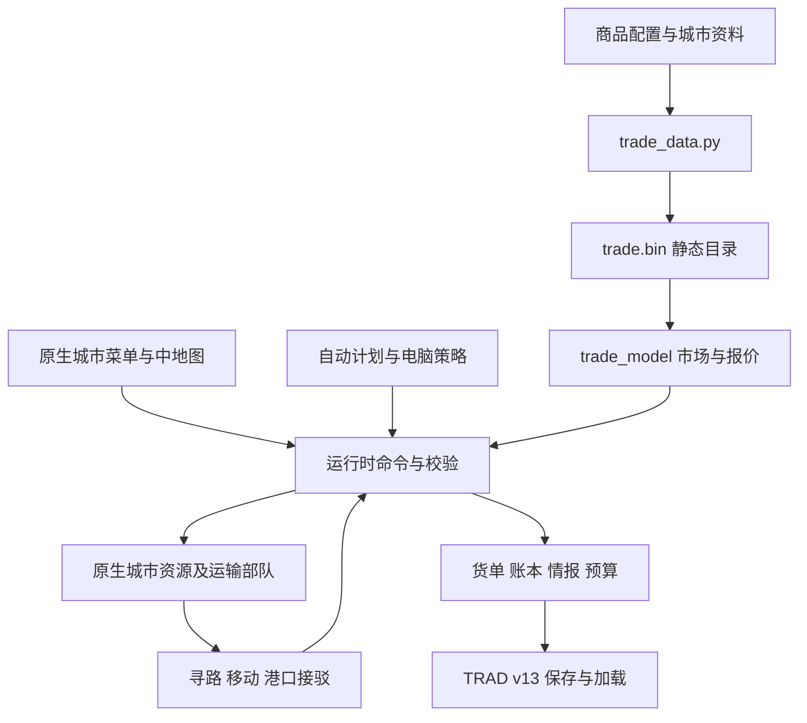
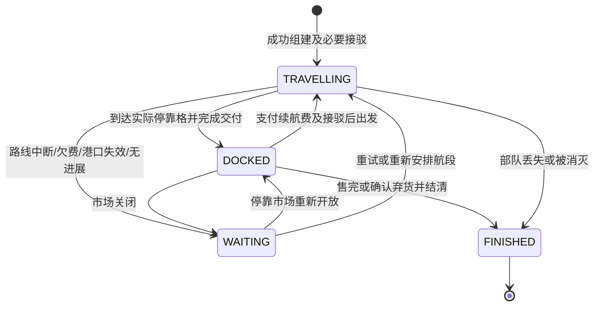
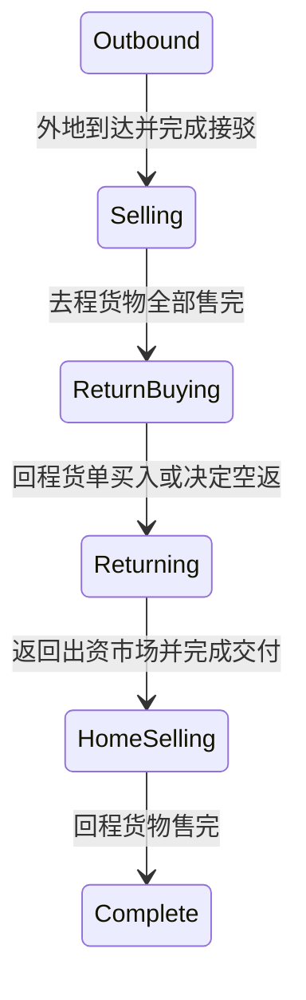

# 世界版《三国志11》贸易系统完整设计与实现说明

整理日期：2026-11-10。本文是当前系统的完整维护说明，覆盖玩家规则、经济计算、运行时流程、数据格式、界面、资源、配置、验证与维护方法。正文描述现行逻辑，附录保留可核对的参数和完整商品配置。

后续补记（2026-11-10）：专属商船经放大版、三桅远洋版迭代，当前为参考汉代船模特征的双桅双帆美术复原版，见第 16 节。本次模型部署时正式 DLL 的 SHA-256 为 `9f9611dc026d3b90b05afa9dde5a6d8598d26a7175f773a53ad31980987775cb`，与首次整理时的港口版基线不同；本次未替换或重新验收该 DLL。第 1 节及附录哈希保留首次整理快照，不能据此判断后续 DLL 已部署的全部变更。

## 目录

1. [版本基线与证据](#1-版本基线与证据)
2. [系统目标、边界和基本单位](#2-系统目标边界和基本单位)
3. [模块与数据流](#3-模块与数据流)
4. [商品、城市与基础价格生成](#4-商品城市与基础价格生成)
5. [动态市场与逐批成交算法](#5-动态市场与逐批成交算法)
6. [组合货物、成本与收益账本](#6-组合货物成本与收益账本)
7. [税收、外交、风险与结算](#7-税收外交风险与结算)
8. [船型、路线、移动与港口接驳](#8-船型路线移动与港口接驳)
9. [商队生命周期及资源事务](#9-商队生命周期及资源事务)
10. [自动往返贸易](#10-自动往返贸易)
11. [委任军团与电脑势力](#11-委任军团与电脑势力)
12. [商才、商人成长及人物池](#12-商才商人成长及人物池)
13. [军需采购与原生制造](#13-军需采购与原生制造)
14. [情报、市场事件与季风](#14-情报市场事件与季风)
15. [原生菜单与操作细节](#15-原生菜单与操作细节)
16. [商品图片与贸易船外观](#16-商品图片与贸易船外观)
17. [原生接口、线程与命令](#17-原生接口线程与命令)
18. [二进制目录与存档协议](#18-二进制目录与存档协议)
19. [配置、调试、构建与部署](#19-配置调试构建与部署)
20. [重要修复、限制和验收清单](#20-重要修复限制和验收清单)
21. [附录：参数、完整商品目录、地区、事件、人物与源码索引](#21-自动提取的完整配置与实现索引)

## 1. 版本基线与证据

| 项目 | 当前核对结果 |
| --- | --- |
| 项目 | `C:\Users\garib\Documents\Work\CMCode\san11world-trade` |
| 正式游戏 | `C:\Games\san11\Romance Of Three Kingdom 11 PK` |
| 游戏入口 | `san11pk_world.exe`，通过 `d3d9.dll` 加载 worldmod |
| 地图／势力／部队 | 530 城市，249 常规势力，1000 部队槽位；地图 1800 行 × 1000 列 |
| 商品目录 | `TRDB v6`，72 商品，ID 0～71；代码上限 128 商品 |
| 当前正式贸易存档写入版本 | `TRAD v13`；读入兼容 v1～v13 |
| 正式 DLL 部署时间 | 2026-11-08 21:39 |
| 正式 DLL SHA-256 | `b827c5289faacb68e03f38b618e263a06aa2828377b26224f7670b583861a71f` |
| 贸易开关 | 正式 `worldmod.ini` 中 `trade=1`、`trade_ai=1` |
| 正式存档目录 | `UserData_kit\Koei\San11 Tc\SaveData` |
| 港口接驳验证 | 807 项运行时检查通过，界面、移动、既有海路模拟通过；本次港口原生出航／往返实机验收未记录完成 |

本次再次核对正式 DLL 哈希，与 `outputs/port-transfer/deployment.json` 一致。不能因为源码已经增加某项能力，就推定正在运行的正式 DLL 已包含它。

**工作区与部署差异：** 工作区 `trade.cpp` 比已部署版本多了 `skill_telemetry.h`、`cityMerchantOfficer` 及售货时的 `skilltelemetry::applied` 调用，用来记录提供商才的武将和奖励触发。商才资格、价格和 20% 奖励公式保持同一行为，但正式 DLL 尚无这段新增记录。已从部署差异文件还原当时源码，并验证其 SHA-256；核对记录见 `outputs/trade-full-design/`。其他模块若有独立的未部署修改，不以本文代替对应模块的发布记录。

阅读优先顺序：正式文件与部署清单 → 对应源码 → 当前配置／数据 → 本文 → 历史方案。旧文档里“正式 v10”“船型仍为候选”等文字只代表当时阶段，不能覆盖本节基线。

## 2. 系统目标、边界和基本单位

系统参考《大航海时代》的产地差价、行情变化、组合配货、航线和商人经营，嵌入原游戏城市与地图部队体系。

核心约束：

- 商队是真实运输部队，有归属、统领、位置、兵力和兵粮；商品清单由贸易模块另存。
- 城市市场、城市官府和商队货物是不同账户。商队交货给市场获得收入，不直接把贸易货物变成官府军需。
- 买货必须消耗有限现货，卖货必须有市场库容；任何推荐或预览都不应改变经济状态。
- 派遣真实支付货款和费用，调出护卫与兵粮；失败按已发生的写入回滚。
- 自动贸易受现金、月预算、路线、情报、货舱、名额和人物池约束，不保证一定出发或盈利。
- 旧货成本、已经实现的收益和原有武将特技不因新规则追溯改写。

| 名词／单位 | 含义 |
| --- | --- |
| 金 | 原生城市金与贸易结算货币；黄金、白银商品不是金币兑换券 |
| 批 | 商品交易数量单位；各品同为“批”，并不代表相同体积或现实重量 |
| 货舱格 | 运输容量单位；内部以十分之一格计，避免浮点误差 |
| `loadUnits` | 每批占用的十分之一格数；例：丝 5、盐 2 |
| 旬 | 游戏行动周期，按 10 天计；3 旬为月，360 天为年 |
| `origin` | 航次原出资城市，回款、商才和归还资源的主要归属 |
| `dest` | 当前航段目的市场，可在停靠后变更 |
| `port` | **已停靠的市场城市 ID**，不是原生港口 ID；在途为 -1 |
| `embarkBase / arrivalBase` | v13 新增的出航／到达据点，可能是城市，也可能是真实港口 |
| 航段／航次 | 一次出发至下一市场为航段；从组建至结束含多个航段的经营过程为航次 |

当前不实现人口供给、城市饥荒、贸易粮直接变军粮、舰船耐久、造船厂生产贸易船、商品腐败、按真实重量装载、海盗势力生成或独立陆运接驳车队。不能把讨论过的设计视为已实现。

## 3. 模块与数据流



| 文件 | 实现职责 |
| --- | --- |
| `data/trade_goods.json` | 商品顺序、产地、价差曲线、需求、库存、地区、事件、历史商人 |
| `tools/trade_data.py` | 把配置和城市位置编译成 TRDB；验证既有 ID 与名称稳定性 |
| `trade_model.h/.cpp` | 独立经济模型：成交、库存、货物、税、事件、情报、商人成长 |
| `trade.cpp` | 原生适配、状态调度、资金事务、部队、人物、命令队列、存档与挂钩 |
| `trade_ports.inc` | 原生港口资格、有限陆路搜索、接驳费用与时间 |
| `trade_panel.h/.cpp` | 共用报价、组合推荐、界面模型，以及中地图绘制和键鼠处理 |
| `trade_native_ui.h` | 原生表格、排序、选择、数量输入、确认和视图恢复 |
| `trade_dialogs.inc` | 城市逐级操作、草稿、商队管理、批量出售 |
| `trade_auto.h` | 预算、预留金、自动阶段、异常决定、候选评分 |
| `trade_auto_runtime.inc / trade_auto_dialogs.inc` | 自动往返执行和设置页面，委任计划同步 |
| `trade_procurement.h / *_runtime.inc / *_dialogs.inc` | 官府采购校验、原生兵装写入、采购记录与 AI 补缺 |
| `trade_images.* / trade_goods_images.inc` | 图片名称映射、懒加载、图卡和 D3D 资源 |
| `trade_ship_visual.*` | 登记商船专属 3D 外观，失败回退原生模型 |
| `movement.* / pathfind.*` | 部队身份约束、移动步耗、可达路径、剩余时间估算 |
| `persons_layout.h / persons.* / skills.*` | 人物池、存档扩容、商才及组合特技支持 |

`.inc` 文件被包含进 `trade.cpp`，共享运行时上下文，不是独立插件或另外一套经济系统。经济模型可脱离游戏执行后台测试；原生接口必须在匹配的游戏程序和线程上运行。

## 4. 商品、城市与基础价格生成

### 4.1 商品 ID 与产地

保留最初 14 种，扩充至 69 种，再新增枪、戟、弩，现共 72 种。商品顺序就是存档和二进制表的 ID。生成器校验既有 0～68 的 key 不得移除或重排；运行时另校验已发布旧目录的名称前缀。新增商品原则是尾部追加，并同步所有目录、图片映射及迁移测试。

产地规则可按 `city`、`zhou` 或 `region` 命中。多个规则取最高生产等级 1～3；0 表示非产地。旧 42 城的州归属与扩展城市的 region 都参与匹配。产地并非每旬调用原生锻造厂／农田生产，而是独立市场月度补货。

商品适合时代与否、产地归属和历史商人资料保存在数据与专题文档；它们是玩法配置，不代表每个数值都是历史测量结果。武器图标可能是示意图，不表示游戏新增近代装备。

### 4.2 静态基础价

令 `b` 为商品目录基价，`L` 为候选产地等级，`d` 为城市至该产地的六角格距离，`P` 为配置的 `per_hexes`，`e` 为商品 `exp`，`cap` 为距离倍率上限。

```text
候选产地供货价 = b × level_factor[L] × min(cap, (1 + d/P)^e)
城市供货基准 = 所有产地候选供货价的最小值
城市基础价 = max(1, round(城市供货基准 × 地区需求倍率))
产地城市的需求倍率强制为 1，不加消费端需求溢价
```

因此不一定取几何上最近的产地：高生产等级可能抵消更长距离。这里用的是静态地图距离，不是道路耗时、港口接驳距离或一条已经寻通的海路。

生成阶段使用 Python 数值计算并取整；运行期读入整数价格矩阵，不重新生成所有地区价差。`trade.bin` 的城市坐标用于这些静态估算；港口资格和实际停靠使用实时 `cityPos`。二者不应混用，尤其是移动过城市的地图。

### 4.3 市场规模和枢纽

市场规模 S 来自旧城／城市等级配置；枢纽乘 `hub_size_factor`。枢纽有初始转口库存、较低税率和较快行情恢复；不是无限货源，也不会因为挂了枢纽标记就具有海运资格。

商品 `price`、`supply`、`demand` 均为 C×G 表；装载系数和原生兵装转换量为 G 表。地区、季风矩形和港市标记另存，互不等同。

## 5. 动态市场与逐批成交算法

### 5.1 库存与月结

每个城市商品独立保存指数 `idx` 和现货 `stock`。默认初始指数 1000，下限 300，上限 4000。`room = max(0, stockLimit-stock)`。

| 项目 | 普通商品默认 | 枪、戟、弩、马 |
| --- | --- | --- |
| 产地初始现货 | S×100% | S×20% |
| 非产地枢纽初始现货 | S×10% | S×2% |
| 其他非产地初始现货 | 0 | 0 |
| 上限 | S×200% | S×40% |
| 月生产 | floor(S×L/30) | S×L/150 的分月累计差 |
| 月消费 | floor(S×D/50000) | S×D/250000 的分月累计差 |

D 以 1000 为一倍。先消费再生产；普通商品限制至上限。军需旧库存若已超过新上限，不直接删去超额，仅消费且停止补产，直到回到合理范围。军需采用 `floor((m+1)×n/den)-floor(m×n/den)`，小城市不会因每月单独取整而永久零产量。

每月行情恢复：`gap=1000-idx`，`step=gap×revert/100`，普通城默认 10%，枢纽 25%；有恢复率且差距非零但整数步长为零时，向基准移动 1。库存变化和指数回归是独立规则，不是完整供需均衡求解器。

### 5.2 价格下限与事件

```text
base = floor(静态城市基础价 × 当前事件倍率 / 1000)
valueAt(index) = max(商品最低中间价 × 1000, base × index)
```

没有下限锚定的商品最低值为 0。军需的中间价下限在事件／指数之后、买卖价差之前生效，不能把 `minValue=150` 理解成最终每批买价／卖价恰好都是 150。

列表中的参考买卖价使用当前指数和基础 spread；**最终成交必须调用 quote／walk**，因为数量推动指数、统领修正和逐批取整都会改变合计金额。

### 5.3 统一逐批价格轨迹

设统领综合价格修正为 pp（千分比参数）。C++ 整数除法按向零截断，买价显式向上取整，卖价向下取整。

```text
half = clamp(max(5, spread×5 - pp/2), 5, 999)
delta = impact==0 ? 0 : max(1, floor(impact×10/S))
买入下一指数 = clamp(index+delta, idxMin, idxMax)
卖出下一指数 = clamp(index-delta, idxMin, idxMax)
边中间值 = valueAt(index)+valueAt(下一指数)
单批买价 = ceil(边中间值×(1000+half)/2000000)
单批卖价 = floor(边中间值×(1000-half)/2000000)
```

按批重复 q 次，求和得到总价。报价使用指数副本；成交才写回指数和现货。买入减少市场库存、提高指数；卖出增加库存、降低指数。

买卖沿相同价格边计算，保留最小价差，避免高政治／商人等级把同城买卖变成套利。拆成多次下单不能凭空获得更好的价格轨迹。库存不足、库容不足、数量非正、越界商品等返回无效报价，不隐式部分成交。

## 6. 组合货物、成本与收益账本

### 6.1 货舱与货单

`OrderLine={good,qty}`；一个组建货单内同一商品只能出现一次。`quoteOrder` 预先检查城市、商品范围、正数量、重复商品、库存、货舱、货款及费用，整单通过才生成 `Cargo`。

```text
占用 = Σ(批数 × 每批 loadUnits)
容量 = maxLoad × 10
占用不得超过容量
```

普通商队基准 20 格、海运商船 60 格，叠加统领载量比例后向下取整。60 格船不意味着所有商品都只能装 60 批：按当前系数，盐每批 0.2 格，可装更多批，但仍受资金／现货等约束。

### 6.2 货物来源与成本

`CargoLot={good,origin,qty,initial,cost}`：同商品同购买地可合并，`initial` 累加原始购入量。售出按存储顺序取出对应商品批次；分配成本 `floor(lot.cost×本次取量/lot.qty)`，剩余成本留给余货，整批售完时总成本仍闭合。

`CargoLot.origin` 是该批货物的购买城市，用于识别异地销售，不是永远不变的现实生产地标签。回程购买会形成新的来源批次。

固定交易经验按累计已售比例的整数差分配，部分售出不重复领取整份经验；同购买城市卖回不发异地固定奖励。

### 6.3 推荐配货

`recommendOrder` 使用已知目标行情，在每次加一批时计算该商品的边际净收益，扣销售税及保守过境税份额，加入适用的商才奖励，再按单位货舱收益比较。选中后推进该商品的模拟买卖指数，直到没有正收益、余额不足或货舱耗尽。最后整单复核。

这是按边际收益的贪心算法，不是穷举所有数量组合的全局最优解。不同商品同时装载；报价只是一份当前行情估计，到港后重新成交。

### 6.4 三种利润不能混用

| 指标 | 定义 |
| --- | --- |
| 单次异地售货毛利 | 税后售货收入减本次售出货物成本，用于商才奖励 |
| 现金净额 `cashNet` | receipts − purchases − fees − taxes |
| 账本利润 `profit` | cashNet + 尚存货物的购入成本 |
| 自动候选保守净利 | 预估收入及奖励 − 采购／出发费 − 税费与返程预留 − 兵粮估值 |

`Ledger` 包含 purchases、receipts、fees、taxes、losses、complete。损失按购入成本展示；它已经体现在采购支出和剩余存货减少中，不能再从现金净额扣一次。receipts 包含商才奖励。旧版本缺少的历史费用不伪造，`complete=false` 表示账本不完整。

最近玩家交易记录最多 24 条，已结束航次最多 24 条；官府采购另有 512 条记录。它们不是无限历史账本。资金或资源超出城市上限时进入待入账队列，账本记录已发生的经济权利与支出，可能暂时不同于城市当前显示金钱。

## 7. 税收、外交、风险与结算

### 7.1 外交判定

`stance(a,b)`：同势力或盟友为 2；其他势力关系值达到 `trade_rel_tax`（默认 40）为 1；低于阈值为 0。无主据点不能作为有效交易目的市场。stance=2 免销售税；stance=1 正常纳税；stance=0 禁止目的地交易并可能触发途中风险。

### 7.2 销售税与旧欠税

普通市场销售税默认 10%，枢纽 5%，乘商人税负比例。税余数按“支付势力、收款势力”持久化：

```text
scaled = revenue × taxPct × merchantTaxPct + remainder
本次税 = floor(scaled/10000)
新余数 = scaled mod 10000
```

这样连续小额卖货不能靠每次向下取整逃掉所有税。当前 v7+ 保存这些余数。历史 `taxDue` 是旧存档债务，不是新航段再次累积无限过境欠税；售货时最多从本笔税后收入中清偿，未清部分保留。

手动销售从收入中扣税；自动销售的税由已预留费用账户支付，回款时不能再扣一次。双方账本仍记同一笔税。

### 7.3 过境税和封顶

每旬按商队所在点附近 30 格内最近城市检查；不是精确每次越过领土边界都征税。起点、终点不重复征途中税，同航段同城市只处理一次，另存 `taxed`。

普通城市 2%、枢纽 1%，以当前货物在当地的估值为基数，并受商人税负比例影响。整段上限为出发货物采购成本的 5%：

`实收=max(0,min(本次估值税, transitLimit-transitPaid))`。

后续新航段重置已访问城市和累计税额。原路线等待后重试不会重新初始化成一份免费的新航段，也不能重复收同一段的全部费用。

### 7.4 抢劫、风暴和部队损失

- 途中敌对城市：默认检查概率 15%，损失比例 50%；商人等级同时降低检查概率和损失比例。按各货物批次扣减并记录成本损失。
- 海上换季风暴：默认每次符合条件的旬检查概率 10%，损失 30%；只对实际海格及相应季风海区生效。
- 原生部队被消灭：贸易回调识别商队、标记丢失，默认将货物估值的 60% 掠夺收益记给胜方；临时商人不作为普通俘虏留下。
- 不保证任何“估算利润”覆盖真实战争、停留、绕路及货损。

### 7.5 回款与资源返还

资金优先归原出资城；若失去该城，则寻找本势力距原城最近的可用城市。`credit` 先登记，再 `settleCredits` 按原生实际接收量逐步入账。没有接收城市或城市满额时保留未结余额。

解散只返还商队真实剩余兵力和兵粮，不补回已消耗数量。未卖货不能直接正常结束；确认放弃余货才记损失并结束。旧欠税未清偿也会阻止正常结清。

## 8. 船型、路线、移动与港口接驳

### 8.1 贸易运力类型

| ID | 名称 | 基准货舱 | 首次费 | 续航费 | 通行 |
| --- | --- | ---: | ---: | ---: | --- |
| 0 | 普通商队 | 20 格 | 默认 100 | 默认 30 | 原生运输支持的陆路与水路 |
| 1 | 海运商船 | 60 格 | 固定 300 | 固定 60 | 河海航线，初始短距离下水例外 |

“两种贸易类型”与原生走舸／楼船／斗舰三个船种不是同一张枚举表。没有增加一个可在原生造船菜单生产的第四类兵装；贸易船通过登记部队身份获得容量、约束和外观。

手动、玩家自动计划可选类型；自动回程继承现有船型，修改城市计划不会把在途普通商队转换成大货舱船。电脑自主新商队目前仍走 `createCaravan` 普通类型路径。

### 8.2 寻路和精确停靠

先筛经济／外交候选，再在真实部队上查询原生路径。普通商队目标是城市 1～2 格范围可用格；商船目标是指定城市或港口 1～3 格内的河海格。目标不可是无法占用的建筑或其他部队格；自己的当前格可作为合法停靠起点。

`queryRoute` 临时标记路由探测部队，允许已经暂停的停靠商队查询路线，结束时恢复。实际移动仍受暂停状态约束。`marketRoute` 校验目标、障碍、路径，并对商船再次检查整条路径的水陆性质。

`dockHex` 是具体终点格；只有实际走到该格才进入到达处理。路由在加载后重算；不能因离目标城市“看上去很近”就完成销售。自动行军在不能执行时尝试其他停靠格，连续 90 天无位置进展进入等待。

### 8.3 移动速度与 ETA

商队仍使用原生行动力和逐格地形成本。贸易身份扩大移动搜索范围：陆上最多 24 步、水上最多 36 步，二者是范围限制而不是保证速度。海格对登记商队的基础成本先应用季风再缩放，整数步耗至少 1；河格不等同于海格加速。上下水比例、原生障碍倍率和特殊地形也参与步耗。

具体缩放：草地、土、砂、道路、桥梁（地形 0/1/2/10/12）的成本取 `max(1,(原成本+1)/3)`；海格在季风后取 `max(1,(成本+2)/4)`，均为整数计算，不用“统一速度翻倍”概括。季风先算后取整，避免原成本先降为1后再乘逆风系数失去差异。

无实际部队／路径时，只能按城市间距离与界面估计速度粗算；不能称为历史实测行程。已有路线用 `movementRouteTime` 与实际移动共享成本函数，计算剩余地形步数和旬数；接驳剩余等待另计。未来季风切换、封锁、玩家停留和新订单会改变实际到达时间。

已有东部至西方海路模拟属于固定路线、月份和附加转运假设下的校准，不是任意中国城市到罗马的确定航期。v13 城市港口接驳也不等于完成跨洲陆海换装网络。

### 8.4 附近港口机制

优先检查城市中心 3 格内是否有 terrain=7（河）或 8（海）。可直航则接驳步数、费用、时间均为 0。不满足时搜索原生港口范围 `[C+10,C+45)`，即 35 个港口；关卡、普通设施和“港市标记”不能代替真实港口。

合格港口必须：原生记录有效、类型为港、与市场城市同势力、港口周围 3 格内有河海、城市至港口的陆路不超过 20 格。通过限定范围的六角格 BFS 搜索最短接驳步数，不穿水和悬崖；城市自身近中心占地允许离开，目标港口中心允许作为陆路终点。选最短接驳路径，等距按编号稳定选择。

两端分别按 `fee=steps×2` 金、`days=ceil(steps/10)×10` 天计算。单段出发一次收两端接驳费；接驳完成不再次扣费。商才的费用八折作用于组建／续航费，不额外折扣接驳费。

| 实际地图案例 | 港口坐标 | 陆路 | 单端时间 | 单端费 |
| --- | --- | ---: | ---: | ---: |
| 北海 | 1379,490 | 15 格 | 2 旬 | 30 金 |
| 建业 | 1397,545 | 6 格 | 1 旬 | 12 金 |

以上来自 2026-11-08 正式地图及当时归属的只读快照，证明接驳资格，不证明两城整条海路已经完成实机通航。

### 8.5 接驳阶段、控制与限制

城市提供资金、货物、护卫和兵粮；船从所选港口调用原生 sortie 生成。货物运输抽象为等待，没有独立货车。

```text
transferStage=0：无接驳等待
transferStage=1：城市→港口；船在港口集结，movementAllowed 阻止提前移动
transferStage=2：港口→城市；货物尚未交付，不能提前采购／卖出
transferUntil：按游戏日期保存截止日，读档不重开计时也不跳过等待
```

每次继续处理都重新校验港口归属、陆路和市场可访问性。港口失守或连接失效进入等待；货物仍在商队。条件恢复可继续完成接驳，自动经营若已有异常还要遵循其重试／玩家决定。截止日不会因重复检查不断后推。

初始下水允许港口／城市周围两格陆地前缀，入水后不可再上陆。船不搬到目的城市，市场交付在水面停靠状态下完成，避免临时商人自动进城。

当前不模拟接驳车队沿途战斗／领土税，也不按整条水路遍历所有备选港口。最近港口水路不通时可能派遣失败，即便另一个更远港口理论上可用；用户不能手动选港。既有直航城市也不会自动为了绕过封锁改借其他港口。

## 9. 商队生命周期及资源事务

### 9.1 运行时状态



`TRAVELLING=0、DOCKED=1、WAITING=2、FINISHED=3`。接驳阶段是附加状态，不新增另一支部队。flags：`F_TEMP=1`、`F_PLAYER=2`、`F_LOOTED=4`、`F_MANUAL=8`。

### 9.2 组建事务顺序

1. 校验城市、运输类型、两端海运资格、市场外交和货单非空。
2. 校验出资城有效、归属、只读状态、自动名额；真实统领在本城且可用；临时统领检查配额和备用人物槽。
3. 计算统领价格／容量，整单报价，核对金、护卫和兵粮；检查发船据点周边空间。
4. 创建或取得统领。临时商人先登记隐藏，再发布原生在任身份，避免出现短暂可任官窗口。
5. 保存涉及商品的原指数和现货；扣真实金、兵粮、兵力，检查原生接口实际扣除量。
6. 买入货单、调用原生 sortie；原生 sortie 不替贸易模块重复支付城市资源。
7. 创建稳定航次 ID，登记单位及统领身份，建立账本／自动状态／接驳状态，再下达行军命令。
8. 寻路或离城失败时撤销刚生成的部队、还原市场，并通过 credit 退回实际支付资源。中途原生消灭回调发生时不能再按“单纯失败”双重退款。

### 9.3 停靠后经营

可逐项买卖、批量出售、续航、返回出资城、从本方停靠城补齐护卫／兵粮、改自动行军模式或结束。补给是资源调拨，不会免费补满；不足则失败，不改变军需商品与兵粮兑换边界。

批量出售预检查全部商品、数量、库容、共享税余数、债务及报价，最终金额与确认值不符则拒绝整单。经验在批量交易完成后统一更新，避免第一件货升级后改变后续商品价格。自动管理中的商队须先接管，才能手动改货和改道。

部队消失但确实进入了己方城市时，保留可确认的货物并将临时人物释放，`tempReleased` 标记旧航次已无活部队。此状态不能伪装成仍可移动的原商队；应结清后重新组建。不是所有“找不到部队”的情况都能保货。

## 10. 自动往返贸易

### 10.1 计划与月预算

每个“势力＋出资城”有一份计划：优先目标、偏好商品列表、船型、enabled、delegated、月预算、已占用金额、本月成功派遣标记及说明。默认预算 4000 金，界面允许 0～100000；0 表示不投入。

预算是本月允许支出的上限，不是每次自动补给的收入账户。`occupied` 计已支付支出与预留款，卖货收入不增加剩余月预算。跨月把本月 occupied 清零，但旧预留现金仍然属于原航次；旧月退回的现金不能减少新月已经发生的支出。

可用资金取 `min(月预算剩余, max(0,城市金−2000))`。`Advance` 保留预留月份和 balance，支出必须足额，退款把 balance 清零；同月退预留可释放该月额度，跨月退款只归还现金。

### 10.2 候选商路和货单评分

自动经营使用临时商人的参数，逐个评估已知且外交开放的目标市场。优先商品不是硬性白名单：每城分别试算全商品组合和偏好组合，允许其他商品补足盈利。

首次派遣的候选费用包括：采购及出发费、销售税、完整过境税上限、将来的返程续航费及两端接驳费。兵粮按本城原生粮价折算经济成本，不再次扣同一笔现金：

`兵粮估值=food×(450−politics)×10/(grainRate×400)`。

正常第一次派遣保守考虑往返时间，不假设未来一定买得到有利润的回程货。候选必须已知、可初筛、投入为正、去程净利为正、保守往返净利为正，且净利至少达到总经济投入的 10%（向上取整）。初筛中的“可达”不等于已经执行原生寻路，正式组建仍可能失败退款。

以保守净利／预计旬数评分：同目标的偏好商品组合达到该目标最佳分数的 95% 时可优先；优先目标存在合格方案时，其他目标须达到其分数的至少 1.20 倍才替换。偏好不会强迫系统走亏损路线。

### 10.3 自动航次阶段



自动状态与运行时 DOCKED／WAITING 是两层状态。只有对应的新到达事件才推进一次阶段。到达报价低于货物成本、库存空间不足或税费预算不足时阻止自动结算。自动售货的保守预检查与最终成交共用市场基础，但前者可能更严格。

回程重新读当地行情并配货，沿用当前商队和容量，不新建人物／单位，不重收组建费。先把旧预留退回，重新按当前月预算准备回程采购和费用；买入失败还原整篮库存、指数、货物及预留状态。已买好回程货但出发失败时，保留 Returning 阶段，重试不得重复买一遍。

回到原城售完、结清、归还资源并结束航次。它不是永远不停靠的循环运输线；城市计划以后按预算、月份和并发名额建立新航次。

### 10.4 异常与玩家决定

Issue 枚举：None、Unprofitable、Budget、Warehouse、Route、Ownership、Resources。可选择下月重评、空返、带货返程或手动接管；空返要求没有余货，返程要求可达且不是出资城归属异常。

手动接管停止该航次自动经营、退回尚未使用的预留、保留货物，后续由玩家下令。暂停城市新派遣通常不终止在途商队。仅保存设置不立即推进任何贸易；“保存并启用本城”只评估该城新派遣，不让其他城市和全部在途交易跟着执行。

`mayDispatch` 保留本月成功标记：一次调度可补到并发上限，但已有成功派遣且预算占用非零时，当月通常不再循环补发。失败不写成功标记，避免“配置后永远不出发”。月度重试不是每帧不断消费预算。

## 11. 委任军团与电脑势力

| 模式 | 默认城市并发 | 有城内商才 | 执行方式 |
| --- | ---: | ---: | --- |
| 玩家设置自动贸易 | 2 | 4 | 自动往返计划 |
| 玩家势力委任军团 | 2 | 4 | 自动生成的 delegated 计划 |
| 非玩家电脑势力 | 1 | 2 | `aiMonth/findRoute` 独立策略 |

玩家计划和委任计划在同一“势力＋城市”维度上是替代关系，**不是同城 2+2 支独立名额**。玩家明确保存的设置，包括暂停，优先于委任自动生成；接管旧自动队后其自动航次身份仍计并发，直到结束，不靠接管刷出无限队伍。手动新建队伍不受这组城市自动名额限制，但受人物池、部队和资源限制。

委任识别原生军团在本势力的序号 2～8，不把全局军团槽位号误当序号。无明确计划时创建 4000 预算、普通商队、不限目标；恢复直辖停止 delegated 新派遣，已经在途的按原有账目处理。委任派遣还要求城市至少 6000 金，调出后留 5000 兵和 9000 粮。非归属类异常默认下月重评；出资城失守不自动授权换城继续花钱。

电脑势力自主贸易不是玩家计划的简单复制：每月默认全局新建最多 6 支，按势力游标轮转、每轮每个势力选择一条最佳路线，游标每月偏移 7。城市至少 6000 金，单次投资默认上限 4000 并保留 2000，候选距离默认 80 格、最低利润率默认 25%。新队通常单一商品、普通商队；停靠旧队可卖货、买下一段货、继续寻找路线。真实商人优先从城内可用一般武将选取，否则使用临时商人。

因此不能把“玩家支持组合海运自动往返”写成“所有电脑都会自动选择海船并照同一计划往返”。

**2026-11-15 更新（电脑与委任海船，已部署）：** 电脑势力新建商队时，对有海运资格的城市同时评估普通商队和海运商船（`trade_ai_ships`，默认 1），海船候选范围 `trade_ai_ship_range`（默认 200 格）、目的地须有海运资格、单次投资上限为 `trade_ai_invest` 的两倍；两者取评分高者出发，失败回退另一种。电脑海船到港卖完后沿用原有逻辑继续买货跑下一段，路线只在有海运资格的市场间选择。委任城计划每次派遣时同时试算海陆两种方案并取最优，不再固定陆路；玩家明确保存的计划仍按玩家所选船型。正式 `trade_ai_month` 由 6 调为 12。存档仍为 TRAD v13。隔离副本实测 10 旬：海船由 7 艘增至 23 艘，其中电脑 8 艘，电脑海船完成到港出售与续航。记录见 `outputs/ai-merchant-ships/`。

## 12. 商才、商人成长及人物池

### 12.1 城市组织特技“商才”

原生特技 ID 147。判断同势力、有效且实际位于出资城市、身份为君主／都督／太守／一般武将的非临时人物；出征、俘虏、在野、未登场、死亡不提供城市效果。原生 HasSkill 支持配置组合内包含 147。多人效果不叠加。

效果：自动名额翻倍；组建和续航费八折并向上取整；异地售货正毛利额外奖励 20%。费用按实际支付时的原出资城资格计算；目的地有商才不能替玩家提供组织加成。

```text
纯异地货物的基本奖励 = floor(max(0,售货收入−销售税−本次旧欠税清偿−售出成本)/5)
```

同商品混合来源时按实际 FIFO 售出批次，计算异地数量比例和对应成本；最终取“整笔正毛利两成”与“异地部分正毛利两成”的较小者。同城买回卖回、亏损售货、超出实有数量均不得领奖。奖励不进入市场价格或税基，计入 receipts，最终行程利润仍须扣组建、续航、税费和损失。

例如售货 12000、销售税 1000、进货成本 10000、无旧欠税，则奖励 200；这不是销售额加 20%，也不是整趟净利润无条件加 20%。

历史分配采用 116 人候选名单：正式适用剧本／当时 Save000、Save001 中，57 名原无特技者赋予商才，59 名已有特技者保留原特技，不强行叠加组合。源名册同步数量不同，不能以一个文件的数量替代所有存档。原候选表和分配记录在附录链接中保留；换档后人物仍需真实在城且任职才有效。

### 12.2 统领能力与商人经验

这是独立于“城内特技组织效果”的机制：历史商人目录的 talent 或政治阈值，可增加统领有效商人等级。不能把“政治 80 有统领天赋”理解成自动获得特技 147、城市名额翻倍。

```text
基础价格 pp = 政治−50
基础容量百分比 = 100+(智力−50)/2
经验等级阈值 = 500,1500,3500,7000,12000（0～5级）
有效等级 = min(经验等级 + talent, 7)
每级：pp +8；容量 +5 个百分点；税负 −8%；抢劫风险比例 −12%
```

税负和抢劫比例最低为 0。talent 优先取历史商人已知天赋，至多 2；无已知天赋时政治达到默认 80 给 1。临时商人固定基础政治 60、智力 50，五维默认 40/30/50/60/50，不积累长期人物经验。正常武将经验只在实际交易时按已售批次与正利润增长，固定项默认 100、利润部分按 20 金折 1 点，分批分摊；不是完成一个空航段就领全部经验。

### 12.3 特殊人物池与隐藏

人物布局：剧情人物 PS + 新武将保留 150 + 特殊人物 100 或 300。扩展只追加 200 槽，保持旧 ID；P 标记对应原特殊池，Q 标记对应扩展池。当前正式 `persons=14163`、`special_persons=300`，总 PT=14613，特殊池起点 14313。

临时商队默认配置上限已被正式设置覆盖为 200，创建后至少保留 50 个自由特殊槽。其他系统也占用特殊池，因此不能承诺总能派满 200。1000 部队总上限和每城限制还会进一步约束。

临时商人显示名“商”，部队上可以显示商队身份，正常武将列表、授官候选等不应显示。实现有两层：原生列表插入过滤与授官候选源过滤；仅识别登记的特殊人物范围，不按名字批量删除真实武将。隐藏目录使用原子更新，UI 读者不等待贸易大锁。

身份判定同时核对单位槽、运输类型、统领 ID 和归属。死亡、结束、释放后旧航次不得继续冻结／控制新占用者；`tempReleased` 支持槽位被新航次复用。回收时清理原生关联并重置仅属于本系统的特殊槽，不对历史武将执行 tempFree。

## 13. 军需采购与原生制造

商队把商品卖给城市市场，收入汇回出资城；城市官府另行支付本城金，从市场采购原生兵装。民间市场不是一个可把同笔钱再次返还官府的无限钱包。

| 商品 | 原生兵装 ID | 每批转换 | 目录基价 | 最低中间价 |
| --- | ---: | ---: | ---: | ---: |
| 枪 | 1 | 100 件 | 180 | 150 |
| 戟 | 2 | 100 件 | 180 | 150 |
| 弩 | 3 | 100 件 | 180 | 150 |
| 马 | 4 | 100 匹 | 220 | 150 |

运行时同时检查商品名和 `native_units_per_lot==100` 才接受映射。刀剑、甲胄、铁器不转换；小麦、稻米、大豆、鱼干等也不兑换原生军粮。没有把原生制造库存反向输出成商品的通道。

采购按本城逐批买价、pp=0，无商人折扣、组队费和商才售货奖励。提交核对势力、城市、现货、资金、兵装空位、确认金额、持久化订单 token；依次真实扣金、增兵装、写市场库存。原生只完成部分数量时回滚，回滚无法恢复则进入只读状态，防止继续破坏资源一致性。

AI 城市每月最多一次补缺采购，预算 `min(2000,现金/10,现金−2000)`。四类兵装总量少于 `min(士兵数,10000)` 时，选可用且每批报价最低者，最多 20 批，并受缺口、仓库和市场现货限制。不会分别免费补齐每种兵装。

制造成本以原生“每次生产金费÷本次实际产量”比较，不能把一次 700 金当作每件成本。原有校准中，700 金产 2000 件折每 100 件 35 金，远低于市场采购价；实际产量仍受武将、设施等影响。贸易模块不改原生制造公式，官府市场采购定位为付溢价补缺。

军粮兑换曾被否决，因为低价粮食商品换原生粮后再出售可能形成套利；现行系统没有采用讨论中的那些候选比例。

## 14. 情报、市场事件与季风

情报保存观察时的指数、事件倍率、库存和年龄，不能把过期价格配实时库存假装已知行情。自有／盟友城市及其周围默认 40 格刷新情报；部队观察附近 10 格城市，商队航行中另观察附近市场。历史默认 12 个月，255 表示从未获知；过期或缺快照的市场不能作为可靠自动盈利依据。

事件模板规定作用对象（产地／消费地／全部）、商品（指定／随机／全部）、地区、倍率、持续月数和权重。每月先结束到期事件，再按默认 15% 概率尝试新增一件，同时最多 4 件；最多尝试 8 次寻找确实受影响且不重复的目标。倍率连乘后限制到 200～5000 千分比。事件实际改变价格倍率，不直接模拟战乱改变原生城池人口或所有生产设施。

随机数采用可存档的 xorshift 状态，不因正常读档无条件重抽。月结根据绝对月份推进，补处理漏过月份；不会因为打开菜单额外执行库存生产。

季风海域为地图矩形与 12 个月字符表：E、W、T、-。正向／反向由实际相邻步方向判定并处理反向寻路；默认顺风 70%、逆风 140%、换季 125% 的海格步耗。`trade_monsoon_all=1` 时还作用于其他原生船只，贸易专属加速仍只给登记商队。完整地区及月份表见附录。

## 15. 原生菜单与操作细节

```text
城市主界面 → 贸易
  市场行情：本城商品 → 商品详情／各地行情 → 带入组队
  组建商队：推荐商路或自选目的地 → 船型／统领 → 组合货单 → 确认
  商队管理：默认本城出资队伍，可切全部 → 交易／接管／续航／返程／补给／结束
  收支账本：当前航次与近期结束航次
  贸易情报：行情年龄、事件、季风
  自动贸易：船型、预算、优先目标、商品多选 → 试算 → 仅保存或启用本城
  待处理：异常或需人工结清的商队 → 重评／返程／接管
  军需采购：枪戟弩／军马 → 数量与报价 → 采购明细
```

入口沿用原城市菜单树、列表、按钮、确认和返回样式，视觉风格参照军事／人才，不依赖固定屏幕像素点击。中地图面板保留作为补充入口。

交互约定：

- 货单直接点击商品修改数量，输入 0 可移除；取消数量输入保留原值。
- 推荐配货明确替换当前货单，可恢复替换前内容；不偷偷追加重复商品。
- 返回时可保留本会话草稿、丢弃或继续编辑；草稿按势力／城市区分，读档清空，不属于永久存档。
- 自动商品一次多选；全不选表示系统配货；目标可恢复“不限”，与返回取消不同。
- 原生表格用稳定记录 ID 恢复排序、焦点和滚动，不因排序把图片或操作绑定到错误商品。
- 商队出售、购买后回到管理层继续操作，不强迫整条流程重开；“返回出资城”保留当前货物。
- 批量出售可选商品，亏损项默认不预选，确认时校验总净额。
- 健康自动商队不会全部挤进待处理列表；异常、已释放但有待处理货物等才进入。
- 港口接驳显示出发与目的港口位置、距离、等待与费用；进行中禁用提前续航和市场交易。
- 未知情报、只读存档、无兵粮、无容量等保留可解释的禁用原因。

旧的中地图快捷键包括 Tab、1～4、方向键、数量输入、Enter 确认、A 自动行军和 Esc 返回；是否启用取决于 `trade_keys` 及对应原生键处理签名。新城市流程以原生控件行为为准，不要求玩家记中地图快捷键。

## 16. 商品图片与贸易船外观

图片以稳定商品名称映射到 `world_custom/trade_goods/` 中的文件，主要来源记录在 `research/trade_goods_images.md`。缺图使用占位图卡，不阻止交易。图卡 320×80，图标等比缩放进 64×64 区域；列表按当前商品选择更新，不依赖视觉行号。

GDI+ 在第一次可见贸易窗口时懒加载，避免在 DllMain 的 loader lock 下启动图形库。CPU 图卡与 GPU 纹理分别管理；设备重建时重新创建资源，不把失效 D3D 指针写进存档。

海运商船加载 `merchant_ship.wkm/.wft`，包含新船体、桅杆和货舱外观。运行时沿用原生船模骨架、描边和绘制管线，验证模型签名、描述结构、顶点／索引范围、有限浮点值、纹理大小及指针字段，防止把资源文件内容当有效 GPU 指针。

外观仅作用于登记的海运商船身份。资产缺失、校验失败、GPU 分配失败时保留原生船；D3D 设备变化会释放／重建资源。开关 `trade_ship_visual` 不改变货舱、费用或海运规则。新增 3D 外观和新增原生兵装船种是两个不同层面的功能。

2026-11-10 外观更新：保留生成器 `tools/build_trade_ship_model.py` 的 `VISUAL_SCALE=1.5` 基准和宽厚船体，按用户确认的方向改为双桅双帆、低前篷、中部货篷、略高的单层舵舱及开阔货运甲板，去掉三桅版的高艉楼、窗廊、顶帆、三角后帆、艏斜桅和索梯。这是参考汉代船模的美术复原，双桅帆装和大型海船比例含推测，不是考古定论。当前 21 部件、7,492 三角面、22,476 顶点、一个绘制批次和 256×16 调色板；普通船和贸易数值不变。正式 WKM/WFT 已备份并替换，DLL、INI、运行进程和存档未由本次修改；保存并重启后加载。几何、原生 GPU 绘制及绑定集成测试通过，新造型的游戏内选取／靠港／密集显示仍待实测。完整记录见[贸易船3D外观](贸易船3D外观.md)，新旧同镜头对比见[汉风版对比图](../outputs/trade-ship-han/comparison.png)。

## 17. 原生接口、线程与命令

### 17.1 关键原生调用与挂钩

| 地址／接口 | 目的 |
| --- | --- |
| `0x5883f0` sortie | 原生创建运输部队的命令队列入口 |
| `0x4aa610` / `0x4acae0` | 创建／释放特殊人物 |
| `0x4bccd0` | 原生移除部队，关联人物释放 |
| `0x4ae2a0` / `0x4ae300` / `0x4ae3c0` | 改城市金／兵粮／士兵，读取实际应用量 |
| `0x4ae430` | 改原生兵装库存 |
| `0x5a8d20` / `0x5ad980` | 设置／执行原生命令 |
| `0x58051e` | 每旬结束调度贸易状态及月结 |
| `0x5def90` | 商队 AI 计划过滤，避免原生军事 AI 改写任务 |
| `0x4bfa30` | 部队消灭时的货损与掠夺结算 |
| `0x57ff80` | 主线程命令泵 |
| `0x4e6340` / `0x5fc30f` | 列表插入与任官候选源过滤 |
| `0x493bce` 序列化扩展点 | 世界数据末尾的 TRAD 读写，具体接线由 worldmod 负责 |
| MapUI 虚表槽 | 中地图键鼠及原生城市菜单挂接 |

这些地址仅适用于本项目支持的可执行文件，不是跨游戏版本 API。安装前检查机器码签名；签名不符不能盲目覆盖。运行时使用原生 thiscall／fastcall 约定、结构偏移和配套 worldmod 扩容布局。

### 17.2 并发、重入与死锁修复

经济写入通过游戏线程命令与临界区集中执行。逻辑线程可能持有贸易锁，调用原生 sortie 后等主线程执行；如果主线程命令泵也阻塞等待贸易锁，就形成互相等待。

修复方式是主线程 `TryEnterCriticalSection`：锁忙就暂缓贸易队列，继续原生命令泵，使原生创建可以完成；不是把所有交易移到任意后台线程。任务使用 `shared_ptr` 持有，60 秒调用等待超时不释放仍在执行的事件／对象。超时也不等于撤销，不能盲目重发有扣款的命令。

加载游戏取消未执行任务并唤醒调用者，清除草稿与旧会话状态。UI 临时人物过滤通过原子发布的只读目录，避免再与主线程列表形成锁依赖。此设计修复已知锁循环，不等于对任意原生模块和所有 UI 重入做了形式化无死锁证明。

### 17.3 命令接口

下列是开发／自动化接口，不要求玩家手工输入。正式配置当前 `automation=0`；城市菜单仍能通过内部队列操作。编号命令优先使用稳定航次 ID，不是可复用的部队槽号。

| 命令 | 语义 |
| --- | --- |
| `trade dump <path>` | 输出经济、商队、账本和城市状态 |
| `trade hidden` | 临时商人隐藏诊断 |
| `trade target <city> <lo> <hi>` | 诊断城市周边可用位置 |
| `trade send <origin> <dest> <good> <qty> [leader]` | 普通单商品商队 |
| `trade sendmix <origin> <dest> <leader> <good qty>...` | 普通组合商队 |
| `trade sendship <origin> <dest> <leader> <type> <good qty>...` | 指定贸易类型组合商队 |
| `trade buy/sell <voyage> <good> <qty>` | 停靠交易 |
| `trade sellbatch <voyage> <expectedNet> <good qty>...` | 验价后批量出售 |
| `trade go <voyage> <dest>` | 续航／原路线重试 |
| `trade route <voyage> [dest]` | 查询实际部队的原生路线 |
| `trade finish <voyage> [discard]` | 结清结束，discard 为明确弃货 |
| `trade resupply <voyage>` | 本方停靠城调拨实际资源 |
| `trade procure <city> <good> <qty> <expected> <token>` | 官府采购事务 |
| `trade ai` | 显式运行电脑贸易调度，具有实际经济副作用 |
| `trade panel ...` | 面板图像诊断，具体参数见 `panelShot` |

界面任务附带 actor，提交时再次检查归属和管理权。`TRADE_NATIVE_TEST` 才编入 `trade native_test ...` 实机探针；生产 DLL 不应包含测试入口。旧注释出现的 `tick` 不能当作当前必然可用的命令。

### 17.4 旬与月的调度次序

`turn()` 先检查地图和只读状态，处理待入账，再遍历商队的真实部队、到达、接驳、货损和行军。随后补齐尚未处理的月份：记录过去行情、进行库存／指数月结、处理事件；到当前月才刷新观察并运行开启的电脑军需与新派遣。之后按现行调度调用玩家／委任自动计划。不能把“每次打开贸易窗口刷新 Model”理解成又发生一次月生产或自动售货。

重要数据写入使用同一经济模型，而 UI 的 `Model` 是用于显示和报价的快照。操作开始后仍需再次核对归属、现金和库存；快照不是资源锁定，也不是未来市场承诺。

## 18. 二进制目录与存档协议

### 18.1 TRDB v6 静态目录

小端序，开头 `TRDB + u32 version + u32 C + u32 G + u32 reserved`。依次为：

1. G 条商品：UTF-8 名 16 字节、基价 u32、装载十分之一格 u32。
2. C 条城市：lo/hi i16、flags u8、group u8、规模 u16、名称 16 字节。
3. C×G u32 价格矩阵；C×G u8 产地等级。
4. v2 地区名称表；季风海域矩形／12 月字符／名称；事件模板。
5. v3 历史商人：27 字节 UTF-8 名、i32 人物 ID、u8 talent。
6. v4 库存配置五个 u32，C×G u16 需求倍率。
7. v6 G 条 `{native_units_per_lot u32, min_value u32}`；v5 使用商品项原保留字段作装载系数。

运行时支持 v1～v6，验证条数、名称／尺寸范围、库存参数、需求倍率、锚定数量和末尾长度。文件包含静态目录，不包含当前月市场库存、正在走的商队或实际城市归属。

### 18.2 TRAD 版本演进

| 版本 | 增加的数据 |
| --- | --- |
| 1 | 基础指数、单商品旧航次、月份及随机状态 |
| 2 | 事件、近期交易、情报历史 |
| 3 | 商人经验／次数 |
| 4 | 有限库存、完整观察、多商品批次、稳定 ID、待入账 |
| 5 | 活动和结束航次账本 |
| 6 | XPRESS_HUFF 压缩封装，旧逻辑载荷对应 v5 |
| 7 | 销售税余数 |
| 8 | 航段过境限额和已付税 |
| 9 | 自动计划、月预算、预留、阶段、异常及临时人物释放状态 |
| 10 | 官府采购序号及历史 |
| 11 | 航次与计划的 shipType |
| 12 | 自动计划 delegated 标记 |
| 13 | legOrigin、embarkBase、arrivalBase、transferStage、transferUntil |

v13 仍按历史追加顺序序列化，不直接 memcpy 当前整个 Caravan。旧 `LegacyCaravan` 固定 52 字节；货单、账本及新字段另存。FINISHED 活动项不再写入活动商队列表，结束记录另存。

压缩块头为 `TRAD、version、压缩载荷长度、rawSize`，之后 XPRESS_HUFF 数据。压缩在写入原生流之前完成，避免原生 32 MiB 保存堆同时保留大原始贸易缓冲。解压上限 128 MiB，先检查声明大小再分配。

完整载荷包含市场指数、月标记、随机种子、AI 游标、活动旧字段、事件／近期记录、情报维度和历史／年龄、经验表、库存／观察、ID 生成器、航次状态和货单、信用队列、账本、税余数、过境费、自动计划和预留、采购、船型、委任、接驳。

### 18.3 解析、迁移和只读保护

先解析到临时结构，验证范围、枚举、日期、数量、非负金额、稳定 ID、活部队／统领冲突、自动状态、接驳字段及完整消费载荷，再统一替换当前状态。禁止损坏块只加载前半部分。

只对明确支持的已发布商品前缀扩容，旧库存、成本、预算和人物释放状态保留，新商品初始化独立库存且不伪造旧情报。v12 商队升级 v13 默认没有新接驳，不传送旧单位，也不补收接驳费。新增阶段保存后，正常读档按原截止日继续。

没有贸易块的旧存档初始化新贸易状态；不支持或损坏的块尽量原样保留并把贸易设为只读。关闭模块时透传未知贸易块，不等于关闭期间可随便移动商队再保证完整恢复。旧 DLL 不应拿来覆盖保存已经有 v13 接驳进度的新存档。

### 18.4 核心运行时字段字典

| 结构／字段 | 精确用途 |
| --- | --- |
| `LegacyCaravan.unit/leader/force/corps` | 原生部队槽、统领、势力、军团；不是单凭槽位确认身份 |
| `origin/dest/good/qty/cost` | 原出资城、当前目标、兼容旧单商品字段；组合货物后由 `syncCargo` 更新总数、总成本和首商品 |
| `taxDue/born/lastCity/flags` | 旧欠税、创建日期、旧兼容城市字段和身份／控制标记 |
| `Caravan.id/state/port` | 稳定航次ID、活动状态、已停靠市场；id不同于unit |
| `lastProgress/lastPos` | 最近位置改变时间与位置，用于无进展保护 |
| `maxLoad/shipType` | 航次已有货舱和运输类型；不得仅因城市配置变动扩容既有货物 |
| `dockHex/route/routeCost` | 可失效的当前路径缓存；不作为可无条件跨读档复用的路线证明 |
| `cargo/lots` | 分商品、购买地、数量和采购成本的货物数据 |
| `transitLimit/transitPaid/taxed` | 当前航段过境税封顶、已付金额、已处理城市 |
| `ledger` | 名义收入支出和损失；64位金额，原生金操作前仍检查整数范围 |
| `tempReleased` | 原临时人物已回收；禁止旧队绑定到复用槽位 |
| `automatic` | 自动航次的阶段、异常、下次重试月份、预留资金及 managed |
| `legOrigin/embarkBase/arrivalBase` | 当前航段城市起点及绑定的真实据点，防止到港后错误借用新选港口 |
| `transferStage/transferUntil` | 接驳方向与游戏日截止值；未结束不能交易或移动 |
| `g_nextCar/g_nextPurchase` | 稳定航次与官府采购序号，随存档保存 |
| `g_credit/g_saleTax` | 待收资源债权与势力对销售税余数 |
| `g_info/g_ev/g_rng/g_merch` | 情报、运行中事件、随机状态、真实武将商人经验 |
| `g_autoPlans` | 每个势力＋城市的自动计划及当月预算 |
| `g_unitDir/g_pausedLeader/g_tradeLeader/g_shipLeader/g_shipQuay` | 供移动等回调读取的单位身份／暂停／方向／初始下水据点目录 |
| `g_hiddenTempForces` | UI过滤临时商人时的特殊人物槽与势力映射 |

自动计划 `status`、草稿、图形资源、当前 UI 滚动状态和上述可重建目录不作为永久经营数据写进 TRAD。读取后重建状态，不能把裸游戏指针序列化后在另一进程直接使用。

## 19. 配置、调试、构建与部署

### 19.1 配置来源

正式 `worldmod.ini` 的 `[san11pk_world]` 只显式覆盖少量选项，其余使用安装函数默认值。完整 `trade_*` 默认值与实际覆盖见附录。不是每个字段都可由 INI 调整：海船 300／60、商才 20% 奖励、自动名额、港口 20 格及接驳 2 金／格等当前写在代码中。

`trade_arrive` 和 `trade_max_turns` 虽仍读取，现行到达使用实际 dockHex，无进展保护是代码内 90 天；不要靠修改这两个历史配置项宣称已经改变现行行为。`trade=1` 之外还依赖 worldmod、地图、城市、人物布局和相应移动／寻路钩子正常加载。

### 19.2 构建与测试入口

```powershell
# 在 san11world-trade 项目根目录，使用 x86 Visual C++ 工具链
cmd /c worldmod\build.bat
cmd /c worldmod\test\build_sim.bat

# 港口版本采用的针对性运行时测试入口
cmd /c outputs\special-pool-300\test-runtime.bat

# 构建后按各测试程序的参数说明运行，例如
worldmod\build\trade_panel_test.exe worldmod\build\trade.bin outputs\trade-full-design
```

`build_sim.bat` 主要负责生成测试程序，不能仅凭构建成功宣称所有测试已运行。构建会复用 `worldmod/build` 中的对象文件，多个构建不应并发写同一输出。`TRADE_UI_TEST` 是脱离原生执行的夹具；`TRADE_NATIVE_TEST` 是隔离游戏中的探针；生产构建必须去掉这些宏。

常用测试覆盖：报价与拆单防套利、组合库存回滚、军需事务、自动预算与阶段、港口归属／接驳时间、名单隐藏／回收、移动限制、原生路线、图卡／船资产、存档往返／损坏拒绝。是否测试通过以对应日志为准，而不是测试文件存在就算通过。

### 19.3 正式部署与回滚

2026-11-08 港口部署只替换正式 `d3d9.dll`，29 个受保护文件前后哈希一致。备份在 `_backups/port-transfer-20261108-213934/`，包含旧 DLL、当时配置、特技表和存档。正常读取旧档即可使用新增资格判断；下一次保存写入 v13，不要求先用外部脚本改正式存档。

后续部署应确认游戏退出，核对候选、源文件和正式基线哈希，备份 DLL 与当前存档，替换后复验哈希并记录清单。回退时匹配 DLL 与存档协议；不要只回退程序却继续覆盖写含新状态的档案。若要测试实际出航，应使用隔离副本和存档快照，不在玩家未保存的正式进度上自动过旬。

部分早期工具如 `tools/stage_trade_saves.py` 有自身支持版本上限；必须检查工具当前解析范围，不因模块支持 v13 就推断所有外部转换脚本都支持 v13。

### 19.4 故障排查顺序

| 症状 | 首先检查 |
| --- | --- |
| 没有贸易菜单 | 实际启动路径、DLL 加载日志、trade 开关、world 中地图／菜单挂接 |
| 海运选项灰色 | 两端直航／同势力港口资格、移动／寻路模块，不看旧港市标记代替判断 |
| 有海运资格仍出发失败 | 实际水路连通、初始下水格、目标停靠格占用、兵粮与临时槽 |
| 自动不派遣 | 计划 enabled、现金保留、预算占用、月成功标记、并发、情报、10% 门槛、原生可达 |
| 到港不出售 | 接驳是否完成、市场外交、库容、亏损保护、税费预留、自动异常 |
| 人物列表仍见“商” | 是否登记的临时人物、列表钩子与任官源钩子日志、是否为其他系统人物 |
| 城市金与账本不同 | 自动预留、待入账、满额、税的支付来源与货物成本 |
| 存档贸易只能看不能操作 | TRAD 支持版本、完整性、人物目录／商品前缀、原生回滚失败日志 |
| 自定义船外观没出现 | 登记船型、trade_ship_visual、资产路径／校验、D3D 设备资源；是否已回退原生船 |

## 20. 重要修复、限制和验收清单

| 事项 | 当前实现／边界 |
| --- | --- |
| 成本高、贸易难赚钱 | 降低普通出发费、独立续航费、过境封顶、组合装载、商才奖励；不保证所有路线盈利 |
| 拆单价格／逃税／刷经验 | 共用逐批边价格、税余数、按批次累计经验分配 |
| 临时商人进入列表与授官 | 列表与候选源双层过滤，原子身份目录，释放槽位后不关联旧队 |
| 到站误结算 | 路径实际终点格＋接驳完成检查 |
| 自动永久不派遣 | 失败不标成功、合理兵粮估值、显示未派遣原因 |
| 自动／原生队列死锁 | 主线程 try-lock 延迟贸易任务，仍推进原生命令 |
| 海运只能少数城市使用 | 直航不再要求港市标记，3 格水面，加真实同势力港口接驳 |
| 货物进城后部队消失 | 分开旧货结清与活单位控制，tempReleased 防止误用复用槽 |
| 兵装买卖／制造套利 | 锚定每批量和价格下限，不开放原生库存反向兑换；军粮转换未上线 |
| 原生保存内存不足 | TRAD 内层压缩、128 MiB 解压校验、原子解析 |
| 贸易 VI 可用但流程繁琐 | 原生逐级流程、直接改量、会话草稿、多选、局部启用、批量销售和返回操作 |

明确保留的限制：最近港口不是全水路最优港；静态差价／地理 ETA 不等于实时路线；配货是贪心；目的地未来行情不保证；军需并非所有城市／军队物资统一经济；接驳不生成独立陆车；历史记录有容量上限；缺图和资源失败有降级；并非所有旧脚本支持最新存档；源代码修改不自动生效于正式游戏。

当前已记录的港口版本验证：807 项运行时检查、贸易面板回归、商队移动约束回归、24 组既有海路季风模拟均通过。海路模拟含明确的转运假设，不能冒充港口原生出航测试。正式部署与文件哈希校验已完成。

后续实机验收应至少覆盖：北海／建业实际从港口生成船、源城市真实扣款和资源、接驳等待不会移动、出港后全水路、到港等待前禁止卖货、正向和回程成交、港口失守／恢复、接驳中存读档、临时商人不出现在任官和武将列表、结束时正确回收资源及槽位。未有对应日志的项目仍标为待验收。

## 21. 自动提取的完整配置与实现索引

以下附录由当前正式目录、配置及源码提取生成。商品目录参数和运行时价格是不同层次：基价表不能当作当前存档的实际市场报价；城市产地清单也不能代替实时归属／港口资格。

<!-- GENERATED_APPENDICES -->

### 21.1 完整 INI 参数及正式有效值

“默认”取安装函数实际读取值；“正式值”以当前配置覆盖。下表 `trade_arrive`、`trade_max_turns` 为保留项，当前主要逻辑不使用其数值。配置合法性还受安装函数范围校验约束，非法关键值会拒绝安装模块。

| 参数 | 源码默认 | 正式有效值 | 含义 |
| --- | --- | --- | --- |
| trade | 0 | 1 | 总开关（0/1） |
| trade_temp_max | 30 | 200 | 全局活跃临时商队上限 |
| trade_temp_keep | 30 | 50 | 创建后保留的空闲特殊人物槽 |
| trade_template | 745 | 745 | 临时人物原生模板 ID |
| trade_ai | 1 | 1 | 电脑自主贸易／AI 月度军需调度开关 |
| trade_ai_hook | 1 | 1 | 商队原生 AI 计划拦截开关 |
| trade_ai_month | 6 | 6 | 每月全局新建电脑商队数 |
| trade_ai_range | 80 | 80 | 电脑候选城市六角距离上限 |
| trade_ai_min_gold | 6000 | 6000 | 电脑派遣城市最低金 |
| trade_ai_invest | 4000 | 4000 | 电脑单次投资上限 |
| trade_ai_reserve | 2000 | 2000 | 电脑城市保留金 |
| trade_ai_margin | 25 | 25 | 电脑候选最低利润率百分比 |
| trade_tax | 10 | 10 | 普通市场销售税百分比 |
| trade_tax_hub | 5 | 5 | 枢纽市场销售税百分比 |
| trade_rel_tax | 40 | 40 | 允许非盟友交易的关系阈值 |
| trade_rob | 15 | 15 | 敌对途中检查基础概率百分比 |
| trade_rob_loss | 50 | 50 | 被劫基础货损百分比 |
| trade_loot | 60 | 60 | 原生部队消灭后胜方掠夺估值百分比 |
| trade_escort | 500 | 500 | 每次组建护卫兵数 |
| trade_food | 3000 | 3000 | 每次组建兵粮 |
| trade_arrive | 3 | 3 | 保留的旧到达距离项 |
| trade_max_turns | 90 | 90 | 保留的旧行程上限项 |
| trade_player_auto | 1 | 1 | 玩家商队默认自动行军 |
| trade_ui | 1 | 1 | 贸易界面开关 |
| trade_ui_ai_caravans | 1 | 1 | 显示可见电脑商队 |
| trade_monsoon_all | 1 | 1 | 季风作用到其他原生船只 |
| trade_keys | 1 | 1 | 中地图快捷键 |
| trade_ai_officers | 1 | 1 | 电脑可选真实商人武将 |
| trade_ai_officer_min | 4 | 4 | 电脑选将时城内人物数量门槛 |
| trade_impact | 50 | 50 | 每规模批量的行情冲击强度 |
| trade_spread | 10 | 10 | 参考买卖价差百分比 |
| trade_revert | 10 | 10 | 普通城市月度行情回归百分比 |
| trade_revert_hub | 25 | 25 | 枢纽行情月回归百分比 |
| trade_cap_land | 20 | 20 | 普通商队基准货舱格 |
| trade_cap_sea | 60 | 60 | 海运商船基准货舱格 |
| trade_fee | 100 | 100 | 普通商队首次费用 |
| trade_transit_tax | 2 | 2 | 普通途中税百分比 |
| trade_transit_hub | 1 | 1 | 枢纽途中税百分比 |
| trade_transit_cap | 5 | 5 | 航段过境税成本封顶百分比 |
| trade_leg_fee | 30 | 30 | 普通商队续航费用 |
| trade_monsoon | 1 | 1 | 季风总开关 |
| trade_monsoon_with | 70 | 70 | 顺风步耗百分比 |
| trade_monsoon_against | 140 | 140 | 逆风步耗百分比 |
| trade_monsoon_storm | 125 | 125 | 换季步耗百分比 |
| trade_storm_risk | 10 | 10 | 换季海上风暴概率百分比 |
| trade_storm_loss | 30 | 30 | 风暴损失百分比 |
| trade_events | 1 | 1 | 市场事件开关 |
| trade_event_chance | 15 | 15 | 每月新事件概率百分比 |
| trade_event_max | 4 | 4 | 同时事件上限 |
| trade_info | 1 | 1 | 情报延迟开关 |
| trade_info_range | 40 | 40 | 领土观察城市距离 |
| trade_info_months | 12 | 12 | 情报保留月份 |
| trade_merchant_exp_trip | 100 | 100 | 异地交易固定经验基准 |
| trade_merchant_exp_div | 20 | 20 | 正利润经验折算除数 |
| trade_merchant_pol | 80 | 80 | 政治提供统领天赋的阈值 |
| trade_merchant_max_level | 7 | 7 | 有效商人等级上限 |
| trade_merchant_price | 8 | 8 | 每级价格 pp 增量 |
| trade_merchant_load | 5 | 5 | 每级容量百分比增量 |
| trade_merchant_tax | 8 | 8 | 每级税负减免百分点 |
| trade_merchant_rob | 12 | 12 | 每级抢劫风险比例减免百分点 |

| 其他参数 | 默认／正式值 | 说明 |
| --- | --- | --- |
| trade_data | trade.bin | 目录位于 data_dir 下 |
| trade_merchant_exp | 500,1500,3500,7000,12000 | 必须为五个正且递增整数 |
| trade_ship_visual | 1 | 商船专属外观 |
| special_persons | 300 | 仅支持 100 或 300 |
| persons | 14163 | 剧情人物数，不是含所有临时人物的 PT |
| skill_combos | 1 | 组合特技支持 |
| automation | 0 | 外部自动化入口 |
| move | 1 | 移动钩子为贸易前置条件 |
| save_dir | UserData_kit | 原生存档目录重定向 |

### 21.2 代码内常量与静态市场配置

| 项目 | 值 | 来源 |
| --- | --- | --- |
| 商品最大数 | 128 | trade_model.h MAX_GOODS |
| 行情指数范围 | 300～4000 | Params idxMin/idxMax |
| 海运首次／续航费 | 300／60 | transportFee |
| 商才费用／毛利奖励 | 80%／20% | merchantFee/merchantProfitBonus |
| 玩家／电脑自动城市上限 | 2／1；有商才翻倍 | trade_auto.h + cityAutoLimit |
| 自动城市现金保留 | 2000 | CITY_RESERVE |
| 自动候选最低收益率 | 10%（保守经济投入） | Candidate::eligible |
| 偏好商品分数门槛 | 最佳同目标方案的95% | choose |
| 优先目标替换门槛 | 其他目标达到其120% | choose |
| 接驳距离／收费／时间 | 20格／2金每格／10格每旬向上取整 | trade_ports.inc |
| 贸易移动搜索步数上限 | 陆24、水36 | movement.cpp |
| 市场规模：原42城 | 250 | trade_goods.json market |
| 市场规模：等级1/2/3 | 300 / 180 / 100 | trade_goods.json market |
| 枢纽规模倍率 | 2.0 | trade_goods.json market |
| 距离价格单位 P | 100 | trade_goods.json price_model |
| 生产等级价格因子1/2/3 | 1.2 / 1.0 / 0.85 | trade_goods.json price_model |
| 市场库存参数 | 200 / 100 / 10 / 30 / 50 | 正式 TRDB：上限%/产地初始%/枢纽初始%/生产除数/消费除数 |
| 近期交易／结束航次／采购记录 | 24／24／512 | trade.cpp |
| 解压载荷上限 | 128 MiB | parseBlock |
| 命令等待超时 | 60000ms | tradeCommand |

### 21.3 完整 72 种商品数值表

基价和载量读取正式 TRDB，并与 JSON 名称／基价／军需锚定核对。最小／最大城市基础价是静态 530 城矩阵的范围，未计实时指数、事件、数量冲击和税。曲线列为指数 exp／倍率上限 cap。

| ID | 商品 | key | 目录基价 | 每批货舱格 | 距离曲线 | 原生量/最低中间价 | 城市基础价范围 |
| --- | --- | --- | --- | --- | --- | --- | --- |
| 0 | 絲 | silk | 30 | 0.5 | 1.4/40 | — | 26～1307 |
| 1 | 蜀錦 | brocade | 80 | 1 | 1.35/35 | — | 68～2555 |
| 2 | 漆器 | lacquer | 30 | 1 | 1.3/20 | — | 26～510 |
| 3 | 鐵器 | iron | 25 | 0.5 | 1.1/8 | — | 21～257 |
| 4 | 馬 | horse | 220 | 1 | 0.65/2.5 | 100/150 | 187～731 |
| 5 | 玉 | jade | 40 | 1 | 1.3/25 | — | 34～670 |
| 6 | 胡椒 | pepper | 10 | 1 | 1.2/30 | — | 8～210 |
| 7 | 棉布 | cotton | 15 | 0.4 | 1.2/15 | — | 13～227 |
| 8 | 玻璃 | glass | 20 | 1 | 1.4/35 | — | 17～722 |
| 9 | 珊瑚 | coral | 20 | 1 | 1.4/35 | — | 17～789 |
| 10 | 乳香 | incense | 25 | 1 | 1.2/25 | — | 21～402 |
| 11 | 皮毛 | fur | 20 | 0.5 | 1.2/20 | — | 17～201 |
| 12 | 珍珠 | pearl | 50 | 1 | 1.4/30 | — | 42～1304 |
| 13 | 鹽 | salt | 8 | 0.2 | 0.8/3 | — | 7～31 |
| 14 | 小麥 | wheat | 6 | 0.2 | 0.65/3 | — | 5～19 |
| 15 | 稻米 | rice | 7 | 0.2 | 0.65/3 | — | 6～22 |
| 16 | 大豆 | soybean | 7 | 0.2 | 0.65/4 | — | 6～27 |
| 17 | 魚乾 | dried_fish | 9 | 0.3 | 0.7/4 | — | 8～35 |
| 18 | 牛肉 | beef | 14 | 0.4 | 0.75/4 | — | 12～48 |
| 19 | 乳酪 | cheese | 16 | 0.4 | 0.8/5 | — | 14～76 |
| 20 | 葡萄乾 | raisins | 15 | 0.4 | 0.9/7 | — | 13～79 |
| 21 | 蜂蜜 | honey | 18 | 0.5 | 0.8/6 | — | 15～75 |
| 22 | 蔗糖 | cane_sugar | 24 | 0.5 | 1.0/10 | — | 20～237 |
| 23 | 橄欖油 | olive_oil | 18 | 0.5 | 0.95/8 | — | 15～134 |
| 24 | 椰子油 | coconut_oil | 14 | 0.5 | 0.85/7 | — | 12～77 |
| 25 | 生薑 | ginger | 12 | 0.4 | 0.9/8 | — | 10～106 |
| 26 | 肉桂 | cinnamon | 22 | 0.5 | 1.15/15 | — | 19～382 |
| 27 | 丁香 | clove | 28 | 0.5 | 1.2/18 | — | 24～514 |
| 28 | 豆蔻 | cardamom | 24 | 0.5 | 1.15/15 | — | 20～317 |
| 29 | 藏紅花 | saffron | 42 | 1 | 1.15/15 | — | 36～535 |
| 30 | 麝香 | musk | 65 | 1 | 1.15/15 | — | 55～937 |
| 31 | 檀香 | sandalwood | 32 | 0.5 | 1.1/15 | — | 27～303 |
| 32 | 羊毛 | wool | 10 | 0.4 | 0.75/5 | — | 8～49 |
| 33 | 棉花 | raw_cotton | 9 | 0.4 | 0.85/7 | — | 8～59 |
| 34 | 麻 | flax | 8 | 0.4 | 0.7/4 | — | 7～27 |
| 35 | 毛織品 | wool_cloth | 22 | 0.5 | 1.0/10 | — | 19～180 |
| 36 | 麻布 | linen | 15 | 0.4 | 0.85/7 | — | 13～62 |
| 37 | 絨毯 | pile_cloth | 35 | 1 | 1.05/12 | — | 30～286 |
| 38 | 葡萄酒 | wine | 20 | 0.5 | 1.0/9 | — | 17～127 |
| 39 | 茶 | tea | 20 | 0.5 | 1.0/12 | — | 17～204 |
| 40 | 米酒 | rice_wine | 15 | 0.5 | 0.8/6 | — | 13～78 |
| 41 | 黃金 | gold | 180 | 1 | 0.65/3 | — | 153～551 |
| 42 | 白銀 | silver | 85 | 1 | 0.75/4 | — | 72～347 |
| 43 | 琥珀 | amber | 40 | 1 | 1.15/16 | — | 34～668 |
| 44 | 水晶 | crystal | 30 | 1 | 0.95/9 | — | 26～140 |
| 45 | 紅寶石 | ruby | 100 | 1 | 1.05/12 | — | 85～1187 |
| 46 | 藍寶石 | sapphire | 95 | 1 | 1.05/12 | — | 81～1128 |
| 47 | 祖母綠 | emerald | 110 | 1 | 1.15/15 | — | 94～1402 |
| 48 | 金剛石 | diamond | 150 | 1 | 1.05/12 | — | 128～1717 |
| 49 | 陶器 | pottery | 18 | 1 | 0.85/8 | — | 15～92 |
| 50 | 象牙 | ivory | 55 | 1 | 1.05/12 | — | 47～594 |
| 51 | 象牙雕品 | ivory_carving | 85 | 1 | 1.15/15 | — | 72～500 |
| 52 | 金工藝品 | goldwork | 150 | 1 | 0.95/8 | — | 128～1037 |
| 53 | 雕刻 | sculpture | 65 | 1 | 1.0/10 | — | 55～486 |
| 54 | 繪畫 | painting | 55 | 1 | 1.0/10 | — | 47～286 |
| 55 | 人參 | ginseng | 45 | 0.5 | 1.05/12 | — | 38～459 |
| 56 | 大黃 | rhubarb | 18 | 0.5 | 0.95/10 | — | 15～136 |
| 57 | 靛藍 | indigo | 25 | 0.5 | 1.0/12 | — | 21～247 |
| 58 | 鬱金 | turmeric | 22 | 0.5 | 1.0/12 | — | 19～167 |
| 59 | 木材 | wood | 8 | 0.5 | 0.65/4 | — | 7～37 |
| 60 | 蜂蠟 | wax | 18 | 0.5 | 0.9/8 | — | 15～99 |
| 61 | 鐵礦石 | iron_ore | 9 | 0.3 | 0.75/5 | — | 8～33 |
| 62 | 銅礦石 | copper_ore | 14 | 0.3 | 0.8/6 | — | 12～50 |
| 63 | 錫礦石 | tin_ore | 22 | 0.3 | 1.05/12 | — | 19～161 |
| 64 | 煤炭 | coal | 7 | 0.3 | 0.65/4 | — | 6～24 |
| 65 | 硫磺 | sulfur | 13 | 0.4 | 0.85/8 | — | 11～58 |
| 66 | 硝鹽 | mineral_nitre | 12 | 0.4 | 0.8/7 | — | 10～71 |
| 67 | 刀劍 | sword | 40 | 1 | 0.95/8 | — | 34～206 |
| 68 | 甲胄 | armor | 60 | 1 | 0.95/8 | — | 51～294 |
| 69 | 槍 | spear | 180 | 1 | 0.5/2 | 100/150 | 153～398 |
| 70 | 戟 | halberd | 180 | 1 | 0.5/2 | 100/150 | 153～398 |
| 71 | 弩 | crossbow | 180 | 1 | 0.5/2 | 100/150 | 153～398 |

### 21.4 每种商品的全部产地匹配和需求配置

规则中“州／地区”取 JSON 原配置名称；同城命中多条取最高等级。需求未列地区为 1 倍；基础价格在产地不加消费地需求溢价，但库存消费仍使用需求表。

| ID | 商品 | 全部产地规则 | 需求倍率 |
| --- | --- | --- | --- |
| 0 | 絲 | 州青州:L3；州兗州:L3；州豫州:L2；州冀州:L2；州徐州:L2；州司隸:L1；州揚州:L1；州荊州:L1 | 羅馬×1.3；安息×1.1；中國×0.8 |
| 1 | 蜀錦 | 城市39（成都）:L3；城市38（江州）:L1；城市37（梓潼）:L1；城市35（永安）:L1；城市510（巴西）:L1 | 羅馬×1.2；中國×1.0 |
| 2 | 漆器 | 州益州:L3；州荊州:L2；州揚州:L1 | 草原×1.3；東夷×1.4；南海×1.2 |
| 3 | 鐵器 | 州冀州:L3；城市16（宛）:L3；州司隸:L2；州青州:L1；城市147（維魯）:L2；城市211（建志）:L1；城市213（缽底）:L1 | 草原×1.6；東夷×1.4；北方×1.3；羅馬×1.1 |
| 4 | 馬 | 城市21（武威）:L3；城市20（天水）:L2；城市19（安定）:L2；城市110（大宛）:L3；城市106（烏孫）:L2；地区匈奴:L2；地区鮮卑:L2；城市297（甘札）:L2；城市298（大不）:L2；地区阿拉伯:L1 | 中國×1.6；南海×1.4；天竺×1.5；羅馬×0.9 |
| 5 | 玉 | 城市112（于闐）:L3；城市216（莎車）:L2；城市427（且末）:L1 | 中國×2.0；草原×1.0；羅馬×0.5；安息×0.6 |
| 6 | 胡椒 | 城市416（穆濟）:L3；城市105（案達）:L2；城市211（建志）:L2；城市213（缽底）:L2；城市102（師子）:L1；城市465（果阿）:L1；城市466（瓦里）:L1 | 羅馬×1.4；中國×1.2；安息×1.1 |
| 7 | 棉布 | 城市205（婆盧）:L3；城市104（優禪）:L2；城市204（信度）:L2；城市117（秣菟）:L2；城市118（華氏）:L1；城市208（憍賞）:L1；城市421（蘇剌）:L2 | 羅馬×1.2；阿拉伯×1.3；中國×1.1 |
| 8 | 玻璃 | 城市80（黎軒）:L3；城市74（安都）:L2；城市75（大馬）:L2；城市166（埃米）:L1；城市42（羅馬）:L1 | 中國×1.5；天竺×1.2；東夷×1.3 |
| 9 | 珊瑚 | 城市46（敘拉）:L3；城市128（巴勒）:L3；城市131（卡利）:L2；城市45（拿坡）:L2；城市226（阿萊）:L1 | 天竺×1.6；中國×1.4；安息×1.1 |
| 10 | 乳香 | 城市304（沙布）:L3；城市451（祖法）:L3；城市303（希木）:L2；城市450（哈杰）:L1；城市491（柏培）:L2 | 羅馬×1.4；中國×1.3；安息×1.1 |
| 11 | 皮毛 | 地区西伯利亞:L3；城市197（挹婁）:L3；城市395（肅慎）:L2；城市124（扶餘）:L2；地区羅斯:L2；地区北歐:L2；地区伏爾加:L2；地区烏拉爾:L2；地区鮮卑:L2；地区波羅的:L1；地区匈奴:L1 | 中國×1.4；羅馬×1.3；安息×1.3；天竺×1.0 |
| 12 | 珍珠 | 城市502（合浦）:L3；城市102（師子）:L3；城市212（摩頭）:L2；城市300（霍爾）:L2；城市302（格拉）:L2 | 羅馬×1.5；中國×1.1；安息×1.2 |
| 13 | 鹽 | 州青州:L3；城市3（南皮）:L3；州徐州:L2；城市24（會稽）:L2；城市23（吳）:L2；城市38（江州）:L2；城市218（樓蘭）:L2；州交州:L1；城市5（晉陽）:L1 | 草原×1.5 |
| 14 | 小麥 | 地区埃及:L3；地区西西里:L2；地区阿非利加:L2；地区兗州:L2；地区豫州:L2 | 草原×1.25 |
| 15 | 稻米 | 地区揚州:L3；地区荊州:L2；地区益州:L2；地区交州:L2；地区天竺:L2 | 草原×1.3；安息×1.15 |
| 16 | 大豆 | 地区冀州:L3；地区青州:L2；地区豫州:L2；地区徐州:L2 | 草原×1.2；南海×1.15 |
| 17 | 魚乾 | 地区青州:L3；地区揚州:L2；地区北歐:L2；地区西班牙:L2；地区南海:L2 | 草原×1.25 |
| 18 | 牛肉 | 地区匈奴:L3；地区鮮卑:L2；地区薩爾馬提亞:L2；地区高盧:L2；地区亞美尼亞:L2 | 羅馬×1.15；安息×1.15 |
| 19 | 乳酪 | 地区意大利:L3；地区希臘:L2；地区高盧:L2；地区亞美尼亞:L2；地区康居:L2 | 阿拉伯×1.2；羅馬×1.1 |
| 20 | 葡萄乾 | 地区西班牙:L3；地区希臘:L2；地区敘利亞:L2；地区亞美尼亞:L2；地区西域:L2 | 中國×1.3；北方×1.2 |
| 21 | 蜂蜜 | 地区希臘:L3；地区意大利:L2；地区西班牙:L2；地区荊州:L2；地区益州:L2 | 羅馬×1.15；草原×1.2 |
| 22 | 蔗糖 | 地区天竺:L3；地区貴霜:L2 | 羅馬×1.3；安息×1.2 |
| 23 | 橄欖油 | 地区意大利:L3；地区希臘:L2；地区西班牙:L2；地区敘利亞:L2；地区阿非利加:L2 | 安息×1.25；天竺×1.15 |
| 24 | 椰子油 | 地区天竺:L3；地区南海:L2 | 阿拉伯×1.25；中國×1.1 |
| 25 | 生薑 | 地区荊州:L3；地区揚州:L2；地区益州:L2；地区交州:L2；地区天竺:L2 | 羅馬×1.3；安息×1.2 |
| 26 | 肉桂 | 地区交州:L3；地区南中:L2；地区天竺:L2 | 羅馬×1.4；阿拉伯×1.2 |
| 27 | 丁香 | 地区南海:L3 | 中國×1.3；天竺×1.2；羅馬×1.2 |
| 28 | 豆蔻 | 地区天竺:L3；地区南海:L2 | 安息×1.3；羅馬×1.25 |
| 29 | 藏紅花 | 地区希臘:L3；地区奇里乞亞:L2；地区米底:L2 | 羅馬×1.3；安息×1.1 |
| 30 | 麝香 | 地区西羌:L3；地区益州:L2；地区南中:L2 | 安息×1.3；羅馬×1.2 |
| 31 | 檀香 | 地区天竺:L3；地区南海:L2 | 中國×1.35；安息×1.2 |
| 32 | 羊毛 | 地区不列顛:L3；地区高盧:L2；地区西班牙:L2；地区亞美尼亞:L2；地区匈奴:L2；地区康居:L2 | 中國×1.15；南海×1.15 |
| 33 | 棉花 | 地区天竺:L3；地区貴霜:L2；地区南海:L2 | 羅馬×1.2；安息×1.15 |
| 34 | 麻 | 地区埃及:L3；地区敘利亞:L2；地区冀州:L2；地区豫州:L2；地区高盧:L2 | 草原×1.15 |
| 35 | 毛織品 | 地区高盧:L3；地区不列顛:L2；地区希臘:L2；地区亞美尼亞:L2；地区康居:L2 | 中國×1.2；阿拉伯×1.15 |
| 36 | 麻布 | 地区埃及:L3；地区敘利亞:L2；地区豫州:L2；地区荊州:L2 | 阿拉伯×1.25；草原×1.15 |
| 37 | 絨毯 | 地区安息:L3；地区米底:L2；地区康居:L2；地区貴霜:L2 | 羅馬×1.3；中國×1.2 |
| 38 | 葡萄酒 | 地区意大利:L3；地区希臘:L2；地区高盧:L2；地区西班牙:L2；地区亞美尼亞:L2；地区西域:L2 | 中國×1.3；草原×1.2 |
| 39 | 茶 | 地区益州:L3；地区荊州:L2；地区揚州:L2 | 中國×1.15；草原×1.15 |
| 40 | 米酒 | 地区揚州:L3；地区荊州:L2；地区益州:L2；地区倭:L2 | 草原×1.2 |
| 41 | 黃金 | 地区埃及:L3；地区努米底亞:L2；地区西班牙:L2；地区達契亞:L2；地区貴霜:L2 | 中國×1.2；羅馬×1.1 |
| 42 | 白銀 | 地区西班牙:L3；地区亞細亞:L2；地区安息:L2；地区希臘:L2 | 中國×1.2；天竺×1.15 |
| 43 | 琥珀 | 地区波羅的:L3；地区北歐:L2；地区維斯瓦:L2 | 羅馬×1.35；中國×1.25 |
| 44 | 水晶 | 地区阿爾巴尼亞:L3；地区天竺:L2；地区益州:L2；地区高盧:L2 | 羅馬×1.2；中國×1.15 |
| 45 | 紅寶石 | 地区天竺:L3 | 羅馬×1.4；中國×1.25；安息×1.2 |
| 46 | 藍寶石 | 地区天竺:L3 | 羅馬×1.4；安息×1.2 |
| 47 | 祖母綠 | 地区埃及:L3 | 羅馬×1.4；安息×1.25；天竺×1.2 |
| 48 | 金剛石 | 地区天竺:L3 | 羅馬×1.35；安息×1.25 |
| 49 | 陶器 | 地区意大利:L3；地区高盧:L2；地区亞細亞:L2；地区揚州:L2；地区荊州:L2；地区益州:L2 | 草原×1.3；北方×1.2 |
| 50 | 象牙 | 地区阿克蘇姆:L3；地区庫施:L2；地区天竺:L2；地区交州:L2 | 羅馬×1.35；中國×1.3 |
| 51 | 象牙雕品 | 地区埃及:L3；地区意大利:L2；地区天竺:L2；地区益州:L2 | 羅馬×1.25；中國×1.2 |
| 52 | 金工藝品 | 地区意大利:L3；地区埃及:L2；地区安息:L2；地区貴霜:L2 | 中國×1.25；羅馬×1.15 |
| 53 | 雕刻 | 地区希臘:L3；地区意大利:L2；地区埃及:L2；地区貴霜:L2 | 羅馬×1.3；安息×1.2 |
| 54 | 繪畫 | 地区埃及:L3；地区希臘:L2；地区意大利:L2；地区益州:L2；地区司隸:L2 | 羅馬×1.2；中國×1.15 |
| 55 | 人參 | 地区東夷:L3；地区幽州:L2 | 中國×1.4 |
| 56 | 大黃 | 地区西羌:L3；地区涼州:L2；地区益州:L2 | 中國×1.25；安息×1.15 |
| 57 | 靛藍 | 地区天竺:L3；地区交州:L2；地区荊州:L2；地区揚州:L2 | 羅馬×1.3；安息×1.2 |
| 58 | 鬱金 | 地区天竺:L3；地区南海:L2；地区交州:L2 | 中國×1.2；安息×1.2 |
| 59 | 木材 | 地区北歐:L3；地区日耳曼:L2；地区高盧:L2；地区荊州:L2；地区益州:L2；地区南海:L2 | 阿拉伯×1.4；羅馬×1.15 |
| 60 | 蜂蠟 | 地区高盧:L3；地区日耳曼:L2；地区波羅的:L2；地区荊州:L2；地区益州:L2 | 羅馬×1.25；中國×1.15 |
| 61 | 鐵礦石 | 地区冀州:L3；地区司隸:L2；地区諾里庫姆:L2；地区不列顛:L2；地区天竺:L2 | 草原×1.3；南海×1.2 |
| 62 | 銅礦石 | 地区塞浦路斯:L3；地区西班牙:L2；地区荊州:L2；地区益州:L2；地区西域:L2 | 中國×1.2；羅馬×1.15 |
| 63 | 錫礦石 | 地区不列顛:L3；地区西班牙:L2；地区南中:L2；地区南海:L2 | 羅馬×1.25；中國×1.2 |
| 64 | 煤炭 | 地区不列顛:L3；地区并州:L2；地区冀州:L2；地区豫州:L2 | 羅馬×1.1；中國×1.1 |
| 65 | 硫磺 | 地区西西里:L3；地区倭:L2；地区南海:L2 | 羅馬×1.15；中國×1.15 |
| 66 | 硝鹽 | 地区涼州:L3；地区西羌:L2；地区益州:L2 | 中國×1.2；安息×1.1 |
| 67 | 刀劍 | 地区司隸:L3；地区冀州:L2；地区諾里庫姆:L2；地区意大利:L2；地区天竺:L2 | 草原×1.4；東夷×1.25；北方×1.2 |
| 68 | 甲胄 | 地区冀州:L3；地区司隸:L2；地区意大利:L2；地区安息:L2 | 草原×1.4；東夷×1.25 |
| 69 | 槍 | 地区司隸:L3；地区冀州:L2；地区意大利:L2；地区天竺:L2 | 草原×1.3；東夷×1.2；北方×1.15 |
| 70 | 戟 | 地区冀州:L3；地区司隸:L2；地区徐州:L2；地区益州:L2 | 草原×1.3；東夷×1.2；北方×1.15 |
| 71 | 弩 | 地区益州:L3；地区荊州:L2；地区徐州:L2；地区司隸:L2 | 草原×1.3；東夷×1.2；北方×1.15 |

### 21.5 地区、季风与事件完整表

| 地区ID | 地区组 | 包含 region/州 |
| --- | --- | --- |
| 1 | 中國 | 幽州、冀州、青州、并州、徐州、揚州、兗州、豫州、司隸、荊州、涼州、益州、南中、交州、夷洲 |
| 2 | 草原 | 西域、康居、匈奴、鮮卑、西羌 |
| 3 | 東夷 | 東夷、倭 |
| 4 | 南海 | 南海 |
| 5 | 天竺 | 天竺、貴霜 |
| 6 | 安息 | 安息、米底、美索不達米亞、亞美尼亞、伊比利亞、阿爾巴尼亞、高加索、科爾基斯、奧斯若恩 |
| 7 | 阿拉伯 | 阿拉伯、阿克蘇姆、庫施 |
| 8 | 羅馬 | 意大利、西西里、撒丁、科西嘉、西班牙、高盧、不列顛、雷蒂亞、諾里庫姆、潘諾尼亞、達爾馬提亞、默西亞、達契亞、色雷斯、馬其頓、希臘、亞細亞、呂基亞、加拉太、卡帕多奇亞、奇里乞亞、本都、敘利亞、猶太、塞浦路斯、埃及、昔蘭尼加、阿非利加、努米底亞、茅利塔尼亞、博斯普魯斯 |
| 9 | 北方 | 日耳曼、北歐、波羅的、維斯瓦、羅斯、伏爾加、烏拉爾、西伯利亞、薩爾馬提亞 |
| 10 | 沙漠 | 撒哈拉、利比亞 |

| 海区 | lo范围（左闭右开） | hi范围（左闭右开） | 1～12月 |
| --- | --- | --- | --- |
| 阿拉伯海 | [480,860) | [560,1000) | WWWTEEEEETWW |
| 印度洋 | [860,1200) | [640,1000) | WWWTEEEEETWW |
| 南海 | [1200,1460) | [600,1000) | WWWTEEEEETWW |

| 模板ID | 名称 | 影响 | 商品 | 地区 | 倍率 | 月数 | 权重 |
| --- | --- | --- | --- | --- | --- | --- | --- |
| 0 | 流行 | 消费地 | 随机 | 随机 | 1.6 | 6～12 | 4 |
| 1 | 歉收 | 产地 | 随机 | 随机 | 1.7 | 3～8 | 3 |
| 2 | 戰亂 | 产地 | 全部 | 随机 | 1.4 | 4～10 | 2 |
| 3 | 疫病 | 全部 | 全部 | 随机 | 0.75 | 3～9 | 1 |
| 4 | 豐收 | 产地 | 随机 | 随机 | 0.7 | 3～6 | 3 |

### 21.6 历史商人天赋目录与商才分配候选

以下是正式 TRDB 中的统领历史天赋表，共 13 条，**不是**原生特技147的116人候选名单。ID=-1 表示仅在原版 ID<850 的人物中按完整短名匹配。

| 姓名 | 人物ID | 天赋等级 |
| --- | --- | --- |
| 糜竺 | -1 | 2 |
| 糜芳 | -1 | 1 |
| 張世平 | 1434 | 2 |
| 蘇雙 | 1503 | 2 |
| 甄逸 | 1608 | 1 |
| 甄儼 | 1956 | 1 |
| 甄堯 | 1476 | 1 |
| 劉巴 | -1 | 1 |
| 王車 | 8522 | 1 |
| 菲爾穆 | 10228 | 2 |
| 那奈萬達 | 12773 | 2 |
| 巴拉特 | 9513 | 1 |
| 康僧會 | 12125 | 1 |

下表保留商才分配前的完整候选审阅记录，包含已有特技及历史依据。这里的“现有特技”指原审阅时的 Save001 快照；57人后续赋予147、59人原特技保护的部署事实见正文。不得把表格当作当前玩家进度的实时人物列表。

#### A：优先推荐——直接商业或产业经营

| ID | 人物 | 现有特技 | 依据、边界与来源 |
|---:|---|---|---|
| 532 | 糜竺 | 富豪（87） | 家族长期货殖并出资支持刘备；商业资本与组织能力较直接。 [来源](https://zh.wikisource.org/wiki/三國志/卷38) |
| 1434 | 張世平 | 无（255） | 中山大商，跨地区贩马并资助刘备。 [来源](https://zh.wikisource.org/wiki/三國志/卷32) |
| 1503 | 蘇雙 | 无（255） | 与张世平同行的中山大商，从事马匹贸易。 [来源](https://zh.wikisource.org/wiki/三國志/卷32) |
| 1307 | 李移子 | 无（255） | 明确从事绢帛贩卖；商业经历成立，品德评价不等于商业能力。 [来源](https://zh.wikisource.org/wiki/三國志/卷08) |
| 1327 | 樂何當 | 诡计（56） | 明确记作商人，富有并与公孙瓒结交。 [来源](https://zh.wikisource.org/wiki/三國志/卷08) |
| 3149 | 秦論 | 无（255） | 大秦商人，远赴交趾并拜见孙权。 [来源](https://zh.wikisource.org/wiki/梁書/卷54) |
| 8522 | 王車 | 无（255） | 明确为商人，受命到宇文部通市与联络。 [来源](https://zh.wikisource.org/wiki/資治通鑑/卷096) |
| 9303 | 丁妃 | 无（255） | 前秦富商，家累千金。 [来源](https://zh.wikisource.org/wiki/晉書/卷113) |
| 9317 | 趙掇 | 无（255） | 长安富商，有相当资本与社会网络。 [来源](https://zh.wikisource.org/wiki/晉書/卷113) |
| 9320 | 鄒甕 | 无（255） | 前秦富商；史书另作鄒瓫，避免因异体字漏配。 [来源](https://zh.wikisource.org/wiki/晉書/卷113) |
| 10764 | 阿巴·巴爾·阿巴 | 规律（72） | 以丝绸贸易为业，兼具信用与跨地区交往记录。 [来源](https://www.chabad.org/library/article_cdo/aid/112293/jewish/Samuel.htm) |
| 11304 | 蓋烏斯·隆吉尼烏斯·斯佩拉圖斯 | 无（255） | 考古资料支持私人砖窑经营者身份；按产业经营型推荐。 [来源](https://rps.baden-wuerttemberg.de/en/presse/artikel/landesdenkmalpflege-baden-wuerttemberg-roemischer-gutshof-des-gaius-longinius-speratus-in-grossbottwar-landkreis-ludwigsburg/) |
| 11676 | 奧蕾莉亞·奈伊斯 | 无（255） | 碑铭明确记其鱼业职业；经营规模仍有解释空间。 [来源](https://feminaeromanae.org/Aurelia_Nais.html) |
| 12773 | 那奈萬達克 | 无（255） | 粟特古信札作者，直接管理跨地区商业信息、资金与货物。 [来源](https://depts.washington.edu/silkroad/texts/sogdlet.html) |
| 13049 | 安東尼努斯（叛將） | 秘计（59） | 原为富商，后任会计，熟悉双语与地区事务。 [来源](https://penelope.uchicago.edu/Thayer/E/Roman/Texts/Ammian/18%2A.html) |

#### B：合理候选——经营经历或具体经济组织

| ID | 人物 | 现有特技 | 依据、边界与来源 |
|---:|---|---|---|
| 316 | 石苞 | 风水（97） | 西晋石苞，曾在邺市贩铁；确有经营经历，但规模与持续时间不明。 [来源](https://zh.wikisource.org/wiki/晉書/卷033) |
| 2022 | 王烈 | 名声（79） | 辞仕后从事商贾；有经历，不宜夸大为著名商队领袖。 名册来源：資治通鑑·孝獻皇帝乙初平二年 |
| 1959 | 董遇 | 指导（84） | 战乱中与兄采集负贩谋生，属短期经营经历。 名册来源：三國志·文帝紀 裴注引《獻帝傳》；三國志·卷十三 王朗傳 |
| 2142 | 董季中 | 无（255） | 与弟董遇采集负贩；同上。 名册来源：三國志·王朗傳 裴注引《魏略》 |
| 3414 | 任嘏 | 仁政（96） | 列传记卖鱼与交易守信；偏商业信用，规模不明。 名册来源：三國志·卷二十七 王昶傳；CBDB  |
| 3766 | 劉寔 | 指导（84） | 年轻时卖牛衣自给；属小规模生产销售经历。 [来源](https://zh.wikisource.org/wiki/晉書/卷041) |
| 4350 | 再牟 | 无（255） | 与乙弗结伴贩盐并乘舟运输，直接接触货运。 [来源](https://zh.wikisource.org/wiki/三國史記/卷17) |
| 12750 | 美川王（高乙弗） | 掠夺（21） | 高句丽美川王即位前曾贩盐；不能将王国全部贸易归为个人业绩。 [来源](https://zh.wikisource.org/wiki/三國史記/卷17) |
| 10376 | 里諾科魯拉的梭倫 | 无（255） | 原为商人，后来出家任主教；商业阶段的成就记载有限。 名册来源：Sozomen, HE Sozomen 6.31 |
| 635 | 劉備 | 仁德（108） | 早年织席贩履；可列谋生经营型，原有仁德必须保留。 [来源](https://zh.wikisource.org/wiki/三國志/卷32) |
| 633 | 劉巴 | 无（255） | 蜀汉刘巴，组织官市、物价及货币筹措，市场管理型。 [来源](https://zh.wikisource.org/wiki/三國志/卷39) |
| 12984 | 王連（字文儀） | 眼力（85） | 王连任司盐校尉，管理盐铁收入并选用属吏。 [来源](https://zh.wikisource.org/wiki/三國志/卷41) |
| 2169 | 衛覬 | 能吏（80） | 建议监卖盐、以收入购买耕牛供民，明确的财政商品经营方案。 名册来源：三國志·武帝紀 裴注引《魏氏春秋》；三國志·卷二十一 衛覬傳 |
| 3035 | 岑述 | 无（255） | 任司盐校尉并有督运职务，商业行政经验可推断。 名册来源：華陽國志·卷七 劉後主志；三國志·蜀志卷十一 楊洪傳 |
| 12989 | 呂乂（字季陽） | 名声（79） | 在王连盐府任典曹都尉，后有组织调发经验。 名册来源：中華三國志 184DHZS；華陽國志·卷七 劉後主志 |
| 2671 | 劉幹 | 无（255） | 蜀汉刘幹，在王连盐府任典曹都尉；勿与后赵同名武将混用。 名册来源：三國志·蜀志卷九 呂乂傳 |
| 2687 | 杜祺 | 无（255） | 王连盐府属吏，任典曹都尉；管理型推断。 名册来源：三國志·蜀志卷九 呂乂傳 |
| 14160 | 奧克索尼烏斯 | 搬运（7） | 组织海船与河船分段运粮，运输组织能力记录直接；并非私人逐利贸易。 [来源](https://tertullian.org/fathers/zosimus04_book4.htm) |
| 13830 | 尤利烏斯·費斯圖斯·希梅提烏斯 | 仁政（96） | 饥荒中售出公粮，丰年补库并上缴价差，具有具体价格和库存管理行为。 [来源](https://penelope.uchicago.edu/Thayer/E/Roman/Texts/Ammian/28%2A.html) |
| 11136 | 蓋烏斯·龐波尼烏斯·圖爾皮利亞努斯 | 无（255） | 列传记掌橄榄油仓储转运，适合港口物资组织；原碑铭未在本轮逐字复核。 名册来源：Prosopographia Imperii Romani (1st ed.) PIR¹ P 567 |
| 13430 | 庫普辛陀 | 无（255） | 尼雅文书列传记管理贷粮和利息；信贷与库存经营型，原牍待逐条复核。 名册来源：Niya Kharosthi documents (tr. Burrow) Niya Kh. 140 |
| 13415 | 黎姆蘇 | 无（255） | 替舅父管理贷粮，并有税物催运经历；同上。 名册来源：Niya Kharosthi documents (tr. Burrow) Niya Kh. 164；Niya Kharosthi documents (tr. Burrow) Niya Kh. 525 |
| 13470 | 卡拉鳩伽波 | 无（255） | 管理骆驼簿籍、贷粮及财物契约；同上。 名册来源：Niya Kharosthi documents (tr. Burrow) Niya Kh. 425 |
| 13403 | 那摩羅斯摩 | 无（255） | 列传记在多处出售牛只，有跨地点交易；同上。 名册来源：Niya Kharosthi documents (tr. Burrow) Niya Kh. 120 |
| 13446 | 僧人僧伽羅持 | 无（255） | 追讨多年骆驼租金，具运输资产出租经验；经营规模不明。 名册来源：Niya Kharosthi documents (tr. Burrow) Niya Kh. 340 |
| 13447 | 王子庫蘇達 | 无（255） | 指示以酒易粮，安排领地收支，具体商品交换管理。 名册来源：Niya Kharosthi documents (tr. Burrow) Niya Kh. 307 |
| 6471 | 莫含 | 秘计（59） | 家世货殖且往来边塞，可推断边贸网络；没有本人经营商队的明文。 [来源](https://zh.wikisource.org/wiki/魏書/卷23) |
| 667 | 魯肅 | 富豪（87） | 鲁肃拥有粮食资产并资助周瑜，适合物资组织；不是明确商人身份。 [来源](https://zh.wikisource.org/wiki/三國志/卷54) |
| 1042 | 衛茲 | 不屈（27） | 卫茲出资助曹操起兵，适合筹资组织；不能仅凭演义富商形象断定。 名册来源：中華三國志 184DHZS；三國志·武帝紀 裴注引《世語》 |
| 13418 | 拉爾蘇 | 无（255） | 有购粮、借贷及债务处置记录；偏资产管理，待复核原牍。 名册来源：Niya Kharosthi documents (tr. Burrow) Niya Kh. 243；Niya Kharosthi documents (tr. Burrow) Niya Kh. 345 |
| 11127 | 邁亞烏斯 | 无（255） | 陶工名见产品印记，具生产经营可能；仅凭印记不能证明大规模贸易。 名册来源：Wikidata Q1885324（Laouenan 等 2022） |

#### C：宽松备选——间接背景、较弱证据与传说

| ID | 人物 | 现有特技 | 依据、边界与来源 |
|---:|---|---|---|
| 533 | 糜芳 | 无（255） | 糜氏商业家族成员，个人经营证据弱于糜竺。 名册来源：三国志·麋竺传 |
| 1608 | 甄逸 | 无（255） | 甄氏家族背景；个人商业经营证据不足。 名册来源：三國志·卷五 文昭甄皇后傳 |
| 1956 | 甄儼 | 无（255） | 甄氏家族背景；不因父兄财富自动视为本人有商才。 名册来源：三國志·文昭甄皇后傳 裴注引《魏書》 |
| 1476 | 甄堯 | 无（255） | 甄氏家族背景；同上。 名册来源：三國志·文昭甄皇后傳 裴注引《魏書》 |
| 300 | 甄氏 | 倾国（69） | 甄氏有家族粮产与赈济背景，偏家产管理推断。 名册来源：三国志·文昭甄皇后传 |
| 336 | 曹洪 | 连击（12） | 曹洪富有，但财富来源和经营能力不能仅由家产判断。 名册来源：三国志·曹洪传 |
| 1431 | 師亮 | 无（255） | 安定富室，只能推断可能管理家产。 名册来源：三國志·蘇則傳 裴注引《魏略》 |
| 1660 | 劉翊 | 仁政（96） | 家富而赈济乡里，有资源动员，缺商业获利记录。 名册来源：後漢書·卷八十一 劉翊傳；三國志·卷十 荀彧傳 |
| 1176 | 劉緯臺 | 风水（97） | 与公孙瓒结交且富有，本业为卜数；不能把同段他人的贩绢经历算给他。 名册来源：中華三國志 184DHZS；三國志·公孫瓚傳 裴注引《英雄記》 |
| 10871 | 盧基烏斯·維布利烏斯·希帕庫斯·提比略·克勞狄烏斯·阿提庫斯·赫羅狄斯 | 富豪（87） | 赫罗狄斯·阿提库斯，巨额家资和公共项目管理；不等于亲自经营贸易。 名册来源：English Wikipedia「Herodes Atticus」（Q311879） |
| 11078 | 狄狄烏斯·尤利安努斯 | 无（255） | 富豪元老，资金规模大；不能以购买帝位证明商业能力。 名册来源：Wikidata Q1440（Laouenan 等 2022） |
| 11969 | 塞克斯圖斯·克勞狄烏斯·佩特羅尼烏斯·普羅布斯 | 眼力（85） | 富有且掌多地行政，聚敛记录不能等同于善于贸易。 名册来源：Wikidata Q1542092（Laouenan 等 2022） |
| 12356 | 坦胡姆·巴·希亞 | 仁政（96） | 家富好施的学者，财产管理可能，缺经营细节。 名册来源：Wikidata Q2392161（Laouenan 等 2022）；Jewish Encyclopedia JE Amora |
| 12096 | 魯菲娜 | 无（255） | 士每拿的鲁菲娜，富有、管理家产；职业贸易未见明确证据。 名册来源：Ammianus Ammianus 28.1；English Wikipedia「Rufina of Smyrna」（Q106298110） |
| 13233 | 尼西亞的尤金尼烏斯 | 无（255） | 富有且出资支持政治行动，筹资可能但非明确商人。 名册来源：Sozomen, HE Sozomen 4.8；Zosimus Zosimus 4.5 |
| 11259 | 安妮婭·芬達尼婭·福斯蒂娜 | 无（255） | 家资豪富、拥有庄园，商业经营属弱推断。 名册来源：Wikidata Q4769172（Laouenan 等 2022） |
| 9513 | 巴拉特斯 | 无（255） | 巴拉特斯，传统上视作商人，但现存碑铭对职业与同名身份的支持有限。 [来源](https://romaninscriptionsofbritain.org/inscriptions/1065) |
| 10228 | 菲爾穆斯 | 诡计（56） | 埃及菲尔穆斯，传世叙事有富商和商船经历，史实性有争议，作为传奇候选。 [来源](https://penelope.uchicago.edu/Thayer/E/Roman/Texts/Historia_Augusta/Firmus_et_al%2A.html) |
| 11587 | 佛羅倫斯的聖米尼亞斯 | 无（255） | 米尼亚斯的传说有商人说，也有王子说；不能当确定史实。 名册来源：Wikidata Q3858417（Laouenan 等 2022） |
| 13516 | 塞維亞的聖尤斯塔 | 仁政（96） | 圣尤斯塔的传说记制陶、售陶；属宗教传记候选。 名册来源：按地区查找 Wikipedia: Justa and Rufina |
| 13517 | 塞維亞的聖魯菲娜 | 无（255） | 圣鲁菲娜同为陶工传说，勿与士每拿鲁菲娜混配。 名册来源：按地区查找 Wikipedia: Justa and Rufina |
| 3525 | 趙元儒 | 眼力（85） | 邺市长，接触市场行政；列传重点是识人而非商业政绩。 名册来源：晉書·卷三十三 石苞傳 |
| 3378 | 駱秀 | 诡计（56） | 司盐校尉职务相关，但缺个人经营成果。 名册来源：中華三國志 184DHZS；三國志·吳書三 孫休傳 |
| 7313 | 王允之 | 沉著（73） | 有司盐都尉任职，其他经历偏军政，商业贡献不详。 名册来源：晉書·卷七十三 庾亮傳；晉書·卷七十六 王舒傳 |
| 7896 | 譚詳 | 无（255） | 市长提出借粮秋收三倍偿还，被否决；仅说明价格和借贷意识，不代表良策。 名册来源：十六國春秋·前涼錄三；晉書·卷八十六 張軌傳 |
| 2403 | 裴潛 | 无（255） | 孙吴校尉裴潛，携货赴辽东买马；勿与曹魏裴潜混配。 名册来源：三國志·公孫度傳 裴注引《魏略》；資治通鑑·孝獻皇帝庚建安十三年 |
| 3005 | 劉鹹 | 无（255） | 护送大秦商人回国，熟悉远行可能，不等于本人经商。 名册来源：梁書·卷五十四 諸夷傳 |
| 3007 | 吳邈 | 无（255） | 接待转送秦论，具港口交往条件，个人经营未见明确记载。 名册来源：梁書·卷五十四 諸夷傳 |
| 9523 | 阿勒克圖斯 | 无（255） | 阿勒克图斯曾任财政官，财务背景相关，贸易能力属推断。 名册来源：Wikidata Q311556（Laouenan 等 2022） |
| 10901 | 蓋烏斯·李錫尼烏斯·特勒馬庫斯 | 无（255） | 雅典财政督办，偏账务与城市财产管理。 名册来源：Prosopographia Imperii Romani (1st ed.) PIR¹ L 175 |
| 11073 | 普布利烏斯·利維烏斯·拉倫西斯 | 指导（84） | 曾掌莫埃西亚财政且家富，商业经营尚无直接证据。 名册来源：Wikidata Q2116486（Laouenan 等 2022） |
| 11433 | 昆圖斯·佩特羅尼烏斯·梅利奧爾 | 待伏（16） | 掌粮食发放、地方财政，偏公共物资管理。 名册来源：Prosopographia Imperii Romani (1st ed.) PIR¹ P 214 |
| 11449 | 蓋烏斯·阿提烏斯·阿爾基穆斯·費利基亞努斯 | 诡计（56） | 历财政、私产、粮政职务，可推断统筹能力；未核实私人经营。 名册来源：Prosopographia Imperii Romani (1st ed.) PIR¹ A 1124 |
| 13179 | 普凱提烏斯 | 无（255） | 财政总管经历，个人贸易成果不明。 名册来源：Eusebius, HE Eusebius HE 9.11 |
| 13250 | 尼科米底亞的馬拉松尼烏斯 | 仁政（96） | 司计出身、积有财富，财务经验明确，商业才干仍属推断。 名册来源：Sozomen, HE Sozomen 4.20 |
| 13269 | 烏爾蘇盧斯 | 能吏（80） | 帝国财务与拨款经验，适合财政型备选。 名册来源：Wikidata Q4006540（Laouenan 等 2022） |
| 13794 | 烏爾蘇斯 | 无（255） | 执行财政拨款，证据主要为职务与支出。 名册来源：Eusebius, HE Eusebius HE 10.6 |
| 13903 | 盧基烏斯·拉尼烏斯·奧普塔圖斯·阿孔提亞努斯 | 规律（72） | 多城财政督理经历，缺具体贸易事迹。 名册来源：Prosopographia Imperii Romani (1st ed.) PIR¹ R 17 |
| 11951 | 伊塔利庫斯 | 无（255） | 承接商品销售免税敕令；执行政策不等于设计或经营能力。 名册来源：Codex Theodosianus CTh 11.16.5；Codex Theodosianus CTh 13.1.10 |
| 12035 | 維文提烏斯 | 仁政（96） | 城市物资供应较充足，管理型弱推断。 名册来源：Ammianus Ammianus 26.4, 27.3；Ammianus Ammianus 30.5 |
| 12278 | 撒摩沙他的保羅 | 能吏（80） | 撒摩沙他的保罗有掌财政叙述；宗教身份与史料立场需区分。 名册来源：Wikidata Q357771（Laouenan 等 2022） |
| 13244 | 凱撒里烏斯（君士坦丁堡城市長官） | 风水（97） | 列传记御医兼比提尼亚财政职务，名单标题有混名嫌疑，分配前核对身份。 名册来源：Ammianus Ammianus 26.7；Wikidata Q256212（Laouenan 等 2022） |
| 13429 | 黎貝耶 | 诡计（56） | 税物、骆驼和田土管理丰富；也有失职争讼，不能等同优良商人。 名册来源：Niya Kharosthi documents (tr. Burrow) Niya Kh. 32；Niya Kharosthi documents (tr. Burrow) Niya Kh. 340 |
| 13420 | 柯里薩 | 搬运（7） | 押运税畜、照料王家骆驼；运输管理相关。 名册来源：Niya Kharosthi documents (tr. Burrow) Niya Kh. 107；Niya Kharosthi documents (tr. Burrow) Niya Kh. 341 |
| 13437 | 奧普蓋耶 | 繁殖（81） | 清点与管理王家骆驼，货运资产经验可推断。 名册来源：Niya Kharosthi documents (tr. Burrow) Niya Kh. 189；Niya Kharosthi documents (tr. Burrow) Niya Kh. 387 |
| 13405 | 阿派那 | 繁殖（81） | 王家骆驼与驼夫管理；缺商业交易证据。 名册来源：Niya Kharosthi documents (tr. Burrow) Niya Kh. 82 |
| 13439 | 使者帕庫多 | 搬运（7） | 组织粮食征集及输送国都；偏公共运输。 名册来源：Niya Kharosthi documents (tr. Burrow) Niya Kh. 291 |
| 13458 | 州長多克羅 | 无（255） | 催收多类实物税并清账；偏商品与账务管理。 名册来源：Niya Kharosthi documents (tr. Burrow) Niya Kh. 714 |
| 13416 | 吉底娑摩 | 无（255） | 催运税物、酥油和骆驼，偏运输协调。 名册来源：Niya Kharosthi documents (tr. Burrow) Niya Kh. 165；Niya Kharosthi documents (tr. Burrow) Niya Kh. 318 |
| 13438 | 宋闍迦 | 仁政（96） | 管理酒粮、人口安置和债务秩序；偏城市供给。 名册来源：Niya Kharosthi documents (tr. Burrow) Niya Kh. 222；Niya Kharosthi documents (tr. Burrow) Niya Kh. 272 |
| 13413 | 書吏蘭索支 | 无（255） | 以骆驼和酒购地，具有资产交易经历；一次购买不等于商人职业。 名册来源：Niya Kharosthi documents (tr. Burrow) Niya Kh. 571 |
| 13434 | 柯利木爾德耶 | 无（255） | 田地与葡萄园经营、以耕作抵偿，资产经营可能。 名册来源：Niya Kharosthi documents (tr. Burrow) Niya Kh. 574 |
| 13450 | 沙門牟遮毗利耶 | 无（255） | 富有并涉及金钱债务；借入或借出方向须对原牍核实，不能直接称放贷人。 名册来源：Niya Kharosthi documents (tr. Burrow) Niya Kh. 494 |
| 1318 | 厥機 | 扫荡（9） | 鲜卑厥机参与通市；库中2988为疑似重复条目，只按一个历史人选计。 名册来源：中華三國志 184DHZS |
| 9893 | 士燮 | 名声（79） | 士燮治理交趾、连接南方物资网络；需区别贡赋与获利贸易。 名册来源：中華三國志 184DHZS；三國志·蜀志卷八 許靖傳 |
| 10445 | 達摩達摩達羅 | 诡计（56） | 与扶南使者交往、港口背景；个人商业政策证据不足。 名册来源：Wikipedia（综述、列表条目） Wikipedia: Murunda dynasty |
| 10652 | 薩納特魯克一世 | 诡计（56） | 治下哈特拉为商业中心，不能把城市地位全部归为本人能力。 名册来源：English Wikipedia「Sanatruq I」（Q2220263） |
| 12741 | 金官伽倻居登王 | 怒发（30） | 金官伽倻居登王处于铁器交易网络，个人经营事迹不足。 名册来源：Wikidata Q496806（Laouenan 等 2022） |
| 12757 | 居叱彌王（金居叱彌） | 诡计（56） | 居叱弥王同属铁器贸易环境，需防止由国家产业推断个人才能。 名册来源：Wikidata Q491113（Laouenan 等 2022） |
| 13670 | 恩杜比斯 | 名声（79） | 恩杜比斯发行钱币并处于红海贸易体系；偏制度型推断。 名册来源：Wikidata Q888734（Laouenan 等 2022） |
| 13672 | 阿非拉斯 | 无（255） | 阿非拉斯早期铸币，与贸易联系存在，个人政绩不详。 名册来源：Wikidata Q618457（Laouenan 等 2022） |
| 9774 | 任峻 | 屯田（78） | 任峻组织军粮及运输，适合补给型备选，获利贸易证据弱。 名册来源：三國志·卷十六 任峻傳；資治通鑑·孝獻皇帝丁建安元年 |
| 1056 | 棗祗 | 屯田（78） | 枣祗组织屯田与军粮，主要是生产供给能力。 名册来源：中華三國志 184DHZS；三國志·卷一 武帝紀 |
| 2252 | 顏斐 | 屯田（78） | 颜斐鼓励车、畜、桑果等生产并处理军市侵民，偏地方经济治理。 名册来源：中華三國志 184DHZS；三國志·卷十六 倉慈傳 |
| 856 | 範冉 | 风水（97） | 范冉曾在市场卖卜，只有小规模服务经营经历。 名册来源：後漢書·卷八十一 範冉傳 |
| 868 | 李燮 | 名声（79） | 李燮长期为酒家佣工，可能熟悉经营，但不是经营者的直接证据。 名册来源：後漢書·卷六十三 李固傳；華陽國志·卷十下 漢中士女 |
| 1036 | 圈文生 | 无（255） | 圈文生有市集议价记录，一次讨价还价不足证明商才。 名册来源：三國志·衛臻傳 裴注引《郭林宗傳》 |
| 12125 | 康僧會 | 指导（84） | 商人家庭背景，经商记载属于父亲；只列极弱备选，不能说本人经商。 名册来源：出三藏記集·卷十三 康僧會傳；Wikidata Q1285758（Laouenan 等 2022） |
| 13409 | 大古蘇羅跋提迦 | 无（255） | 牵驼经商者是其子婆藪提婆；只能作为商业家庭背景，不能把儿子的经历移给父亲。 名册来源：Niya Kharosthi documents (tr. Burrow) Niya Kh. 696 |
| 13455 | 瓦蘇薩迦摩耶 | 无（255） | 陶工身份属于父亲，本人有收酒送驼官役；产业家庭和供给经验均属弱关联。 名册来源：Niya Kharosthi documents (tr. Burrow) Niya Kh. 621 |

#### D：暂不纳入——误关联、重复或身份待核对

| ID | 人物 | 现有特技 | 依据、边界与来源 |
|---:|---|---|---|
| 10050 | 石崇 | 富豪（87） | 石崇的致富叙事含劫掠远使商客，不以掠夺本身证明贸易组织能力。 名册来源：晉書·卷三十三 石苞傳；晉書·卷四十 賈謐傳 |
| 2590 | 胡玉 | 无（255） | 胡玉为劫掠商人的海盗，不能因列传出现商人二字入选。 名册来源：三國志·吳書一 孫堅傳 |
| 10625 | 諾霍達雷斯 | 突袭（13） | 谋袭商品集市属于军事目标选择，不能据此赋予商才。 名册来源：Ammianus Ammianus 14.3；Ammianus Ammianus 18.6 |
| 10418 | 首陀羅迦 | 诗想（76） | 首陀罗迦作品中的商人是角色，不是作者的经商经历。 名册来源：Wikidata Q1331151（Laouenan 等 2022） |
| 10193 | 馬庫斯·菲爾穆斯 | 水将（38） | 列传与10228埃及菲尔穆斯重复，姓名、官职混用待清理，不作第二个人选。 名册来源：Wikidata Q11690871（Laouenan 等 2022）；Wikidata Q1049820（Laouenan 等 2022） |
| 10872 | 柏拉圖派哲學家阿提庫斯 | 指导（84） | 标题为柏拉图派哲学家，列传却是赫罗狄斯·阿提库斯，不按此混合记录赋予。 名册来源：Wikidata Q758060（Laouenan 等 2022）；Wikidata Q311879（Laouenan 等 2022） |
| 958 | 李鹹 | 名声（79） | 东汉李咸混入晋代官市账簿来源，年代与身份不合，暂不作为市场审计候选。 名册来源：後漢書·卷五十六 陳球傳；資治通鑑·孝桓皇帝下建寧四年 |
| 10335 | 德拉孔提烏斯 | 无（255） | 主教身份混入铸币厂职务，需先核对是否同人。 名册来源：Ammianus Ammianus 22.11；Socrates, HE Socrates 2.28 |
| 12325 | 老馬克里亞努斯 | 秘计（59） | 标题老马克里亚努斯而列传叙其子，不能把父亲财务经历直接套给该记录。 名册来源：Wikidata Q378675（Laouenan 等 2022）；Wikidata Q378624（Laouenan 等 2022） |


该候选资料来自本地已完成的审阅记录；本次文档整理没有重新进行互联网历史考证。

### 21.7 全部 530 座城市的静态市场目录

来自正式 `trade.bin`。坐标是静态经济目录坐标，不冒充实时 `cityPos`。H=枢纽，P=旧港市标记，K=原42城；P 不能判定今天可否海运。最后一列列出该城所有产地商品ID及等级，可与72商品表对应；未列商品生产等级为0，但仍可能有进口库存。

| 城市ID | 名称 | 目录lo,hi | 地区组 | 规模 | 标记 | 产地 商品ID:L等级 |
| --- | --- | --- | --- | --- | --- | --- |
| 0 | 襄平 | 1408,452 | 中國 | 250 | K | 55:L2 |
| 1 | 北平 | 1383,456 | 中國 | 250 | K | 55:L2 |
| 2 | 薊 | 1356,452 | 中國 | 250 | K | 55:L2 |
| 3 | 南皮 | 1372,473 | 中國 | 250 | PK | 0:L2, 3:L3, 13:L3, 16:L3, 34:L2, 61:L3, 64:L2, 67:L2, 68:L3, 69:L2, 70:L3 |
| 4 | 平原 | 1363,490 | 中國 | 250 | K | 0:L3, 3:L1, 13:L3, 16:L2, 17:L3 |
| 5 | 晉陽 | 1325,475 | 中國 | 250 | K | 13:L1, 64:L2 |
| 6 | 鄴 | 1343,489 | 中國 | 250 | K | 0:L2, 3:L3, 16:L3, 34:L2, 61:L3, 64:L2, 67:L2, 68:L3, 69:L2, 70:L3 |
| 7 | 北海 | 1394,487 | 中國 | 250 | PK | 0:L3, 3:L1, 13:L3, 16:L2, 17:L3 |
| 8 | 下邳 | 1390,513 | 中國 | 250 | PK | 0:L2, 13:L2, 16:L2, 70:L2, 71:L2 |
| 9 | 小沛 | 1370,513 | 中國 | 250 | K | 0:L2, 13:L2, 16:L2, 70:L2, 71:L2 |
| 10 | 壽春 | 1374,532 | 中國 | 250 | K | 0:L1, 2:L1, 15:L3, 17:L2, 25:L2, 39:L2, 40:L3, 49:L2, 57:L2 |
| 11 | 濮陽 | 1354,507 | 中國 | 250 | K | 0:L3, 14:L2 |
| 12 | 陳留 | 1342,515 | 中國 | 250 | K | 0:L3, 14:L2 |
| 13 | 許昌 | 1333,528 | 中國 | 250 | K | 0:L2, 14:L2, 16:L2, 34:L2, 36:L2, 64:L2 |
| 14 | 汝南 | 1347,543 | 中國 | 250 | K | 0:L2, 14:L2, 16:L2, 34:L2, 36:L2, 64:L2 |
| 15 | 洛陽 | 1313,512 | 中國 | 500 | HK | 0:L1, 3:L2, 54:L2, 61:L2, 67:L3, 68:L2, 69:L3, 70:L2, 71:L2 |
| 16 | 宛 | 1311,528 | 中國 | 250 | K | 0:L1, 2:L2, 3:L3, 15:L2, 21:L2, 25:L3, 36:L2, 39:L2, 40:L2, 49:L2, 57:L2, 59:L2, 60:L2, 62:L2, 71:L2 |
| 17 | 長安 | 1287,509 | 中國 | 500 | HK | 0:L1, 3:L2, 54:L2, 61:L2, 67:L3, 68:L2, 69:L3, 70:L2, 71:L2 |
| 18 | 上庸 | 1288,538 | 中國 | 250 | K | 0:L1, 2:L2, 15:L2, 21:L2, 25:L3, 36:L2, 39:L2, 40:L2, 49:L2, 57:L2, 59:L2, 60:L2, 62:L2, 71:L2 |
| 19 | 安定 | 1262,491 | 中國 | 250 | K | 4:L2, 56:L2, 66:L3 |
| 20 | 天水 | 1244,507 | 中國 | 250 | K | 4:L2, 56:L2, 66:L3 |
| 21 | 武威 | 1243,477 | 中國 | 250 | K | 4:L3, 56:L2, 66:L3 |
| 22 | 建業 | 1396,540 | 中國 | 250 | PK | 0:L1, 2:L1, 15:L3, 17:L2, 25:L2, 39:L2, 40:L3, 49:L2, 57:L2 |
| 23 | 吳 | 1416,545 | 中國 | 250 | PK | 0:L1, 2:L1, 13:L2, 15:L3, 17:L2, 25:L2, 39:L2, 40:L3, 49:L2, 57:L2 |
| 24 | 會稽 | 1418,561 | 中國 | 250 | PK | 0:L1, 2:L1, 13:L2, 15:L3, 17:L2, 25:L2, 39:L2, 40:L3, 49:L2, 57:L2 |
| 25 | 廬江 | 1380,554 | 中國 | 250 | K | 0:L1, 2:L1, 15:L3, 17:L2, 25:L2, 39:L2, 40:L3, 49:L2, 57:L2 |
| 26 | 柴桑 | 1360,569 | 中國 | 250 | K | 0:L1, 2:L1, 15:L3, 17:L2, 25:L2, 39:L2, 40:L3, 49:L2, 57:L2 |
| 27 | 江夏 | 1349,557 | 中國 | 250 | K | 0:L1, 2:L2, 15:L2, 21:L2, 25:L3, 36:L2, 39:L2, 40:L2, 49:L2, 57:L2, 59:L2, 60:L2, 62:L2, 71:L2 |
| 28 | 新野 | 1321,545 | 中國 | 250 | K | 0:L1, 2:L2, 15:L2, 21:L2, 25:L3, 36:L2, 39:L2, 40:L2, 49:L2, 57:L2, 59:L2, 60:L2, 62:L2, 71:L2 |
| 29 | 襄陽 | 1311,553 | 中國 | 250 | K | 0:L1, 2:L2, 15:L2, 21:L2, 25:L3, 36:L2, 39:L2, 40:L2, 49:L2, 57:L2, 59:L2, 60:L2, 62:L2, 71:L2 |
| 30 | 江陵 | 1316,573 | 中國 | 250 | K | 0:L1, 2:L2, 15:L2, 21:L2, 25:L3, 36:L2, 39:L2, 40:L2, 49:L2, 57:L2, 59:L2, 60:L2, 62:L2, 71:L2 |
| 31 | 長沙 | 1342,600 | 中國 | 250 | K | 0:L1, 2:L2, 15:L2, 21:L2, 25:L3, 36:L2, 39:L2, 40:L2, 49:L2, 57:L2, 59:L2, 60:L2, 62:L2, 71:L2 |
| 32 | 武陵 | 1303,591 | 中國 | 250 | K | 0:L1, 2:L2, 15:L2, 21:L2, 25:L3, 36:L2, 39:L2, 40:L2, 49:L2, 57:L2, 59:L2, 60:L2, 62:L2, 71:L2 |
| 33 | 桂陽 | 1333,624 | 中國 | 250 | K | 0:L1, 2:L2, 15:L2, 21:L2, 25:L3, 36:L2, 39:L2, 40:L2, 49:L2, 57:L2, 59:L2, 60:L2, 62:L2, 71:L2 |
| 34 | 零陵 | 1304,621 | 中國 | 250 | K | 0:L1, 2:L2, 15:L2, 21:L2, 25:L3, 36:L2, 39:L2, 40:L2, 49:L2, 57:L2, 59:L2, 60:L2, 62:L2, 71:L2 |
| 35 | 永安 | 1280,564 | 中國 | 250 | K | 1:L1, 2:L3, 15:L2, 21:L2, 25:L2, 30:L2, 39:L3, 40:L2, 44:L2, 49:L2, 51:L2, 54:L2, 56:L2, 59:L2, 60:L2, 62:L2, 66:L2, 70:L2, 71:L3 |
| 36 | 漢中 | 1261,525 | 中國 | 250 | K | 2:L3, 15:L2, 21:L2, 25:L2, 30:L2, 39:L3, 40:L2, 44:L2, 49:L2, 51:L2, 54:L2, 56:L2, 59:L2, 60:L2, 62:L2, 66:L2, 70:L2, 71:L3 |
| 37 | 梓潼 | 1250,546 | 中國 | 250 | K | 1:L1, 2:L3, 15:L2, 21:L2, 25:L2, 30:L2, 39:L3, 40:L2, 44:L2, 49:L2, 51:L2, 54:L2, 56:L2, 59:L2, 60:L2, 62:L2, 66:L2, 70:L2, 71:L3 |
| 38 | 江州 | 1264,583 | 中國 | 250 | K | 1:L1, 2:L3, 13:L2, 15:L2, 21:L2, 25:L2, 30:L2, 39:L3, 40:L2, 44:L2, 49:L2, 51:L2, 54:L2, 56:L2, 59:L2, 60:L2, 62:L2, 66:L2, 70:L2, 71:L3 |
| 39 | 成都 | 1244,568 | 中國 | 250 | K | 1:L3, 2:L3, 15:L2, 21:L2, 25:L2, 30:L2, 39:L3, 40:L2, 44:L2, 49:L2, 51:L2, 54:L2, 56:L2, 59:L2, 60:L2, 62:L2, 66:L2, 70:L2, 71:L3 |
| 40 | 建寧 | 1261,610 | 中國 | 250 | K | 26:L2, 30:L2, 63:L2 |
| 41 | 雲南 | 1239,627 | 中國 | 250 | K | 26:L2, 30:L2, 63:L2 |
| 42 | 羅馬 | 282,424 | 羅馬 | 600 | HP | 8:L1, 19:L3, 21:L2, 23:L3, 38:L3, 49:L3, 51:L2, 52:L3, 53:L2, 54:L2, 67:L2, 68:L2, 69:L2 |
| 43 | 米蘭 | 250,382 | 羅馬 | 300 | — | 19:L3, 21:L2, 23:L3, 38:L3, 49:L3, 51:L2, 52:L3, 53:L2, 54:L2, 67:L2, 68:L2, 69:L2 |
| 44 | 阿奎 | 292,377 | 羅馬 | 300 | P | 19:L3, 21:L2, 23:L3, 38:L3, 49:L3, 51:L2, 52:L3, 53:L2, 54:L2, 67:L2, 68:L2, 69:L2 |
| 45 | 拿坡 | 300,435 | 羅馬 | 180 | P | 9:L2, 19:L3, 21:L2, 23:L3, 38:L3, 49:L3, 51:L2, 52:L3, 53:L2, 54:L2, 67:L2, 68:L2, 69:L2 |
| 46 | 敘拉 | 309,487 | 羅馬 | 180 | P | 9:L3, 14:L2, 65:L3 |
| 47 | 塔拉 | 168,434 | 羅馬 | 300 | P | 17:L2, 20:L3, 21:L2, 23:L2, 32:L2, 38:L2, 41:L2, 42:L3, 62:L2, 63:L2 |
| 48 | 科爾 | 104,472 | 羅馬 | 300 | P | 17:L2, 20:L3, 21:L2, 23:L2, 32:L2, 38:L2, 41:L2, 42:L3, 62:L2, 63:L2 |
| 49 | 梅里 | 89,464 | 羅馬 | 180 | — | 17:L2, 20:L3, 21:L2, 23:L2, 32:L2, 38:L2, 41:L2, 42:L3, 62:L2, 63:L2 |
| 50 | 里昂 | 208,375 | 羅馬 | 300 | P | 18:L2, 19:L2, 32:L2, 34:L2, 35:L3, 38:L2, 44:L2, 49:L2, 59:L2, 60:L3 |
| 51 | 納博 | 186,410 | 羅馬 | 180 | P | 18:L2, 19:L2, 32:L2, 34:L2, 35:L3, 38:L2, 44:L2, 49:L2, 59:L2, 60:L3 |
| 52 | 馬賽 | 210,405 | 羅馬 | 180 | P | 18:L2, 19:L2, 32:L2, 34:L2, 35:L3, 38:L2, 44:L2, 49:L2, 59:L2, 60:L3 |
| 53 | 波爾 | 148,392 | 羅馬 | 180 | P | 18:L2, 19:L2, 32:L2, 34:L2, 35:L3, 38:L2, 44:L2, 49:L2, 59:L2, 60:L3 |
| 54 | 蘭斯 | 197,336 | 羅馬 | 180 | — | 18:L2, 19:L2, 32:L2, 34:L2, 35:L3, 38:L2, 44:L2, 49:L2, 59:L2, 60:L3 |
| 55 | 特里 | 222,328 | 羅馬 | 300 | — | 18:L2, 19:L2, 32:L2, 34:L2, 35:L3, 38:L2, 44:L2, 49:L2, 59:L2, 60:L3 |
| 56 | 倫丁 | 154,306 | 羅馬 | 180 | P | 32:L3, 35:L2, 61:L2, 63:L3, 64:L3 |
| 57 | 約克 | 144,279 | 羅馬 | 180 | P | 32:L3, 35:L2, 61:L2, 63:L3, 64:L3 |
| 58 | 美因 | 242,324 | 北方 | 180 | P | 59:L2, 60:L2 |
| 59 | 奧格 | 268,348 | 北方 | 180 | — | 59:L2, 60:L2 |
| 60 | 卡農 | 330,354 | 羅馬 | 180 | P | — |
| 61 | 阿昆 | 357,357 | 羅馬 | 180 | P | — |
| 62 | 西爾 | 358,393 | 羅馬 | 180 | P | — |
| 63 | 薩洛 | 325,406 | 羅馬 | 300 | P | — |
| 64 | 薩米 | 393,380 | 羅馬 | 180 | — | 41:L2 |
| 65 | 塞爾 | 393,414 | 羅馬 | 100 | — | — |
| 66 | 拜占 | 453,435 | 羅馬 | 600 | HP | — |
| 67 | 潘提 | 531,383 | 羅馬 | 180 | P | — |
| 68 | 雅典 | 402,474 | 羅馬 | 300 | P | 19:L2, 20:L2, 21:L3, 23:L2, 29:L3, 35:L2, 38:L2, 42:L2, 53:L3, 54:L2 |
| 69 | 帖撒 | 391,440 | 羅馬 | 300 | P | — |
| 70 | 以弗 | 439,472 | 羅馬 | 300 | P | 42:L2, 49:L2 |
| 71 | 安卡 | 497,453 | 羅馬 | 180 | — | — |
| 72 | 馬薩 | 522,458 | 羅馬 | 180 | — | — |
| 73 | 塔爾 | 516,486 | 羅馬 | 300 | P | 29:L2 |
| 74 | 安都 | 531,494 | 羅馬 | 600 | HP | 8:L2, 20:L2, 23:L2, 34:L2, 36:L2 |
| 75 | 大馬 | 530,527 | 羅馬 | 180 | — | 8:L2, 20:L2, 23:L2, 34:L2, 36:L2 |
| 76 | 帕爾 | 550,516 | 羅馬 | 600 | H | 20:L2, 23:L2, 34:L2, 36:L2 |
| 77 | 耶城 | 516,546 | 羅馬 | 180 | — | — |
| 78 | 埃德 | 556,483 | 安息 | 180 | — | — |
| 79 | 尼西 | 581,484 | 安息 | 180 | — | — |
| 80 | 黎軒 | 463,558 | 羅馬 | 600 | HP | 8:L3, 14:L3, 34:L3, 36:L3, 41:L3, 47:L3, 51:L3, 52:L2, 53:L2, 54:L3 |
| 81 | 孟菲 | 474,572 | 羅馬 | 180 | P | 14:L3, 34:L3, 36:L3, 41:L3, 47:L3, 51:L3, 52:L2, 53:L2, 54:L3 |
| 82 | 底比 | 496,624 | 羅馬 | 100 | P | 14:L3, 34:L3, 36:L3, 41:L3, 47:L3, 51:L3, 52:L2, 53:L2, 54:L3 |
| 83 | 迦太 | 262,489 | 羅馬 | 300 | P | 14:L2, 23:L2 |
| 84 | 錫爾 | 223,498 | 羅馬 | 180 | — | 41:L2 |
| 85 | 約爾 | 178,491 | 羅馬 | 180 | P | — |
| 86 | 丁吉 | 95,503 | 羅馬 | 180 | P | — |
| 87 | 萊普 | 303,539 | 羅馬 | 300 | P | 14:L2, 23:L2 |
| 88 | 昔蘭 | 381,540 | 羅馬 | 180 | — | — |
| 89 | 亞塔 | 615,445 | 安息 | 180 | — | 18:L2, 19:L2, 20:L2, 32:L2, 35:L2, 38:L2 |
| 90 | 斯賓 | 618,530 | 安息 | 600 | HP | 37:L3, 42:L2, 52:L2, 68:L2 |
| 91 | 哈特 | 596,502 | 安息 | 180 | — | 37:L3, 42:L2, 52:L2, 68:L2 |
| 92 | 查拉 | 646,566 | 安息 | 300 | P | 37:L3, 42:L2, 52:L2, 68:L2 |
| 93 | 蘇薩 | 650,543 | 安息 | 180 | — | 37:L3, 42:L2, 52:L2, 68:L2 |
| 94 | 阿蠻 | 651,513 | 安息 | 300 | — | 37:L3, 42:L2, 52:L2, 68:L2 |
| 95 | 拉蓋 | 686,504 | 安息 | 180 | — | 37:L3, 42:L2, 52:L2, 68:L2 |
| 96 | 波斯 | 699,575 | 安息 | 180 | — | 37:L3, 42:L2, 52:L2, 68:L2 |
| 97 | 赫卡 | 717,496 | 安息 | 180 | — | 37:L3, 42:L2, 52:L2, 68:L2 |
| 98 | 木鹿 | 794,478 | 安息 | 360 | H | 37:L3, 42:L2, 52:L2, 68:L2 |
| 99 | 丸都 | 1440,447 | 東夷 | 180 | — | 55:L3 |
| 100 | 大和 | 1530,513 | 東夷 | 100 | — | 40:L2, 65:L2 |
| 101 | 扶南 | 1271,806 | 南海 | 600 | HP | 17:L2, 24:L2, 27:L3, 28:L2, 31:L2, 33:L2, 58:L2, 59:L2, 63:L2, 65:L2 |
| 102 | 師子 | 985,832 | 天竺 | 300 | — | 6:L1, 12:L3, 15:L2, 22:L3, 24:L3, 25:L2, 26:L2, 28:L3, 31:L3, 33:L3, 44:L2, 45:L3, 46:L3, 48:L3, 50:L2, 51:L2, 57:L3, 58:L3, 61:L2, 67:L2, 69:L2 |
| 103 | 罽賓 | 871,509 | 天竺 | 180 | — | 15:L2, 22:L3, 24:L3, 25:L2, 26:L2, 28:L3, 31:L3, 33:L3, 44:L2, 45:L3, 46:L3, 48:L3, 50:L2, 51:L2, 57:L3, 58:L3, 61:L2, 67:L2, 69:L2 |
| 104 | 優禪 | 941,653 | 天竺 | 300 | — | 7:L2, 15:L2, 22:L3, 24:L3, 25:L2, 26:L2, 28:L3, 31:L3, 33:L3, 44:L2, 45:L3, 46:L3, 48:L3, 50:L2, 51:L2, 57:L3, 58:L3, 61:L2, 67:L2, 69:L2 |
| 105 | 案達 | 1003,740 | 天竺 | 300 | P | 6:L2, 15:L2, 22:L3, 24:L3, 25:L2, 26:L2, 28:L3, 31:L3, 33:L3, 44:L2, 45:L3, 46:L3, 48:L3, 50:L2, 51:L2, 57:L3, 58:L3, 61:L2, 67:L2, 69:L2 |
| 106 | 烏孫 | 972,427 | 草原 | 180 | — | 4:L2, 20:L2, 38:L2, 62:L2 |
| 107 | 高附 | 875,517 | 天竺 | 180 | — | 22:L2, 33:L2, 37:L2, 41:L2, 52:L2, 53:L2 |
| 108 | 康居 | 844,453 | 草原 | 180 | — | 20:L2, 38:L2, 62:L2 |
| 109 | 藍氏 | 846,488 | 天竺 | 600 | H | 22:L2, 33:L2, 37:L2, 41:L2, 52:L2, 53:L2 |
| 110 | 大宛 | 901,439 | 草原 | 360 | H | 4:L3, 20:L2, 38:L2, 62:L2 |
| 111 | 疏勒 | 943,456 | 草原 | 360 | H | 20:L2, 38:L2, 62:L2 |
| 112 | 于闐 | 1003,495 | 草原 | 180 | — | 5:L3, 20:L2, 38:L2, 62:L2 |
| 113 | 龜茲 | 1055,448 | 草原 | 180 | — | 20:L2, 38:L2, 62:L2 |
| 114 | 高昌 | 1133,442 | 草原 | 100 | — | 20:L2, 38:L2, 62:L2 |
| 115 | 敦煌 | 1179,464 | 草原 | 360 | H | 20:L2, 38:L2, 62:L2 |
| 116 | 富樓 | 894,521 | 天竺 | 600 | H | 22:L2, 33:L2, 37:L2, 41:L2, 52:L2, 53:L2 |
| 117 | 秣菟 | 967,604 | 天竺 | 300 | P | 7:L2, 15:L2, 22:L3, 24:L3, 25:L2, 26:L2, 28:L3, 31:L3, 33:L3, 44:L2, 45:L3, 46:L3, 48:L3, 50:L2, 51:L2, 57:L3, 58:L3, 61:L2, 67:L2, 69:L2 |
| 118 | 華氏 | 1095,647 | 天竺 | 300 | P | 7:L1, 15:L2, 22:L3, 24:L3, 25:L2, 26:L2, 28:L3, 31:L3, 33:L3, 44:L2, 45:L3, 46:L3, 48:L3, 50:L2, 51:L2, 57:L3, 58:L3, 61:L2, 67:L2, 69:L2 |
| 119 | 番禺 | 1338,649 | 南海 | 360 | HP | 17:L2, 24:L2, 27:L3, 28:L2, 31:L2, 33:L2, 58:L2, 59:L2, 63:L2, 65:L2 |
| 120 | 交趾 | 1280,675 | 南海 | 360 | HP | 17:L2, 24:L2, 27:L3, 28:L2, 31:L2, 33:L2, 58:L2, 59:L2, 63:L2, 65:L2 |
| 121 | 樂浪 | 1439,475 | 東夷 | 180 | — | 55:L3 |
| 122 | 斯盧 | 1469,506 | 東夷 | 180 | — | 55:L3 |
| 123 | 邪馬 | 1490,524 | 東夷 | 180 | — | 40:L2, 65:L2 |
| 124 | 扶餘 | 1432,428 | 東夷 | 180 | — | 11:L2, 55:L3 |
| 125 | 龍城 | 1248,387 | 草原 | 100 | — | 4:L2, 11:L2, 18:L2 |
| 126 | 拉文 | 279,394 | 羅馬 | 180 | P | 19:L3, 21:L2, 23:L3, 38:L3, 49:L3, 51:L2, 52:L3, 53:L2, 54:L2, 67:L2, 68:L2, 69:L2 |
| 127 | 布林 | 341,442 | 羅馬 | 180 | P | 19:L3, 21:L2, 23:L3, 38:L3, 49:L3, 51:L2, 52:L3, 53:L2, 54:L2, 67:L2, 68:L2, 69:L2 |
| 128 | 巴勒 | 287,476 | 羅馬 | 180 | P | 9:L3, 14:L2, 65:L3 |
| 129 | 都靈 | 232,387 | 羅馬 | 100 | — | 19:L3, 21:L2, 23:L3, 38:L3, 49:L3, 51:L2, 52:L3, 53:L2, 54:L2, 67:L2, 68:L2, 69:L2 |
| 130 | 佛羅 | 269,404 | 羅馬 | 100 | — | 19:L3, 21:L2, 23:L3, 38:L3, 49:L3, 51:L2, 52:L3, 53:L2, 54:L2, 67:L2, 68:L2, 69:L2 |
| 131 | 卡利 | 248,457 | 羅馬 | 180 | P | 9:L2 |
| 132 | 新迦 | 144,472 | 羅馬 | 180 | P | 17:L2, 20:L3, 21:L2, 23:L2, 32:L2, 38:L2, 41:L2, 42:L3, 62:L2, 63:L2 |
| 133 | 加的 | 91,488 | 羅馬 | 180 | P | 17:L2, 20:L3, 21:L2, 23:L2, 32:L2, 38:L2, 41:L2, 42:L3, 62:L2, 63:L2 |
| 134 | 薩拉 | 143,429 | 羅馬 | 180 | P | 17:L2, 20:L3, 21:L2, 23:L2, 32:L2, 38:L2, 41:L2, 42:L3, 62:L2, 63:L2 |
| 135 | 里斯 | 62,463 | 羅馬 | 180 | P | 17:L2, 20:L3, 21:L2, 23:L2, 32:L2, 38:L2, 41:L2, 42:L3, 62:L2, 63:L2 |
| 136 | 布拉 | 69,429 | 羅馬 | 180 | — | 17:L2, 20:L3, 21:L2, 23:L2, 32:L2, 38:L2, 41:L2, 42:L3, 62:L2, 63:L2 |
| 137 | 阿斯 | 95,418 | 羅馬 | 100 | — | 17:L2, 20:L3, 21:L2, 23:L2, 32:L2, 38:L2, 41:L2, 42:L3, 62:L2, 63:L2 |
| 138 | 巴黎 | 182,338 | 羅馬 | 100 | — | 18:L2, 19:L2, 32:L2, 34:L2, 35:L3, 38:L2, 44:L2, 49:L2, 59:L2, 60:L3 |
| 139 | 普瓦 | 159,368 | 羅馬 | 100 | — | 18:L2, 19:L2, 32:L2, 34:L2, 35:L3, 38:L2, 44:L2, 49:L2, 59:L2, 60:L3 |
| 140 | 貝桑 | 218,364 | 羅馬 | 100 | — | 18:L2, 19:L2, 32:L2, 34:L2, 35:L3, 38:L2, 44:L2, 49:L2, 59:L2, 60:L3 |
| 141 | 斯特 | 234,342 | 羅馬 | 100 | — | 18:L2, 19:L2, 32:L2, 34:L2, 35:L3, 38:L2, 44:L2, 49:L2, 59:L2, 60:L3 |
| 142 | 切斯 | 126,289 | 羅馬 | 100 | — | 32:L3, 35:L2, 61:L2, 63:L3, 64:L3 |
| 143 | 卡迪 | 125,307 | 羅馬 | 100 | — | 32:L3, 35:L2, 61:L2, 63:L3, 64:L3 |
| 144 | 雷根 | 280,335 | 北方 | 100 | — | 59:L2, 60:L2 |
| 145 | 馬科 | 303,326 | 北方 | 100 | — | 59:L2, 60:L2 |
| 146 | 森農 | 294,297 | 北方 | 100 | — | 59:L2, 60:L2 |
| 147 | 維魯 | 304,366 | 羅馬 | 180 | — | 3:L2, 61:L2, 67:L2 |
| 148 | 都拉 | 358,432 | 羅馬 | 180 | P | — |
| 149 | 納伊 | 378,410 | 羅馬 | 100 | — | — |
| 150 | 菲利 | 411,419 | 羅馬 | 300 | — | — |
| 151 | 哈德 | 432,427 | 羅馬 | 100 | — | — |
| 152 | 馬爾 | 441,409 | 羅馬 | 100 | — | — |
| 153 | 托米 | 450,397 | 羅馬 | 180 | P | — |
| 154 | 奧比 | 484,366 | 羅馬 | 100 | P | — |
| 155 | 克森 | 504,388 | 羅馬 | 180 | P | — |
| 156 | 塔奈 | 560,359 | 羅馬 | 100 | P | — |
| 157 | 克里 | 413,508 | 羅馬 | 180 | — | 19:L2, 20:L2, 21:L3, 23:L2, 29:L3, 35:L2, 38:L2, 42:L2, 53:L3, 54:L2 |
| 158 | 羅德 | 453,487 | 羅馬 | 180 | P | 42:L2, 49:L2 |
| 159 | 塞浦 | 500,507 | 羅馬 | 180 | P | 62:L3 |
| 160 | 錫諾 | 515,430 | 羅馬 | 180 | P | — |
| 161 | 特拉 | 571,438 | 羅馬 | 180 | P | — |
| 162 | 阿塔 | 471,485 | 羅馬 | 100 | P | — |
| 163 | 科尼 | 491,475 | 羅馬 | 100 | — | — |
| 164 | 梅利 | 548,468 | 羅馬 | 100 | — | — |
| 165 | 佩特 | 519,565 | 阿拉伯 | 360 | H | 4:L1 |
| 166 | 埃米 | 535,511 | 羅馬 | 180 | — | 8:L1, 20:L2, 23:L2, 34:L2, 36:L2 |
| 167 | 杜拉 | 578,509 | 羅馬 | 100 | — | 20:L2, 23:L2, 34:L2, 36:L2 |
| 168 | 佩魯 | 492,558 | 羅馬 | 180 | P | 14:L3, 34:L3, 36:L3, 41:L3, 47:L3, 51:L3, 52:L2, 53:L2, 54:L3 |
| 169 | 賽伊 | 499,641 | 羅馬 | 100 | P | 14:L3, 34:L3, 36:L3, 41:L3, 47:L3, 51:L3, 52:L2, 53:L2, 54:L3 |
| 170 | 麥羅 | 508,729 | 阿拉伯 | 180 | P | 50:L2 |
| 171 | 阿克 | 555,758 | 阿拉伯 | 300 | — | 50:L3 |
| 172 | 希波 | 235,487 | 羅馬 | 180 | P | 41:L2 |
| 173 | 沃呂 | 98,520 | 羅馬 | 100 | — | — |
| 174 | 姆茨 | 622,423 | 安息 | 180 | — | — |
| 175 | 卡巴 | 649,437 | 安息 | 180 | — | 44:L3 |
| 176 | 阿貝 | 609,495 | 安息 | 180 | — | 37:L3, 42:L2, 52:L2, 68:L2 |
| 177 | 伊斯 | 689,537 | 安息 | 100 | — | 37:L3, 42:L2, 52:L2, 68:L2 |
| 178 | 克爾 | 751,560 | 安息 | 100 | — | 37:L3, 42:L2, 52:L2, 68:L2 |
| 179 | 尼薩 | 756,471 | 安息 | 100 | — | 37:L3, 42:L2, 52:L2, 68:L2 |
| 180 | 赫拉 | 796,520 | 安息 | 180 | — | 37:L3, 42:L2, 52:L2, 68:L2 |
| 181 | 花剌 | 778,432 | 草原 | 180 | — | 19:L2, 32:L2, 35:L2, 37:L2 |
| 182 | 馬里 | 623,746 | 阿拉伯 | 180 | — | 4:L1 |
| 183 | 里加 | 402,245 | 北方 | 100 | — | 11:L1, 43:L3, 60:L2 |
| 184 | 塔林 | 411,214 | 北方 | 100 | — | 11:L1, 43:L3, 60:L2 |
| 185 | 維紐 | 415,273 | 北方 | 100 | — | 11:L1, 43:L3, 60:L2 |
| 186 | 明斯 | 440,280 | 北方 | 100 | — | 11:L2 |
| 187 | 克拉 | 360,324 | 北方 | 100 | — | 43:L2 |
| 188 | 斯摩 | 486,266 | 北方 | 100 | — | 11:L2 |
| 189 | 莫斯 | 544,257 | 北方 | 100 | — | 11:L2 |
| 190 | 諾夫 | 478,224 | 北方 | 100 | — | 11:L2 |
| 191 | 下諾 | 609,255 | 北方 | 100 | — | 11:L2 |
| 192 | 喀山 | 664,254 | 北方 | 100 | — | 11:L2 |
| 193 | 堅昆 | 1142,315 | 北方 | 100 | — | 11:L3 |
| 194 | 丁零 | 1254,332 | 北方 | 100 | — | 11:L3 |
| 195 | 狼居 | 1298,377 | 草原 | 100 | — | 4:L2, 11:L1, 18:L3, 32:L2 |
| 196 | 燕然 | 1217,383 | 草原 | 100 | — | 4:L2, 11:L1, 18:L3, 32:L2 |
| 197 | 挹婁 | 1456,420 | 東夷 | 100 | — | 11:L3, 55:L3 |
| 198 | 馬韓 | 1457,497 | 東夷 | 180 | — | 55:L3 |
| 199 | 出雲 | 1501,509 | 東夷 | 100 | — | 40:L2, 65:L2 |
| 200 | 九真 | 1280,693 | 南海 | 180 | — | 17:L2, 24:L2, 27:L3, 28:L2, 31:L2, 33:L2, 58:L2, 59:L2, 63:L2, 65:L2 |
| 201 | 日南 | 1298,730 | 南海 | 180 | — | 17:L2, 24:L2, 27:L3, 28:L2, 31:L2, 33:L2, 58:L2, 59:L2, 63:L2, 65:L2 |
| 202 | 驃國 | 1203,718 | 南海 | 180 | P | 17:L2, 24:L2, 27:L3, 28:L2, 31:L2, 33:L2, 58:L2, 59:L2, 63:L2, 65:L2 |
| 203 | 木爾 | 895,567 | 天竺 | 100 | — | 15:L2, 22:L3, 24:L3, 25:L2, 26:L2, 28:L3, 31:L3, 33:L3, 44:L2, 45:L3, 46:L3, 48:L3, 50:L2, 51:L2, 57:L3, 58:L3, 61:L2, 67:L2, 69:L2 |
| 204 | 信度 | 856,625 | 天竺 | 180 | P | 7:L2, 15:L2, 22:L3, 24:L3, 25:L2, 26:L2, 28:L3, 31:L3, 33:L3, 44:L2, 45:L3, 46:L3, 48:L3, 50:L2, 51:L2, 57:L3, 58:L3, 61:L2, 67:L2, 69:L2 |
| 205 | 婆盧 | 908,670 | 天竺 | 600 | HP | 7:L3, 15:L2, 22:L3, 24:L3, 25:L2, 26:L2, 28:L3, 31:L3, 33:L3, 44:L2, 45:L3, 46:L3, 48:L3, 50:L2, 51:L2, 57:L3, 58:L3, 61:L2, 67:L2, 69:L2 |
| 206 | 曲女 | 1007,619 | 天竺 | 100 | — | 15:L2, 22:L3, 24:L3, 25:L2, 26:L2, 28:L3, 31:L3, 33:L3, 44:L2, 45:L3, 46:L3, 48:L3, 50:L2, 51:L2, 57:L3, 58:L3, 61:L2, 67:L2, 69:L2 |
| 207 | 舍衛 | 1047,615 | 天竺 | 100 | — | 15:L2, 22:L3, 24:L3, 25:L2, 26:L2, 28:L3, 31:L3, 33:L3, 44:L2, 45:L3, 46:L3, 48:L3, 50:L2, 51:L2, 57:L3, 58:L3, 61:L2, 67:L2, 69:L2 |
| 208 | 憍賞 | 1037,643 | 天竺 | 180 | P | 7:L1, 15:L2, 22:L3, 24:L3, 25:L2, 26:L2, 28:L3, 31:L3, 33:L3, 44:L2, 45:L3, 46:L3, 48:L3, 50:L2, 51:L2, 57:L3, 58:L3, 61:L2, 67:L2, 69:L2 |
| 209 | 多摩 | 1131,681 | 天竺 | 180 | P | 15:L2, 22:L3, 24:L3, 25:L2, 26:L2, 28:L3, 31:L3, 33:L3, 44:L2, 45:L3, 46:L3, 48:L3, 50:L2, 51:L2, 57:L3, 58:L3, 61:L2, 67:L2, 69:L2 |
| 210 | 羯陵 | 1105,707 | 天竺 | 180 | — | 15:L2, 22:L3, 24:L3, 25:L2, 26:L2, 28:L3, 31:L3, 33:L3, 44:L2, 45:L3, 46:L3, 48:L3, 50:L2, 51:L2, 57:L3, 58:L3, 61:L2, 67:L2, 69:L2 |
| 211 | 建志 | 984,777 | 天竺 | 180 | — | 3:L1, 6:L2, 15:L2, 22:L3, 24:L3, 25:L2, 26:L2, 28:L3, 31:L3, 33:L3, 44:L2, 45:L3, 46:L3, 48:L3, 50:L2, 51:L2, 57:L3, 58:L3, 61:L2, 67:L2, 69:L2 |
| 212 | 摩頭 | 962,813 | 天竺 | 300 | — | 12:L2, 15:L2, 22:L3, 24:L3, 25:L2, 26:L2, 28:L3, 31:L3, 33:L3, 44:L2, 45:L3, 46:L3, 48:L3, 50:L2, 51:L2, 57:L3, 58:L3, 61:L2, 67:L2, 69:L2 |
| 213 | 缽底 | 933,700 | 天竺 | 300 | P | 3:L1, 6:L2, 15:L2, 22:L3, 24:L3, 25:L2, 26:L2, 28:L3, 31:L3, 33:L3, 44:L2, 45:L3, 46:L3, 48:L3, 50:L2, 51:L2, 57:L3, 58:L3, 61:L2, 67:L2, 69:L2 |
| 214 | 因陀 | 960,592 | 天竺 | 100 | — | 15:L2, 22:L3, 24:L3, 25:L2, 26:L2, 28:L3, 31:L3, 33:L3, 44:L2, 45:L3, 46:L3, 48:L3, 50:L2, 51:L2, 57:L3, 58:L3, 61:L2, 67:L2, 69:L2 |
| 215 | 邏些 | 1152,594 | 草原 | 100 | — | 30:L3, 56:L3, 66:L2 |
| 216 | 莎車 | 960,471 | 草原 | 180 | — | 5:L2, 20:L2, 38:L2, 62:L2 |
| 217 | 焉耆 | 1103,449 | 草原 | 180 | — | 20:L2, 38:L2, 62:L2 |
| 218 | 樓蘭 | 1136,465 | 草原 | 180 | — | 13:L2, 20:L2, 38:L2, 62:L2 |
| 219 | 車師 | 1130,425 | 草原 | 180 | — | 20:L2, 38:L2, 62:L2 |
| 220 | 伊吾 | 1175,439 | 草原 | 100 | — | 20:L2, 38:L2, 62:L2 |
| 221 | 石國 | 870,433 | 草原 | 100 | — | 19:L2, 32:L2, 35:L2, 37:L2 |
| 222 | 烏弋 | 834,550 | 天竺 | 180 | — | 22:L2, 33:L2, 37:L2, 41:L2, 52:L2, 53:L2 |
| 223 | 塔瑞 | 87,283 | 羅馬 | 100 | — | 32:L3, 35:L2, 61:L2, 63:L3, 64:L3 |
| 224 | 安科 | 295,406 | 羅馬 | 100 | P | 19:L3, 21:L2, 23:L3, 38:L3, 49:L3, 51:L2, 52:L3, 53:L2, 54:L2, 67:L2, 68:L2, 69:L2 |
| 225 | 雷焦 | 318,471 | 羅馬 | 100 | P | 19:L3, 21:L2, 23:L3, 38:L3, 49:L3, 51:L2, 52:L3, 53:L2, 54:L2, 67:L2, 68:L2, 69:L2 |
| 226 | 阿萊 | 249,429 | 羅馬 | 100 | P | 9:L1 |
| 227 | 盧戈 | 78,409 | 羅馬 | 100 | — | 17:L2, 20:L3, 21:L2, 23:L2, 32:L2, 38:L2, 41:L2, 42:L3, 62:L2, 63:L2 |
| 228 | 托萊 | 114,453 | 羅馬 | 100 | — | 17:L2, 20:L3, 21:L2, 23:L2, 32:L2, 38:L2, 41:L2, 42:L3, 62:L2, 63:L2 |
| 229 | 瓦倫 | 151,454 | 羅馬 | 100 | P | 17:L2, 20:L3, 21:L2, 23:L2, 32:L2, 38:L2, 41:L2, 42:L3, 62:L2, 63:L2 |
| 230 | 克盧 | 121,426 | 羅馬 | 100 | — | 17:L2, 20:L3, 21:L2, 23:L2, 32:L2, 38:L2, 41:L2, 42:L3, 62:L2, 63:L2 |
| 231 | 潘普 | 137,416 | 羅馬 | 100 | — | 17:L2, 20:L3, 21:L2, 23:L2, 32:L2, 38:L2, 41:L2, 42:L3, 62:L2, 63:L2 |
| 232 | 貝哈 | 73,472 | 羅馬 | 100 | — | 17:L2, 20:L3, 21:L2, 23:L2, 32:L2, 38:L2, 41:L2, 42:L3, 62:L2, 63:L2 |
| 233 | 科英 | 69,445 | 羅馬 | 100 | — | 17:L2, 20:L3, 21:L2, 23:L2, 32:L2, 38:L2, 41:L2, 42:L3, 62:L2, 63:L2 |
| 234 | 帕馬 | 182,453 | 羅馬 | 100 | P | 17:L2, 20:L3, 21:L2, 23:L2, 32:L2, 38:L2, 41:L2, 42:L3, 62:L2, 63:L2 |
| 235 | 奧爾 | 174,350 | 羅馬 | 100 | — | 18:L2, 19:L2, 32:L2, 34:L2, 35:L3, 38:L2, 44:L2, 49:L2, 59:L2, 60:L3 |
| 236 | 利摩 | 169,378 | 羅馬 | 100 | — | 18:L2, 19:L2, 32:L2, 34:L2, 35:L3, 38:L2, 44:L2, 49:L2, 59:L2, 60:L3 |
| 237 | 克萊 | 188,378 | 羅馬 | 100 | — | 18:L2, 19:L2, 32:L2, 34:L2, 35:L3, 38:L2, 44:L2, 49:L2, 59:L2, 60:L3 |
| 238 | 魯昂 | 169,332 | 羅馬 | 100 | P | 18:L2, 19:L2, 32:L2, 34:L2, 35:L3, 38:L2, 44:L2, 49:L2, 59:L2, 60:L3 |
| 239 | 雷恩 | 138,350 | 羅馬 | 100 | — | 18:L2, 19:L2, 32:L2, 34:L2, 35:L3, 38:L2, 44:L2, 49:L2, 59:L2, 60:L3 |
| 240 | 南特 | 140,364 | 羅馬 | 100 | P | 18:L2, 19:L2, 32:L2, 34:L2, 35:L3, 38:L2, 44:L2, 49:L2, 59:L2, 60:L3 |
| 241 | 布洛 | 173,318 | 羅馬 | 100 | P | 18:L2, 19:L2, 32:L2, 34:L2, 35:L3, 38:L2, 44:L2, 49:L2, 59:L2, 60:L3 |
| 242 | 弗雷 | 224,406 | 羅馬 | 100 | P | 18:L2, 19:L2, 32:L2, 34:L2, 35:L3, 38:L2, 44:L2, 49:L2, 59:L2, 60:L3 |
| 243 | 通格 | 210,317 | 羅馬 | 100 | — | 18:L2, 19:L2, 32:L2, 34:L2, 35:L3, 38:L2, 44:L2, 49:L2, 59:L2, 60:L3 |
| 244 | 卡萊 | 125,268 | 羅馬 | 100 | — | 32:L3, 35:L2, 61:L2, 63:L3, 64:L3 |
| 245 | 溫徹 | 142,314 | 羅馬 | 100 | — | 32:L3, 35:L2, 61:L2, 63:L3, 64:L3 |
| 246 | 喀里 | 120,250 | 羅馬 | 100 | — | 32:L3, 35:L2, 61:L2, 63:L3, 64:L3 |
| 247 | 桑滕 | 224,304 | 北方 | 100 | — | 59:L2, 60:L2 |
| 248 | 奧古 | 230,356 | 北方 | 100 | — | 59:L2, 60:L2 |
| 249 | 帕紹 | 296,349 | 北方 | 100 | — | 59:L2, 60:L2 |
| 250 | 夸迪 | 327,337 | 北方 | 100 | — | 59:L2, 60:L2 |
| 251 | 赫爾 | 269,315 | 北方 | 100 | — | 59:L2, 60:L2 |
| 252 | 卡蒂 | 253,311 | 北方 | 100 | — | 59:L2, 60:L2 |
| 253 | 弗里 | 220,290 | 北方 | 100 | — | 59:L2, 60:L2 |
| 254 | 卡烏 | 245,292 | 北方 | 100 | — | 59:L2, 60:L2 |
| 255 | 倫巴 | 258,281 | 北方 | 100 | — | 59:L2, 60:L2 |
| 256 | 汪達 | 332,310 | 北方 | 100 | — | 59:L2, 60:L2 |
| 257 | 魯吉 | 293,278 | 北方 | 100 | — | 59:L2, 60:L2 |
| 258 | 哥特 | 347,275 | 北方 | 100 | — | 59:L2, 60:L2 |
| 259 | 斯維 | 338,208 | 北方 | 100 | — | 11:L2, 17:L2, 43:L2, 59:L3 |
| 260 | 哥塔 | 317,226 | 北方 | 100 | — | 11:L2, 17:L2, 43:L2, 59:L3 |
| 261 | 丹人 | 284,258 | 北方 | 100 | — | 11:L2, 17:L2, 43:L2, 59:L3 |
| 262 | 日德 | 254,253 | 北方 | 100 | — | 11:L2, 17:L2, 43:L2, 59:L3 |
| 263 | 挪威 | 265,207 | 北方 | 100 | — | 11:L2, 17:L2, 43:L2, 59:L3 |
| 264 | 艾斯 | 367,270 | 北方 | 100 | — | 18:L2 |
| 265 | 維內 | 370,302 | 北方 | 100 | — | 18:L2 |
| 266 | 巴斯 | 423,350 | 北方 | 100 | — | 18:L2 |
| 267 | 卡皮 | 439,362 | 北方 | 100 | — | 18:L2 |
| 268 | 雅濟 | 361,371 | 北方 | 100 | — | 18:L2 |
| 269 | 阿蘭 | 589,387 | 北方 | 100 | — | 18:L2 |
| 270 | 布迪 | 468,324 | 北方 | 100 | — | 18:L2 |
| 271 | 梅亞 | 563,236 | 北方 | 100 | — | 18:L2 |
| 272 | 莫爾 | 622,277 | 北方 | 100 | — | 18:L2 |
| 273 | 波埃 | 317,372 | 羅馬 | 100 | — | — |
| 274 | 穆爾 | 347,383 | 羅馬 | 100 | — | — |
| 275 | 因斯 | 279,365 | 羅馬 | 100 | — | — |
| 276 | 庫爾 | 258,363 | 羅馬 | 100 | — | — |
| 277 | 維米 | 372,387 | 羅馬 | 180 | P | — |
| 278 | 波洛 | 392,361 | 羅馬 | 100 | — | 41:L2 |
| 279 | 羅穆 | 405,398 | 羅馬 | 100 | — | 41:L2 |
| 280 | 佩林 | 446,435 | 羅馬 | 180 | P | — |
| 281 | 帕特 | 385,469 | 羅馬 | 100 | P | 19:L2, 20:L2, 21:L3, 23:L2, 29:L3, 35:L2, 38:L2, 42:L2, 53:L3, 54:L2 |
| 282 | 阿馬 | 530,439 | 羅馬 | 180 | — | — |
| 283 | 塞巴 | 539,453 | 羅馬 | 100 | — | — |
| 284 | 特洛 | 429,455 | 羅馬 | 100 | — | 42:L2, 49:L2 |
| 285 | 安提 | 470,598 | 羅馬 | 100 | — | 14:L3, 34:L3, 36:L3, 41:L3, 47:L3, 51:L3, 52:L2, 53:L2, 54:L3 |
| 286 | 托勒 | 488,611 | 羅馬 | 100 | P | 14:L3, 34:L3, 36:L3, 41:L3, 47:L3, 51:L3, 52:L2, 53:L2, 54:L3 |
| 287 | 貝列 | 520,642 | 羅馬 | 180 | P | 14:L3, 34:L3, 36:L3, 41:L3, 47:L3, 51:L3, 52:L2, 53:L2, 54:L3 |
| 288 | 錫瓦 | 419,579 | 羅馬 | 100 | — | 14:L3, 34:L3, 36:L3, 41:L3, 47:L3, 51:L3, 52:L2, 53:L2, 54:L3 |
| 289 | 納帕 | 480,707 | 阿拉伯 | 100 | — | 50:L2 |
| 290 | 塞蒂 | 205,500 | 羅馬 | 100 | — | — |
| 291 | 波馬 | 142,509 | 羅馬 | 100 | — | — |
| 292 | 塔卡 | 259,523 | 羅馬 | 100 | P | 14:L2, 23:L2 |
| 293 | 貝倫 | 364,544 | 羅馬 | 100 | P | — |
| 294 | 加拉 | 292,612 | 沙漠 | 180 | — | — |
| 295 | 蘇菲 | 249,506 | 羅馬 | 100 | — | 14:L2, 23:L2 |
| 296 | 法西 | 587,421 | 安息 | 100 | P | — |
| 297 | 甘札 | 636,490 | 安息 | 180 | — | 4:L2, 29:L2, 37:L2 |
| 298 | 大不 | 627,471 | 安息 | 100 | — | 4:L2, 29:L2, 37:L2 |
| 299 | 錫斯 | 796,558 | 安息 | 100 | — | 37:L3, 42:L2, 52:L2, 68:L2 |
| 300 | 霍爾 | 736,603 | 安息 | 100 | P | 12:L2, 37:L3, 42:L2, 52:L2, 68:L2 |
| 301 | 布哈 | 821,453 | 草原 | 100 | — | 19:L2, 32:L2, 35:L2, 37:L2 |
| 302 | 格拉 | 667,625 | 阿拉伯 | 360 | HP | 4:L1, 12:L2 |
| 303 | 希木 | 620,765 | 阿拉伯 | 180 | — | 4:L1, 10:L2 |
| 304 | 沙布 | 640,746 | 阿拉伯 | 180 | — | 4:L1, 10:L3 |
| 305 | 雅特 | 564,637 | 阿拉伯 | 100 | — | 4:L1 |
| 306 | 赫格 | 547,607 | 阿拉伯 | 100 | — | 4:L1 |
| 307 | 麥加 | 565,673 | 阿拉伯 | 100 | — | 4:L1 |
| 308 | 杜邁 | 567,572 | 阿拉伯 | 100 | — | 4:L1 |
| 309 | 阿曼 | 756,648 | 阿拉伯 | 100 | — | 4:L1 |
| 310 | 卑爾 | 210,201 | 北方 | 100 | — | 11:L2, 17:L2, 43:L2, 59:L3 |
| 311 | 特隆 | 263,163 | 北方 | 100 | — | 11:L2, 17:L2, 43:L2, 59:L3 |
| 312 | 斯塔 | 215,218 | 北方 | 100 | — | 11:L2, 17:L2, 43:L2, 59:L3 |
| 313 | 克斯 | 238,228 | 北方 | 100 | — | 11:L2, 17:L2, 43:L2, 59:L3 |
| 314 | 哥德 | 280,235 | 北方 | 100 | — | 11:L2, 17:L2, 43:L2, 59:L3 |
| 315 | 卡馬 | 322,247 | 北方 | 100 | — | 11:L2, 17:L2, 43:L2, 59:L3 |
| 316 | 維斯 | 344,236 | 北方 | 100 | — | 11:L2, 17:L2, 43:L2, 59:L3 |
| 317 | 松茲 | 334,177 | 北方 | 100 | — | 11:L2, 17:L2, 43:L2, 59:L3 |
| 318 | 于默 | 365,159 | 北方 | 100 | — | 11:L2, 17:L2, 43:L2, 59:L3 |
| 319 | 呂勒 | 384,138 | 北方 | 100 | — | 11:L2, 17:L2, 43:L2, 59:L3 |
| 320 | 奧盧 | 417,147 | 北方 | 100 | — | 11:L2, 17:L2, 43:L2, 59:L3 |
| 321 | 圖庫 | 385,200 | 北方 | 100 | — | 11:L2, 17:L2, 43:L2, 59:L3 |
| 322 | 坦佩 | 402,186 | 北方 | 100 | — | 11:L2, 17:L2, 43:L2, 59:L3 |
| 323 | 庫奧 | 439,172 | 北方 | 100 | — | 11:L2, 17:L2, 43:L2, 59:L3 |
| 324 | 維堡 | 452,197 | 北方 | 100 | — | 11:L2, 17:L2, 43:L2, 59:L3 |
| 325 | 法倫 | 317,197 | 北方 | 100 | — | 11:L2, 17:L2, 43:L2, 59:L3 |
| 326 | 厄斯 | 307,168 | 北方 | 100 | — | 11:L2, 17:L2, 43:L2, 59:L3 |
| 327 | 博德 | 305,118 | 北方 | 100 | — | 11:L2, 17:L2, 43:L2, 59:L3 |
| 328 | 特羅 | 350,84 | 北方 | 100 | — | 11:L2, 17:L2, 43:L2, 59:L3 |
| 329 | 基律 | 364,111 | 北方 | 100 | — | 11:L2, 17:L2, 43:L2, 59:L3 |
| 330 | 羅瓦 | 421,130 | 北方 | 100 | — | 11:L2, 17:L2, 43:L2, 59:L3 |
| 331 | 約恩 | 464,174 | 北方 | 100 | — | 11:L2, 17:L2, 43:L2, 59:L3 |
| 332 | 塔圖 | 431,225 | 北方 | 100 | — | 11:L1, 43:L3, 60:L2 |
| 333 | 克佩 | 374,257 | 北方 | 100 | — | 11:L1, 43:L3, 60:L2 |
| 334 | 道加 | 427,258 | 北方 | 100 | — | 11:L1, 43:L3, 60:L2 |
| 335 | 格羅 | 401,282 | 北方 | 100 | — | 11:L1, 43:L3, 60:L2 |
| 336 | 珀洛 | 454,258 | 北方 | 100 | — | 11:L2 |
| 337 | 平斯 | 424,299 | 北方 | 100 | — | 11:L2 |
| 338 | 布列 | 400,299 | 北方 | 100 | — | 11:L2 |
| 339 | 戈梅 | 475,297 | 北方 | 100 | — | 11:L2 |
| 340 | 莫吉 | 471,282 | 北方 | 100 | — | 11:L2 |
| 341 | 維捷 | 469,266 | 北方 | 100 | — | 11:L2 |
| 342 | 盧布 | 388,312 | 北方 | 100 | — | 43:L2 |
| 343 | 托倫 | 345,293 | 北方 | 100 | — | 43:L2 |
| 344 | 什切 | 309,287 | 北方 | 100 | — | 43:L2 |
| 345 | 羅茲 | 356,306 | 北方 | 100 | — | 43:L2 |
| 346 | 熱舒 | 383,326 | 北方 | 100 | — | 43:L2 |
| 347 | 日托 | 451,324 | 北方 | 100 | — | 11:L2 |
| 348 | 哈爾 | 529,327 | 北方 | 100 | — | 11:L2 |
| 349 | 波塔 | 514,332 | 北方 | 100 | — | 11:L2 |
| 350 | 扎波 | 515,353 | 北方 | 100 | — | 11:L2 |
| 351 | 利沃 | 404,329 | 北方 | 100 | — | 11:L2 |
| 352 | 盧茨 | 417,318 | 北方 | 100 | — | 11:L2 |
| 353 | 蘇梅 | 515,316 | 北方 | 100 | — | 11:L2 |
| 354 | 頓涅 | 546,352 | 北方 | 100 | — | 11:L2 |
| 355 | 布良 | 512,290 | 北方 | 100 | — | 11:L2 |
| 356 | 庫斯 | 529,306 | 北方 | 100 | — | 11:L2 |
| 357 | 沃羅 | 562,307 | 北方 | 100 | — | 11:L2 |
| 358 | 圖拉 | 544,276 | 北方 | 100 | — | 11:L2 |
| 359 | 梁贊 | 565,273 | 北方 | 100 | — | 11:L2 |
| 360 | 弗拉 | 574,251 | 北方 | 100 | — | 11:L2 |
| 361 | 特爾 | 526,240 | 北方 | 100 | — | 11:L2 |
| 362 | 普斯 | 450,230 | 北方 | 100 | — | 11:L2 |
| 363 | 拉多 | 489,206 | 北方 | 100 | — | 11:L2 |
| 364 | 沃洛 | 567,215 | 北方 | 100 | — | 11:L2 |
| 365 | 科斯 | 580,229 | 北方 | 100 | — | 11:L2 |
| 366 | 薩馬 | 675,291 | 北方 | 100 | — | 11:L2 |
| 367 | 薩托 | 628,305 | 北方 | 100 | — | 11:L2 |
| 368 | 坦波 | 583,294 | 北方 | 100 | — | 11:L2 |
| 369 | 察里 | 612,340 | 北方 | 100 | — | 11:L2 |
| 370 | 埃利 | 612,372 | 北方 | 100 | — | 11:L2 |
| 371 | 庫班 | 558,385 | 羅馬 | 100 | P | — |
| 372 | 彼爾 | 735,232 | 北方 | 100 | — | 11:L2 |
| 373 | 烏法 | 733,269 | 北方 | 100 | — | 11:L2 |
| 374 | 奧倫 | 724,303 | 北方 | 100 | — | 11:L2 |
| 375 | 基洛 | 668,223 | 北方 | 100 | — | 11:L2 |
| 376 | 伊熱 | 705,244 | 北方 | 100 | — | 11:L2 |
| 377 | 切博 | 643,248 | 北方 | 100 | — | 11:L2 |
| 378 | 烏里 | 651,274 | 北方 | 100 | — | 11:L2 |
| 379 | 阿漢 | 572,150 | 北方 | 100 | — | 11:L2 |
| 380 | 彼扎 | 508,186 | 北方 | 100 | — | 11:L2 |
| 381 | 科特 | 637,187 | 北方 | 100 | — | 11:L2 |
| 382 | 葉卡 | 781,244 | 北方 | 100 | — | 11:L2 |
| 383 | 車里 | 789,264 | 北方 | 100 | — | 11:L2 |
| 384 | 秋明 | 832,241 | 北方 | 100 | — | 11:L3 |
| 385 | 托博 | 855,228 | 北方 | 100 | — | 11:L3 |
| 386 | 鄂木 | 916,264 | 北方 | 100 | — | 11:L3 |
| 387 | 新西 | 1021,270 | 北方 | 100 | — | 11:L3 |
| 388 | 托木 | 1042,254 | 北方 | 100 | — | 11:L3 |
| 389 | 巴爾 | 1033,300 | 北方 | 100 | — | 11:L3 |
| 390 | 赤塔 | 1320,335 | 北方 | 100 | — | 11:L3 |
| 391 | 烏蘭 | 1282,339 | 北方 | 100 | — | 11:L3 |
| 392 | 科布 | 1157,385 | 草原 | 100 | — | 4:L2, 11:L1, 18:L3, 32:L2 |
| 393 | 烏雅 | 1199,389 | 草原 | 100 | — | 4:L2, 11:L1, 18:L3, 32:L2 |
| 394 | 呼倫 | 1367,372 | 草原 | 100 | — | 4:L2, 11:L2, 18:L2 |
| 395 | 肅慎 | 1446,400 | 東夷 | 100 | — | 11:L2, 55:L3 |
| 396 | 黑水 | 1404,391 | 東夷 | 100 | — | 55:L3 |
| 397 | 室韋 | 1379,357 | 草原 | 100 | — | 4:L2, 11:L2, 18:L2 |
| 398 | 沃沮 | 1460,443 | 東夷 | 100 | — | 55:L3 |
| 399 | 耽羅 | 1459,523 | 東夷 | 100 | — | 55:L3 |
| 400 | 吉備 | 1515,512 | 東夷 | 100 | — | 40:L2, 65:L2 |
| 401 | 高志 | 1553,483 | 東夷 | 100 | — | 40:L2, 65:L2 |
| 402 | 毛野 | 1562,495 | 東夷 | 100 | — | 40:L2, 65:L2 |
| 403 | 蝦夷 | 1570,477 | 東夷 | 100 | — | 40:L2, 65:L2 |
| 404 | 頓遜 | 1222,802 | 南海 | 180 | P | 17:L2, 24:L2, 27:L3, 28:L2, 31:L2, 33:L2, 58:L2, 59:L2, 63:L2, 65:L2 |
| 405 | 盤盤 | 1215,824 | 南海 | 100 | — | 17:L2, 24:L2, 27:L3, 28:L2, 31:L2, 33:L2, 58:L2, 59:L2, 63:L2, 65:L2 |
| 406 | 狼牙 | 1225,851 | 南海 | 100 | — | 17:L2, 24:L2, 27:L3, 28:L2, 31:L2, 33:L2, 58:L2, 59:L2, 63:L2, 65:L2 |
| 407 | 墮羅 | 1232,765 | 南海 | 100 | P | 17:L2, 24:L2, 27:L3, 28:L2, 31:L2, 33:L2, 58:L2, 59:L2, 63:L2, 65:L2 |
| 408 | 撣國 | 1210,694 | 南海 | 100 | — | 17:L2, 24:L2, 27:L3, 28:L2, 31:L2, 33:L2, 58:L2, 59:L2, 63:L2, 65:L2 |
| 409 | 蘇門 | 1237,969 | 南海 | 100 | P | 17:L2, 24:L2, 27:L3, 28:L2, 31:L2, 33:L2, 58:L2, 59:L2, 63:L2, 65:L2 |
| 410 | 呂宋 | 1427,740 | 南海 | 100 | — | 17:L2, 24:L2, 27:L3, 28:L2, 31:L2, 33:L2, 58:L2, 59:L2, 63:L2, 65:L2 |
| 411 | 婆羅 | 1353,871 | 南海 | 100 | — | 17:L2, 24:L2, 27:L3, 28:L2, 31:L2, 33:L2, 58:L2, 59:L2, 63:L2, 65:L2 |
| 412 | 奢羯 | 925,540 | 天竺 | 100 | — | 15:L2, 22:L3, 24:L3, 25:L2, 26:L2, 28:L3, 31:L3, 33:L3, 44:L2, 45:L3, 46:L3, 48:L3, 50:L2, 51:L2, 57:L3, 58:L3, 61:L2, 67:L2, 69:L2 |
| 413 | 波羅 | 1064,642 | 天竺 | 180 | P | 15:L2, 22:L3, 24:L3, 25:L2, 26:L2, 28:L3, 31:L3, 33:L3, 44:L2, 45:L3, 46:L3, 48:L3, 50:L2, 51:L2, 57:L3, 58:L3, 61:L2, 67:L2, 69:L2 |
| 414 | 瞻波 | 1121,653 | 天竺 | 100 | P | 15:L2, 22:L3, 24:L3, 25:L2, 26:L2, 28:L3, 31:L3, 33:L3, 44:L2, 45:L3, 46:L3, 48:L3, 50:L2, 51:L2, 57:L3, 58:L3, 61:L2, 67:L2, 69:L2 |
| 415 | 迦摩 | 1164,633 | 天竺 | 100 | — | 15:L2, 22:L3, 24:L3, 25:L2, 26:L2, 28:L3, 31:L3, 33:L3, 44:L2, 45:L3, 46:L3, 48:L3, 50:L2, 51:L2, 57:L3, 58:L3, 61:L2, 67:L2, 69:L2 |
| 416 | 穆濟 | 943,810 | 天竺 | 360 | HP | 6:L3, 15:L2, 22:L3, 24:L3, 25:L2, 26:L2, 28:L3, 31:L3, 33:L3, 44:L2, 45:L3, 46:L3, 48:L3, 50:L2, 51:L2, 57:L3, 58:L3, 61:L2, 67:L2, 69:L2 |
| 417 | 跋那 | 930,757 | 天竺 | 100 | — | 15:L2, 22:L3, 24:L3, 25:L2, 26:L2, 28:L3, 31:L3, 33:L3, 44:L2, 45:L3, 46:L3, 48:L3, 50:L2, 51:L2, 57:L3, 58:L3, 61:L2, 67:L2, 69:L2 |
| 418 | 那私 | 918,688 | 天竺 | 100 | — | 15:L2, 22:L3, 24:L3, 25:L2, 26:L2, 28:L3, 31:L3, 33:L3, 44:L2, 45:L3, 46:L3, 48:L3, 50:L2, 51:L2, 57:L3, 58:L3, 61:L2, 67:L2, 69:L2 |
| 419 | 毗舍 | 972,653 | 天竺 | 100 | — | 15:L2, 22:L3, 24:L3, 25:L2, 26:L2, 28:L3, 31:L3, 33:L3, 44:L2, 45:L3, 46:L3, 48:L3, 50:L2, 51:L2, 57:L3, 58:L3, 61:L2, 67:L2, 69:L2 |
| 420 | 薩他 | 956,573 | 天竺 | 100 | — | 15:L2, 22:L3, 24:L3, 25:L2, 26:L2, 28:L3, 31:L3, 33:L3, 44:L2, 45:L3, 46:L3, 48:L3, 50:L2, 51:L2, 57:L3, 58:L3, 61:L2, 67:L2, 69:L2 |
| 421 | 蘇剌 | 883,672 | 天竺 | 100 | — | 7:L2, 15:L2, 22:L3, 24:L3, 25:L2, 26:L2, 28:L3, 31:L3, 33:L3, 44:L2, 45:L3, 46:L3, 48:L3, 50:L2, 51:L2, 57:L3, 58:L3, 61:L2, 67:L2, 69:L2 |
| 422 | 阿吉 | 927,613 | 天竺 | 100 | — | 15:L2, 22:L3, 24:L3, 25:L2, 26:L2, 28:L3, 31:L3, 33:L3, 44:L2, 45:L3, 46:L3, 48:L3, 50:L2, 51:L2, 57:L3, 58:L3, 61:L2, 67:L2, 69:L2 |
| 423 | 憍薩 | 1050,689 | 天竺 | 100 | — | 15:L2, 22:L3, 24:L3, 25:L2, 26:L2, 28:L3, 31:L3, 33:L3, 44:L2, 45:L3, 46:L3, 48:L3, 50:L2, 51:L2, 57:L3, 58:L3, 61:L2, 67:L2, 69:L2 |
| 424 | 尼波 | 1093,625 | 天竺 | 100 | — | 15:L2, 22:L3, 24:L3, 25:L2, 26:L2, 28:L3, 31:L3, 33:L3, 44:L2, 45:L3, 46:L3, 48:L3, 50:L2, 51:L2, 57:L3, 58:L3, 61:L2, 67:L2, 69:L2 |
| 425 | 象雄 | 1024,573 | 草原 | 100 | — | 30:L3, 56:L3, 66:L2 |
| 426 | 姑墨 | 1012,446 | 草原 | 100 | — | 20:L2, 38:L2, 62:L2 |
| 427 | 且末 | 1089,493 | 草原 | 100 | — | 5:L1, 20:L2, 38:L2, 62:L2 |
| 428 | 精絕 | 1051,495 | 草原 | 100 | — | 20:L2, 38:L2, 62:L2 |
| 429 | 呼揭 | 1119,396 | 草原 | 100 | — | 4:L2, 11:L1, 18:L3, 32:L2 |
| 430 | 悅般 | 930,364 | 草原 | 100 | — | 19:L2, 32:L2, 35:L2, 37:L2 |
| 431 | 梵衍 | 856,511 | 天竺 | 100 | — | 22:L2, 33:L2, 37:L2, 41:L2, 52:L2, 53:L2 |
| 432 | 拘謎 | 865,465 | 天竺 | 100 | — | 22:L2, 33:L2, 37:L2, 41:L2, 52:L2, 53:L2 |
| 433 | 怛羅 | 900,412 | 草原 | 100 | — | 19:L2, 32:L2, 35:L2, 37:L2 |
| 434 | 碎葉 | 927,413 | 草原 | 100 | — | 20:L2, 38:L2, 62:L2 |
| 435 | 伊列 | 1024,415 | 草原 | 100 | — | 20:L2, 38:L2, 62:L2 |
| 436 | 塔城 | 1050,389 | 草原 | 100 | — | 20:L2, 38:L2, 62:L2 |
| 437 | 卡干 | 910,330 | 草原 | 100 | — | 19:L2, 32:L2, 35:L2, 37:L2 |
| 438 | 阿莫 | 894,311 | 草原 | 100 | — | 19:L2, 32:L2, 35:L2, 37:L2 |
| 439 | 阿托 | 746,324 | 草原 | 100 | — | 19:L2, 32:L2, 35:L2, 37:L2 |
| 440 | 烏爾 | 684,310 | 草原 | 100 | — | 19:L2, 32:L2, 35:L2, 37:L2 |
| 441 | 克孜 | 832,386 | 草原 | 100 | — | 19:L2, 32:L2, 35:L2, 37:L2 |
| 442 | 打耳 | 651,422 | 安息 | 100 | — | — |
| 443 | 巴庫 | 668,444 | 安息 | 100 | — | — |
| 444 | 阿達 | 653,469 | 安息 | 100 | — | 37:L3, 42:L2, 52:L2, 68:L2 |
| 445 | 加茲 | 672,498 | 安息 | 100 | — | 37:L3, 42:L2, 52:L2, 68:L2 |
| 446 | 徒思 | 773,496 | 安息 | 100 | — | 37:L3, 42:L2, 52:L2, 68:L2 |
| 447 | 亞茲 | 715,544 | 安息 | 100 | — | 37:L3, 42:L2, 52:L2, 68:L2 |
| 448 | 納季 | 615,722 | 阿拉伯 | 100 | — | 4:L1 |
| 449 | 哈伊 | 587,600 | 阿拉伯 | 100 | — | 4:L1 |
| 450 | 哈杰 | 637,633 | 阿拉伯 | 100 | — | 4:L1, 10:L1 |
| 451 | 祖法 | 714,722 | 阿拉伯 | 100 | P | 4:L1, 10:L3 |
| 452 | 蘇哈 | 740,639 | 阿拉伯 | 100 | P | 4:L1 |
| 453 | 加圖 | 114,558 | 羅馬 | 100 | — | — |
| 454 | 瓦爾 | 210,546 | 羅馬 | 100 | — | 41:L2 |
| 455 | 卡舍 | 74,297 | 羅馬 | 100 | — | 32:L3, 35:L2, 61:L2, 63:L3, 64:L3 |
| 456 | 克魯 | 69,281 | 羅馬 | 100 | — | 32:L3, 35:L2, 61:L2, 63:L3, 64:L3 |
| 457 | 皮克 | 112,234 | 羅馬 | 100 | — | 32:L3, 35:L2, 61:L2, 63:L3, 64:L3 |
| 458 | 摩臘 | 932,642 | 天竺 | 100 | — | 15:L2, 22:L3, 24:L3, 25:L2, 26:L2, 28:L3, 31:L3, 33:L3, 44:L2, 45:L3, 46:L3, 48:L3, 50:L2, 51:L2, 57:L3, 58:L3, 61:L2, 67:L2, 69:L2 |
| 459 | 盧呼 | 990,856 | 天竺 | 100 | — | 15:L2, 22:L3, 24:L3, 25:L2, 26:L2, 28:L3, 31:L3, 33:L3, 44:L2, 45:L3, 46:L3, 48:L3, 50:L2, 51:L2, 57:L3, 58:L3, 61:L2, 67:L2, 69:L2 |
| 460 | 喀奇 | 875,651 | 天竺 | 100 | — | 15:L2, 22:L3, 24:L3, 25:L2, 26:L2, 28:L3, 31:L3, 33:L3, 44:L2, 45:L3, 46:L3, 48:L3, 50:L2, 51:L2, 57:L3, 58:L3, 61:L2, 67:L2, 69:L2 |
| 461 | 毗羅 | 946,602 | 天竺 | 100 | — | 15:L2, 22:L3, 24:L3, 25:L2, 26:L2, 28:L3, 31:L3, 33:L3, 44:L2, 45:L3, 46:L3, 48:L3, 50:L2, 51:L2, 57:L3, 58:L3, 61:L2, 67:L2, 69:L2 |
| 462 | 毗陀 | 993,683 | 天竺 | 100 | — | 15:L2, 22:L3, 24:L3, 25:L2, 26:L2, 28:L3, 31:L3, 33:L3, 44:L2, 45:L3, 46:L3, 48:L3, 50:L2, 51:L2, 57:L3, 58:L3, 61:L2, 67:L2, 69:L2 |
| 463 | 果提 | 983,719 | 天竺 | 100 | — | 15:L2, 22:L3, 24:L3, 25:L2, 26:L2, 28:L3, 31:L3, 33:L3, 44:L2, 45:L3, 46:L3, 48:L3, 50:L2, 51:L2, 57:L3, 58:L3, 61:L2, 67:L2, 69:L2 |
| 464 | 維查 | 1057,730 | 天竺 | 100 | — | 15:L2, 22:L3, 24:L3, 25:L2, 26:L2, 28:L3, 31:L3, 33:L3, 44:L2, 45:L3, 46:L3, 48:L3, 50:L2, 51:L2, 57:L3, 58:L3, 61:L2, 67:L2, 69:L2 |
| 465 | 果阿 | 918,745 | 天竺 | 100 | — | 6:L1, 15:L2, 22:L3, 24:L3, 25:L2, 26:L2, 28:L3, 31:L3, 33:L3, 44:L2, 45:L3, 46:L3, 48:L3, 50:L2, 51:L2, 57:L3, 58:L3, 61:L2, 67:L2, 69:L2 |
| 466 | 瓦里 | 1161,663 | 天竺 | 100 | P | 6:L1, 15:L2, 22:L3, 24:L3, 25:L2, 26:L2, 28:L3, 31:L3, 33:L3, 44:L2, 45:L3, 46:L3, 48:L3, 50:L2, 51:L2, 57:L3, 58:L3, 61:L2, 67:L2, 69:L2 |
| 467 | 吉大 | 1173,682 | 天竺 | 100 | — | 15:L2, 22:L3, 24:L3, 25:L2, 26:L2, 28:L3, 31:L3, 33:L3, 44:L2, 45:L3, 46:L3, 48:L3, 50:L2, 51:L2, 57:L3, 58:L3, 61:L2, 67:L2, 69:L2 |
| 468 | 曼尼 | 1193,648 | 天竺 | 100 | — | 15:L2, 22:L3, 24:L3, 25:L2, 26:L2, 28:L3, 31:L3, 33:L3, 44:L2, 45:L3, 46:L3, 48:L3, 50:L2, 51:L2, 57:L3, 58:L3, 61:L2, 67:L2, 69:L2 |
| 469 | 奎達 | 843,567 | 天竺 | 100 | — | 22:L2, 33:L2, 37:L2, 41:L2, 52:L2, 53:L2 |
| 470 | 吉爾 | 923,497 | 天竺 | 100 | — | 22:L2, 33:L2, 37:L2, 41:L2, 52:L2, 53:L2 |
| 471 | 拉達 | 962,526 | 草原 | 100 | — | 30:L3, 56:L3, 66:L2 |
| 472 | 占碑 | 1225,952 | 南海 | 100 | P | 17:L2, 24:L2, 27:L3, 28:L2, 31:L2, 33:L2, 58:L2, 59:L2, 63:L2, 65:L2 |
| 473 | 婆魯 | 1179,910 | 南海 | 100 | — | 17:L2, 24:L2, 27:L3, 28:L2, 31:L2, 33:L2, 58:L2, 59:L2, 63:L2, 65:L2 |
| 474 | 亞齊 | 1159,869 | 南海 | 100 | P | 17:L2, 24:L2, 27:L3, 28:L2, 31:L2, 33:L2, 58:L2, 59:L2, 63:L2, 65:L2 |
| 475 | 馬六 | 1218,905 | 南海 | 100 | — | 17:L2, 24:L2, 27:L3, 28:L2, 31:L2, 33:L2, 58:L2, 59:L2, 63:L2, 65:L2 |
| 476 | 淡馬 | 1232,917 | 南海 | 100 | — | 17:L2, 24:L2, 27:L3, 28:L2, 31:L2, 33:L2, 58:L2, 59:L2, 63:L2, 65:L2 |
| 477 | 古晉 | 1299,913 | 南海 | 100 | — | 17:L2, 24:L2, 27:L3, 28:L2, 31:L2, 33:L2, 58:L2, 59:L2, 63:L2, 65:L2 |
| 478 | 蘇祿 | 1417,853 | 南海 | 100 | — | 17:L2, 24:L2, 27:L3, 28:L2, 31:L2, 33:L2, 58:L2, 59:L2, 63:L2, 65:L2 |
| 479 | 宿務 | 1454,797 | 南海 | 100 | — | 17:L2, 24:L2, 27:L3, 28:L2, 31:L2, 33:L2, 58:L2, 59:L2, 63:L2, 65:L2 |
| 480 | 民答 | 1465,832 | 南海 | 100 | — | 17:L2, 24:L2, 27:L3, 28:L2, 31:L2, 33:L2, 58:L2, 59:L2, 63:L2, 65:L2 |
| 481 | 勃固 | 1209,732 | 南海 | 100 | — | 17:L2, 24:L2, 27:L3, 28:L2, 31:L2, 33:L2, 58:L2, 59:L2, 63:L2, 65:L2 |
| 482 | 若開 | 1183,697 | 南海 | 100 | P | 17:L2, 24:L2, 27:L3, 28:L2, 31:L2, 33:L2, 58:L2, 59:L2, 63:L2, 65:L2 |
| 483 | 蒲甘 | 1196,689 | 南海 | 100 | — | 17:L2, 24:L2, 27:L3, 28:L2, 31:L2, 33:L2, 58:L2, 59:L2, 63:L2, 65:L2 |
| 484 | 清邁 | 1235,718 | 南海 | 100 | — | 17:L2, 24:L2, 27:L3, 28:L2, 31:L2, 33:L2, 58:L2, 59:L2, 63:L2, 65:L2 |
| 485 | 南掌 | 1256,698 | 南海 | 100 | — | 17:L2, 24:L2, 27:L3, 28:L2, 31:L2, 33:L2, 58:L2, 59:L2, 63:L2, 65:L2 |
| 486 | 萬象 | 1255,722 | 南海 | 100 | — | 17:L2, 24:L2, 27:L3, 28:L2, 31:L2, 33:L2, 58:L2, 59:L2, 63:L2, 65:L2 |
| 487 | 真臘 | 1267,770 | 南海 | 100 | — | 17:L2, 24:L2, 27:L3, 28:L2, 31:L2, 33:L2, 58:L2, 59:L2, 63:L2, 65:L2 |
| 488 | 東古 | 466,701 | 阿拉伯 | 100 | — | 50:L2 |
| 489 | 蘇亞 | 540,702 | 阿拉伯 | 100 | — | 50:L2 |
| 490 | 摩加 | 620,904 | 阿拉伯 | 100 | — | 50:L3 |
| 491 | 柏培 | 620,808 | 阿拉伯 | 100 | P | 10:L2, 50:L3 |
| 492 | 吉布 | 601,795 | 阿拉伯 | 100 | — | 50:L3 |
| 493 | 貢德 | 548,781 | 阿拉伯 | 100 | — | 50:L3 |
| 494 | 哈勒 | 588,814 | 阿拉伯 | 100 | — | 50:L3 |
| 495 | 加奧 | 151,737 | 沙漠 | 100 | — | — |
| 496 | 廷巴 | 124,727 | 沙漠 | 100 | — | — |
| 497 | 傑內 | 112,767 | 沙漠 | 100 | — | — |
| 498 | 阿加 | 238,728 | 沙漠 | 100 | — | — |
| 499 | 加涅 | 310,770 | 沙漠 | 100 | — | — |
| 500 | 蒼梧 | 1311,652 | 中國 | 180 | — | 13:L1, 15:L2, 25:L2, 26:L3, 50:L2, 57:L2, 58:L2 |
| 501 | 鬱林 | 1296,651 | 中國 | 180 | — | 13:L1, 15:L2, 25:L2, 26:L3, 50:L2, 57:L2, 58:L2 |
| 502 | 合浦 | 1301,668 | 中國 | 180 | P | 12:L3, 13:L1, 15:L2, 25:L2, 26:L3, 50:L2, 57:L2, 58:L2 |
| 503 | 珠崖 | 1316,689 | 中國 | 100 | — | 13:L1, 15:L2, 25:L2, 26:L3, 50:L2, 57:L2, 58:L2 |
| 504 | 臨賀 | 1311,639 | 中國 | 100 | — | 0:L1, 2:L2, 15:L2, 21:L2, 25:L3, 36:L2, 39:L2, 40:L2, 49:L2, 57:L2, 59:L2, 60:L2, 62:L2, 71:L2 |
| 505 | 始興 | 1345,638 | 中國 | 100 | — | 0:L1, 2:L2, 15:L2, 21:L2, 25:L3, 36:L2, 39:L2, 40:L2, 49:L2, 57:L2, 59:L2, 60:L2, 62:L2, 71:L2 |
| 506 | 永昌 | 1224,636 | 中國 | 180 | — | 26:L2, 30:L2, 63:L2 |
| 507 | 興古 | 1260,637 | 中國 | 100 | — | 26:L2, 30:L2, 63:L2 |
| 508 | 越巂 | 1246,592 | 中國 | 180 | — | 26:L2, 30:L2, 63:L2 |
| 509 | 牂柯 | 1258,624 | 中國 | 180 | — | 26:L2, 30:L2, 63:L2 |
| 510 | 巴西 | 1262,556 | 中國 | 180 | — | 1:L1, 2:L3, 15:L2, 21:L2, 25:L2, 30:L2, 39:L3, 40:L2, 44:L2, 49:L2, 51:L2, 54:L2, 56:L2, 59:L2, 60:L2, 62:L2, 66:L2, 70:L2, 71:L3 |
| 511 | 建安 | 1398,595 | 中國 | 180 | — | 0:L1, 2:L1, 15:L3, 17:L2, 25:L2, 39:L2, 40:L3, 49:L2, 57:L2 |
| 512 | 豫章 | 1363,589 | 中國 | 180 | P | 0:L1, 2:L1, 15:L3, 17:L2, 25:L2, 39:L2, 40:L3, 49:L2, 57:L2 |
| 513 | 臨川 | 1375,599 | 中國 | 100 | — | 0:L1, 2:L1, 15:L3, 17:L2, 25:L2, 39:L2, 40:L3, 49:L2, 57:L2 |
| 514 | 南康 | 1356,622 | 中國 | 100 | — | 0:L1, 2:L1, 15:L3, 17:L2, 25:L2, 39:L2, 40:L3, 49:L2, 57:L2 |
| 515 | 丹陽 | 1404,559 | 中國 | 180 | — | 0:L1, 2:L1, 15:L3, 17:L2, 25:L2, 39:L2, 40:L3, 49:L2, 57:L2 |
| 516 | 東陽 | 1411,572 | 中國 | 100 | — | 0:L1, 2:L1, 15:L3, 17:L2, 25:L2, 39:L2, 40:L3, 49:L2, 57:L2 |
| 517 | 新都 | 1399,577 | 中國 | 100 | — | 0:L1, 2:L1, 15:L3, 17:L2, 25:L2, 39:L2, 40:L3, 49:L2, 57:L2 |
| 518 | 衡陽 | 1318,608 | 中國 | 100 | — | 0:L1, 2:L2, 15:L2, 21:L2, 25:L3, 36:L2, 39:L2, 40:L2, 49:L2, 57:L2, 59:L2, 60:L2, 62:L2, 71:L2 |
| 519 | 昭陵 | 1300,604 | 中國 | 100 | — | 0:L1, 2:L2, 15:L2, 21:L2, 25:L3, 36:L2, 39:L2, 40:L2, 49:L2, 57:L2, 59:L2, 60:L2, 62:L2, 71:L2 |
| 520 | 宜都 | 1304,567 | 中國 | 100 | — | 0:L1, 2:L2, 15:L2, 21:L2, 25:L3, 36:L2, 39:L2, 40:L2, 49:L2, 57:L2, 59:L2, 60:L2, 62:L2, 71:L2 |
| 521 | 揭陽 | 1379,644 | 中國 | 100 | P | 13:L1, 15:L2, 25:L2, 26:L3, 50:L2, 57:L2, 58:L2 |
| 522 | 博羅 | 1353,653 | 中國 | 100 | P | 13:L1, 15:L2, 25:L2, 26:L3, 50:L2, 57:L2, 58:L2 |
| 523 | 高涼 | 1325,665 | 中國 | 100 | — | 13:L1, 15:L2, 25:L2, 26:L3, 50:L2, 57:L2, 58:L2 |
| 524 | 象林 | 1307,740 | 中國 | 100 | — | 13:L1, 15:L2, 25:L2, 26:L3, 50:L2, 57:L2, 58:L2 |
| 525 | 夷洲 | 1419,643 | 中國 | 100 | — | — |
| 526 | 侯官 | 1413,611 | 中國 | 100 | P | 0:L1, 2:L1, 15:L3, 17:L2, 25:L2, 39:L2, 40:L3, 49:L2, 57:L2 |
| 527 | 東安 | 1401,627 | 中國 | 100 | P | 0:L1, 2:L1, 15:L3, 17:L2, 25:L2, 39:L2, 40:L3, 49:L2, 57:L2 |
| 528 | 永寧 | 1421,585 | 中國 | 100 | P | 0:L1, 2:L1, 15:L3, 17:L2, 25:L2, 39:L2, 40:L3, 49:L2, 57:L2 |
| 529 | 臨海 | 1428,574 | 中國 | 100 | P | 0:L1, 2:L1, 15:L3, 17:L2, 25:L2, 39:L2, 40:L3, 49:L2, 57:L2 |

### 21.8 开发定位索引

函数名是稳定的定位入口；行号随代码修改可能变化。下表索引不代表工作区未部署改动已经进入正式DLL。

| 函数 | 文件 | 当前定位行 |
| --- | --- | --- |
| createCaravanOrder | worldmod/src/trade.cpp | 598 |
| cityMerchantOfficer | worldmod/src/trade.cpp | 382 |
| cityMerchantSkill | worldmod/src/trade.cpp | 392 |
| cityAutoLimit | worldmod/src/trade.cpp | 393 |
| cityAutoCount | worldmod/src/trade.cpp | 400 |
| tradeCargo | worldmod/src/trade.cpp | 765 |
| sellCargoBatch | worldmod/src/trade.cpp | 840 |
| dock | worldmod/src/trade.cpp | 850 |
| arriveAtMarket | worldmod/src/trade.cpp | 859 |
| waitForTransfer | worldmod/src/trade.cpp | 872 |
| caravanTurn | worldmod/src/trade.cpp | 937 |
| depart | worldmod/src/trade.cpp | 1063 |
| finishCaravan | worldmod/src/trade.cpp | 905 |
| releaseTempIfOurs | worldmod/src/trade.cpp | 351 |
| freeTradeTemp | worldmod/src/trade.cpp | 338 |
| rebuildHiddenTemps | worldmod/src/trade.cpp | 330 |
| listRowHook | worldmod/src/trade.cpp | 1374 |
| rankPeopleHook | worldmod/src/trade.cpp | 1390 |
| rebuildDirs | worldmod/src/trade.cpp | 429 |
| marketRoute | worldmod/src/trade.cpp | 559 |
| shipWaterPath | worldmod/src/trade.cpp | 549 |
| queryRoute | worldmod/src/trade.cpp | 541 |
| settleCredits | worldmod/src/trade.cpp | 740 |
| credit | worldmod/src/trade.cpp | 525 |
| aiMonth | worldmod/src/trade.cpp | 1098 |
| observeTerritory | worldmod/src/trade.cpp | 1145 |
| turn | worldmod/src/trade.cpp | 1188 |
| pumpHook | worldmod/src/trade.cpp | 1340 |
| buildModel | worldmod/src/trade.cpp | 1433 |
| payloadBytes | worldmod/src/trade.cpp | 1897 |
| parseBlock | worldmod/src/trade.cpp | 2005 |
| tradeStream | worldmod/src/trade.cpp | 2502 |
| tradeCommand | worldmod/src/trade.cpp | 2507 |
| tradeInstall | worldmod/src/trade.cpp | 2552 |
| quoteOrder | worldmod/src/trade_model.cpp | 31 |
| Market::walk | worldmod/src/trade_model.cpp | 210 |
| Market::month | worldmod/src/trade_model.cpp | 241 |
| Cargo::take | worldmod/src/trade_model.cpp | 176 |
| Cargo::saleBonus | worldmod/src/trade_model.cpp | 156 |
| transitCharge | worldmod/src/trade_model.cpp | 46 |
| bestRoute | worldmod/src/trade_model.cpp | 266 |
| Events::month | worldmod/src/trade_model.cpp | 393 |
| Info::view | worldmod/src/trade_model.cpp | 465 |
| merchantBonus | worldmod/src/trade_model.cpp | 504 |
| nativePort | worldmod/src/trade_ports.inc | 9 |
| portLandSteps | worldmod/src/trade_ports.inc | 22 |
| shipAccessAt | worldmod/src/trade_ports.inc | 46 |
| shipAccess | worldmod/src/trade_ports.inc | 57 |
| plan | worldmod/src/trade_panel.cpp | 89 |
| basketPlan | worldmod/src/trade_panel.cpp | 164 |
| recommendOrder | worldmod/src/trade_panel.cpp | 231 |
| maxOrderQuantity | worldmod/src/trade_panel.cpp | 213 |
| delegatedCity | worldmod/src/trade_auto_runtime.inc | 6 |
| syncDelegatedPlan | worldmod/src/trade_auto_runtime.inc | 14 |
| autoOffersModel | worldmod/src/trade_auto_runtime.inc | 61 |
| autoFund | worldmod/src/trade_auto_runtime.inc | 132 |
| autoReserve | worldmod/src/trade_auto_runtime.inc | 140 |
| autoVoyage | worldmod/src/trade_auto_runtime.inc | 147 |
| autoTick | worldmod/src/trade_auto_runtime.inc | 221 |
| nativeFormation | worldmod/src/trade_dialogs.inc | 233 |
| nativeManage | worldmod/src/trade_dialogs.inc | 415 |
| nativeSellBatch | worldmod/src/trade_dialogs.inc | 337 |
| nativeChooseTransport | worldmod/src/trade_dialogs.inc | 222 |
| procureMilitary | worldmod/src/trade_procurement_runtime.inc | 2 |
| aiMilitaryMonth | worldmod/src/trade_procurement_runtime.inc | 23 |

### 21.9 专题资料与验收证据

- [贸易系统原方案](贸易系统.md)
- [历史重要修改汇总](贸易系统设计与重要修改汇总.md)
- [修复进度](贸易系统修复进度.md)
- [城市港口接驳](城市港口接驳.md)
- [贸易菜单交互优化](贸易菜单交互优化.md)
- [商才分配与费用收益](商才分配与费用加成.md)
- [商才扩展候选名单](商才扩展候选名单.md)
- [委任军团自动贸易](委任军团自动贸易.md)
- [贸易船3D外观](贸易船3D外观.md)

主要本地证据：`outputs/port-transfer/{candidate.json,deployment.json,runtime-test.log,panel-test.log,movement-test.log,sea-test.log}`；商才分配、20%奖励和菜单实机专项分别位于 `outputs/merchant-assignment/`、`outputs/merchant-profit-20/`、`outputs/trade-interaction/`。日志里的验证范围不可互相替代。

### 21.10 文档数据基线与维护约定

| 核对文件 | SHA-256 |
| --- | --- |
| C:\Games\san11\Romance Of Three Kingdom 11 PK\d3d9.dll | 9f9611dc026d3b90b05afa9dde5a6d8598d26a7175f773a53ad31980987775cb |
| C:\Games\san11\Romance Of Three Kingdom 11 PK\worldmod.ini | 1820c115a568f3755e4ebdeefe31c952efc9aa2ee81d1992baca1794d27da243 |
| C:\Games\san11\Romance Of Three Kingdom 11 PK\world_custom\trade.bin | a7821c3a2cf4f4aeaaac3b9b9bce7f82e5e027caf910d4c0523a308744627cd8 |
| C:\Users\garib\Documents\Work\CMCode\san11world-trade\data\trade_goods.json | bc0a46646129f92a2da30e415ec9588f6ff17aaddc2d2f29f9150324356a61a9 |
| C:\Users\garib\Documents\Work\CMCode\san11world-trade\worldmod\src\trade.cpp | b5bdad9cef7766ab1879159d56c74b748545cad9d238d461e1abd44f3bb927b6 |
| C:\Users\garib\Documents\Work\CMCode\san11world-trade\worldmod\src\trade_ports.inc | 018a03510efbccf493e1d2520ba4247f5d53700e51048e9d017948bc3dd23a0c |

本文件为设计／实现基线，不枚举正在变化的玩家存档全部交易和每城实时资金。未来修改任何收费、名额、港口规则、价格模型或存档版本时，应同时更新对应正文、生成附录、部署状态和验证记录。参数名称存在不代表其控制项必然仍被主流程使用。


### 2026-11-11：海运商队属性页同步

海运商队在原生部队情报中显示“海運商隊”与“大型海船”，标题空白区展示实际双桅模型缩略图和外观说明。运输队携带兵装的库存图标保留原义。新增实现 `worldmod/src/trade_ship_ui.cpp/.h`、生成器 `tools/build_trade_ship_properties.py` 及 `properties.png`；身份复用已登记单位与统领校验，普通运输队和战船保持原生资料。独立显示测试 10 项通过，贸易运行时回归 0 failures，最终构建在隔离游戏中验证了海运商队资料及切换普通战船。已部署正式模块和图片，下次启动生效，无存档格式变更。入口、回退方法和验证限制见 [贸易船3D外观](贸易船3D外观.md) 的“队伍属性页船型同步”；哈希及备份见 `outputs/trade-ship-properties/deployment.json`。


### 2026-11-11：往返备粮、续航补给与商路避敌

商队按往返行程和缓冲预留兵粮，真实出发前用原生路线复核并从本城库存补差；城市粮不足则撤销并退款。续航和自动回程买货前检查路线与粮食，本方城市可补差，外地不足时阻止继续；委任城保留9000粮军事储备。原生敌对部队周围4格、敌方城市／关隘／港口周围3格作为商队禁行区，无安全路则暂停。普通军队规则不变，当前敌情在每次规划刷新；不保证未来战争变化或无限期停靠的安全。使用每格一比特的快照并清理结束航次缓存。最终后台贸易检查850项通过，界面测试通过，隔离游戏完成真实陆海派遣及寻路。正式模块已部署，下次启动生效，无存档迁移；细节及备份见 [商队补给与避险](商队补给与避险.md)。


### 2026-11-11：旧版在途商队一次性补粮

经用户批准，仅对最新Save001.s11补救：66支仍存活玩家商队从30座出资城转移135950粮，各城至少保留9000粮。已返程者只备返程，其他按当前安全路线保守界限备粮；已消失商队不复活。仅改原生单位和城市粮食字段，总粮守恒，整个TRAD块及其他游戏资料原样保留。8项事务测试和隔离游戏530城／82单位读档验证通过，正式存档已备份并替换。此为一次性旧版兼容补救，不开放常态远程补给；备份及验证细节见 [商队补给与避险](商队补给与避险.md)。


### 2026-11-11：海陆贸易队伍名称统一

原生类型栏、部队资料标题和地图详情中的贸易队伍按登记模式显示“陸路商隊／海運商隊”，贸易菜单统一采用相同名称；普通运输队保留原生名称。海运船图和“大型海船”描述仍仅用于专用海运模式，不改兵种或库存。17项显示检查、850项贸易检查及海陆／普通队伍实机资料页验证通过。正式模块已部署，下次启动生效，前次补粮存档及其他正式存档哈希不变。实现和备份见 [贸易船3D外观](贸易船3D外观.md) 的“海陆商队名称统一”。
## 商队资料页统一名称与货单（2026-11-11）

本次更新取代此前在部队名称中区分“陆路商队／海运商队”的显示方式：已登记贸易队伍的名称、类型和资料页标题统一显示“商队”（繁体界面为“商隊”）。运输方式仍在贸易组建菜单和资料页摘要中分别标明陆路、海运，统领的武将姓名不改。

部队详细资料的标题右侧增加两行摘要：运输方式、船型、货舱占用／上限，以及当前贸易货物的商品名与批数。海运显示大型海船缩略图；陆路不显示船图。长货单在摘要中以省略号收尾，点击整个摘要区域或其中的“商隊詳情”可查看完整内容。

详情沿用原游戏可滚动、可排序的一览窗口，列出商队编号、本程起终点、停靠或行进状态、自动贸易／自动行军／手动行军、船型、货舱容量和总成本；其后按货物批次列出商品、产地、批数与采购成本。空载有明确提示。同一商品不同产地保留独立批次；点击商品行可查看已有商品图片。船型为“大型海船（双桅双帆）”，陆路明确标为无船型。数量单位为批，货舱单位为格，两者不混用。原生兵装库存仍显示携带的军备，和贸易货单分开。

实现位于 `worldmod/src/trade_ship_ui.cpp` 与 `trade.cpp` 的 `readUnitTradeDetails`。名称使用原生部队文字属性 1、3；船型文字使用属性 26；所有覆盖均受注册商队的部队槽位与统领身份校验保护。动态摘要只在内容变化时重新生成纹理，D3D 状态与设备重置沿用原有保护。

UI 读者只尝试获取贸易锁，复制自有字符串与表格后释放锁；派遣繁忙时显示“资料更新中”，不阻塞原生指令泵，也不持锁打开模态窗口。点击按下、释放必须属于同一窗口、部队和统领，移出区域或身份改变即取消。原生鼠标坐标先从窗口相对坐标换算为屏幕坐标。打开详情前隐藏原资料窗口，返回后重新显示，以恢复原生焦点和事件注册；普通部队不显示摘要、也不响应该入口。

验证：29 项 x86 UI 检查、858 项运行时检查通过；隔离游戏实测海运混装三种商品、商品图片、陆路混装、详情返回后切换队伍，以及普通运输队保持原生资料。证据在 `outputs/trade-unit-details/`。正式部署只更新核心 DLL，不迁移或改写存档。

## 商队资料改用原生卡片（2026-11-12）

本节取代上一版资料页顶部自绘摘要条。队伍名称仍统一为“商队”，完整货单和商品图片功能继续保留。

- 左下方空白区增加“商路、载量、载货”三行，复用原生属性格的标题底图、数值底图和字体。长内容按格宽显示省略号，点击信息格可打开完整的原生商队详情。
- 海运在原生“楼船”右侧的第四个空位增加“海船”卡片，底部标“大型”，图标使用当前双桅海船模型的透明缩略图。边框、底色、文字均由原生控件绘制；点击卡片打开详情，其中完整船型为“大型海船（双桅双帆）”。陆路隐藏该卡片。
- 原“楼船”等七种兵装库存控件、图标及数量保持原样；普通运输队隐藏全部新增商队控件。标题区不再绘制额外横条。

实现使用 `trade_ship_ui.cpp` 中原生布局工厂 `0x4db050`，复制布局记录 `0x1ad2..0x1ad5` 的属性格和 `0x1b22..0x1b27` 的船舶卡片样式，只新增 17 个控件，交由资料窗口管理生命周期。新控件采用独立 ID `0x7700..`，不覆盖原有 ID；传给原生几何函数的布局 ID 为 -1，避免被当成静态布局表索引。D3D 层只补画 48×48 透明船图，不绘制边框、背景或文字。

扩展人物池会移动资料窗口内部的运输面板；原版偏移 `0x708` 在当前扩展环境中为 `0x2d28`。安装时核对原生指令并读取 `0x62ec31` 的 LEA 位移，和游戏自身使用同一位置。新增控件在原生运输面板初始化完成后创建，先检查其子控件哈希表就绪状态，避免标题设置或创建期间提前绘制造成非法读取。该兼容问题在隔离副本中复现并修复；正式模块在验证前未替换。

验证：41 项 x86 UI 检查、858 项运行时检查通过。隔离实测海运混装货单、楼船旁新增卡片、陆路隐藏船型、原生详情打开与返回、切换普通运输队恢复原布局。证据在 `outputs/trade-native-cards/`。部署仅更新核心 DLL，存档与商品、船模资源无需迁移。

