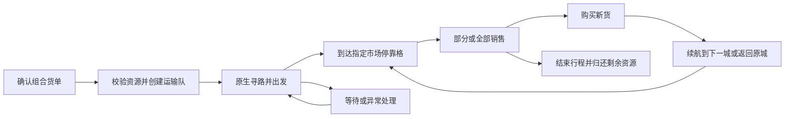

# 贸易系统设计与重要修改汇总

2026-11-10：当前完整基线已整理为[贸易系统完整设计与实现说明](贸易系统完整设计与实现说明.md)，包含全部玩法／公式、自动经营、港口、存档协议、72商品、530城市市场和参数／函数索引。本文保留历史修改记录；当前版本与部署状态以完整说明的基线核对为准。

2026-11-08：新增城市经附近同势力港口出航的候选实现，包含陆路接驳、费用／时间、自动往返预算及 TRAD v13 存档兼容。后台验证通过，21:39 已部署到正式游戏，实机出航验收待完成；见[城市港口接驳](城市港口接驳.md)。

2026-11-08：城市贸易菜单的操作流程已调整，包含组合配货直接改量、会话草稿、自动贸易按本城启用、多选偏好、直接接管和批量出售。操作规则、验证记录及部署说明见[贸易菜单交互优化](贸易菜单交互优化.md)。

设计基线日期：2026-11-03；2026-11-04 补充自动贸易死锁审核；2026-11-05 新增贸易船型候选版，见第 17 节。项目：世界版《三国志11》`san11world-trade`。

本文汇总当前系统设计、关键决策、重要问题与修复、测试边界和部署状态，供后续开发与维护使用。以当前源码、商品目录及最近一次部署清单为依据；旧文档中的初版参数和阶段性“候选／未部署”说明，不自动代表当前状态。

最初版本仅整理文档；后续开发与部署状态分别记录在新增章节。完整历史过程保留在[原方案与实现](贸易系统.md)和[修复进度](贸易系统修复进度.md)。

## 1. 当前版本与核心原则

| 项目 | 当前状态 |
| --- | --- |
| 世界规模 | 530 城市、249 个常规势力 |
| 商品 | 72 种，稳定编号 0～71；代码容量上限 128，不代表已发布 128 种 |
| 商品数据 | `TRDB v6`，文件名 `trade.bin` |
| 贸易存档 | 正式版 `TRAD v10`；贸易船候选版写入 `TRAD v11`，嵌入游戏存档 |
| 新贸易船型 | 「海运商船」候选版：后台验证通过，尚未部署／实机验收 |
| 主要入口 | 城市主界面「贸易」，逐级原生菜单；保留中地图面板 |
| 经营方式 | 手动组合贸易、玩家自动往返、电脑势力贸易 |
| 战争供给接入 | 官府从本城市场采购枪、戟、弩、马 |
| 军粮转换 | 未开放；贸易粮食仍是商品 |
| 最新文件核对 | 2026-11-04，正式 DLL 已包含主线程非阻塞锁修复，见第 16 节 |
| 完整验收 | 未完成；后台验证和部分实机专项通过，不能视为全系统实机验收 |

系统参考《大航海时代》的产地差价、市场行情、组合装货、航线选择和商人经营，同时适配汉末至三国的世界设定。

必须保留的原则：

1. 商队是地图上的真实运输部队，归属出资势力，受道路、外交和战争影响。
2. 商品市场与城市官府资源分别记账。商队向市场卖货获得收入，官府另行花钱采购军需。
3. 商品有有限现货；买卖、推荐与实际成交共用经济模型。
4. 出发真实扣除资金、护卫与兵粮，失败回滚；返还只返还真实剩余资源。
5. 自动经营不得超预算、重复买货或凭空补兵补粮；不满足条件时说明原因。
6. 临时商人不得混入正常武将使用体系；人物槽位回收后，旧航次不得控制复用槽位。
7. 旧货成本和历史账本不因新定价而追溯改写，商品扩充保持既有编号。
8. 地理估算、后台模拟、原生机器码验证和实机验收分别记录。

## 2. 玩家操作与菜单

贸易入口使用原游戏城市主菜单的按钮和逐级展开机制，交互参照「军事」「人才」。内层采用原生列表、数量输入、确认／取消、排序和返回，不依赖固定屏幕坐标。

```text
城市 → 贸易
  市场行情 → 本城商品 → 商品详情／各地行情
  组建商队 → 目标市场／统领／商品组合／商路推荐 → 出发确认
  商队管理 → 选商队 → 货物／买卖／续航／补给／结束
  收支账本 → 活动行程／已结束行程
  贸易情报 → 行情、事件、季风
  自动贸易 → 优先目标／月预算／偏好商品／开关／试算／保存
  待处理 → 选择自动商队 → 重评／返程／手动接管
  军需采购 → 采购兵装／采购军马／采购明细
```

组建时允许一次装载多个商品。预览、建议配货及试算不扣钱；最终确认后整单执行。商品数量以“批”为统一界面单位，军需额外显示每批对应件数或匹数。

图片按稳定商品编号／名称关联，列表排序不改变映射；在商品选择、详情和相关交易窗口中显示。当前记录为 72 张商品图卡、71 张图片，大黄显示“暂无图片”。图源主要是《大航海时代 Online》，部分装备图仅作示意；来源记录见 `research/trade_goods_images.md`。

## 3. 商品范围、产地与库存

### 3.1 商品取舍

原始 14 种保留，随后增加 55 种适合时代设定的商品，再追加枪、戟、弩，共 72 种。完整编号、基价和装载系数见文末附录。

覆盖食物、油脂、香辛料、织物、饮品、宝石、工艺品、药材、染料、矿物及冷兵器。未加入咖啡、白兰地、朗姆酒、天鹅绒、近代火器、新大陆作物等不适合当前设定的商品。白金、冬虫夏草、龙涎香等未纳入本次发布范围。

产地、需求倍率、价格和载量是玩法配置，不是精确历史报价或每城实际生产的考证结论。硝盐不开放火药机制；保存食品没有独立腐败系统。

黄金、白银作为商品正常交易，没有固定面值兑换金币的额外通道。刀剑、甲胄、铁器也不自动兑换原生兵装。

### 3.2 有限库存

每个城市、每种商品独立保存库存、行情指数和观察快照。商队买货减少市场库存，售货补入市场库存；官府军需采购与商队使用同一现货。

普通非产地不会自动生产进口商品，但可以转售商队运来的货物。枢纽具有初始转口库存、更大市场规模和更快行情恢复；这不表示枢纽库存无限。

设市场规模为 S、生产等级为 L、需求系数为 D（1000 表示 1 倍），数量单位为批：

| 规则 | 普通商品 | 枪、戟、弩、马 |
| --- | --- | --- |
| 产地初始库存 | S × 100% | S × 20% |
| 非产地枢纽初始库存 | S × 10% | S × 2% |
| 库存上限 | S × 200% | S × 40% |
| 月生产 | S × L ÷ 30 | S × L ÷ 150 |
| 月民间消费 | S × D ÷ 50000 | S × D ÷ 250000 |

军需月度小数通过相邻累计整数之差结算，避免小城市长期向下取整后永远没有生产。读档不额外执行月结。

旧军需库存高于新上限时保留原数量，暂停自产与新增收货，允许采购和正常消费；消化到上限内后恢复。旧档与新开局因此不会立即具有相同供给状态。

## 4. 定价、费用与利润口径

### 4.1 基准价与成交价

城市基准价由商品基价、产地等级、到产地的距离、商品距离指数／上限及地区需求共同生成。初始产地等级系数：一级 1.2、二级 1.0、三级 0.85。

运行时再应用市场事件、行情指数、商品最低中间价、买卖价差和商人修正。每批成交沿同一条价格轨迹推进，以相邻价格节点估值并按买卖方向取整。

当前默认参数：行情指数初始 1000、范围 300～4000；基础买卖总价差 10%；普通城市每月恢复距 1000 差额的 10%，枢纽 25%。关闭回归时不再隐式移动指数。

买入推高指数、卖出压低指数。现实现按逐批加减指数推进；不要沿用初版文档中一次性乘除总数量的简化公式。商人加成缩小价差并保留最小差价，不能制造同城即买即卖套利。报价只模拟，成交才提交库存和指数。

### 4.2 运量与税费

| 项目 | 当前默认 |
| --- | --- |
| 普通商队基础货舱 | 20 格，统领能力／商人等级可修正；海运商船候选参数见第 17 节 |
| 首次组队费 | 100 金，组合货单只收一次 |
| 已有商队新航段费 | 30 金；原航段恢复不重复收 |
| 出发护卫 | 500 兵 |
| 出发兵粮 | 3000 粮 |
| 普通／枢纽销售税 | 10%／5% |
| 普通／枢纽过境税 | 2%／1% |
| 每航段过境税总上限 | 航段出发时货物采购成本的 5% |
| 本方／同盟 | 相关税免征 |

货物按十分之一格计载重。例：盐每批 0.2 格、棉布 0.4 格、丝／皮毛／铁器 0.5 格；其他商品以目录为准。盐 50 批加蜀锦 10 批占 20 格。

虽然配置结构保留海运容量 60 的字段，当前正式容量函数统一使用陆队容量，尚未启用真实港口拆合队。不能把“两端都是港口”解释为自动获得 60 格货舱。

销售税小数按“付款势力—收税势力”累计并存档，换商品、换港或新建行程不能清除。过境税按航段记录，经过同城不重复收取，新航段重新计额。

### 4.3 三种收益口径

**行程实际账本：**

```text
现金净流量 = 销售收入 − 采购支出 − 手续费 − 税费
账面损益 = 现金净流量 + 剩余货物的采购成本
```

货损按采购成本记录，损失已包含在采购支出中，不再从现金净流量重复扣除。尚未卖出的货物不按预期卖价提前确认利润。城市满仓而未实际到账的款项单列待入账。

**手动商路推荐：** 扣货款、组队费、销售税和预估过境税；通常未折算兵粮和货损。按每单位货舱边际收益建议组合，不保证全局最优。

**玩家自动贸易：** 额外纳入起运兵粮的补回估值、过境税上限和返程续航费。下文给出公式。三种数字不可直接混用。

## 5. 商队生命周期、返程与人物保护



商队记录稳定行程 ID，不能仅凭可复用的原生部队槽位识别。每个货物批次保存商品、采购地、数量和采购成本；组合中任一项不合法，整单拒绝。

出发要求出资城归属正确、商品有现货、资金和货舱足够、护卫和兵粮足够、统领合法且路径可达。临时商人另检查特殊武将空位和数量上限。失败恢复市场与预扣资源。

商队到达指定外围停靠格才可交易，不再仅以“离城很近”判定到站。行进中禁止买卖、补给、结束等不合法操作。停靠／等待时冻结本商队的移动，不影响复用槽位的其他部队。

**可以载货返程。** 手动商队在目的地出售后，买入当地商品，再选择续航至原城或另一开放市场。自动商队按预算和盈利条件评估回程组合；回程货不保证一定有利。

销售收入汇回出资城市；出资城失守时，手动结算按现有规则寻找同势力城市承接。自动计划遇到归属变化进入异常处理，不擅自改用另一城继续花费。超过城市容量的资金和可返还资源保留待入账。

### 临时商人要求

- 无统领时创建特殊人物“商”，默认政治 60、智力 50，不占用正常历史武将出勤。
- 临时商队全局默认最多 30 队，并保留至少 30 个特殊人物空位；AI 与玩家会共同消耗相关资源。
- 正常停在城外市场；若原生流程将部队收入城市，回收临时人物，保存 `tempReleased`，保留货物与账本。
- 历史武将和自建武将不进入临时人物释放逻辑；回收后旧航次不再冻结、加速或支配复用的人物／部队。
- 已入城并失去原生部队的商队不能继续采购、续航或自动再造护卫，须售清／结算后重新组队。
- 临时商人通过原生人物列表统一入口过滤；军团调整不影响身份判定。2026-11-07 的后台与实机验证见第 18 节；完整航次的逐回合实机验收仍与列表验证区分。

## 6. 陆路、海路与运输时间

使用原生 A* 寻找真实路径。曾因传错对象导致路径步耗失真，现通过正确的单位包装记录及边界校验调用。出发、续航及停靠格均受原生路径检查。

只有登记且身份匹配的商队享受加速：普通陆地基础步耗约降至三分之一；困难地形、火焰和不可通行条件继续有效。海洋商船在季风计算后应用约四分之一基础步耗，普通舰队和河流不直接套用此海洋折扣。

单次搜索／行动范围深度：商队陆地 24，水上 36。没有直接提高原生移动力预算；每旬行动还受原生移动力和地形约束。

时间显示分两类：

- 出发前：地理粗估，不能保证原生实际可达或准确耗时。
- 已有商队：根据当前位置与缓存原生路径逐格估算剩余旬数，考虑当前地形、移动力、范围和季风；未来季风、战斗、封路和等待仍会造成偏差。

中国东部至罗马的海运校准目标为常规单程 18～24 个月。后台地图海路样本为北海—番禺—扶南—马六—穆济—贝列，以及黎轩—罗马，共 1733 个水路格；中间埃及转运／装卸另假设 5 旬。双向各 12 个出发月份的模拟为 66～72 旬，即 22～24 个月。

**上述 5 旬转运没有写入游戏规则，整条海陆联运也未实机跑通。** 海洋几何连通不等于港口权限、原生进出港和陆地转运全部可行。最快 12 个月方案未达成，自动等风、自动港口拆队／合队未实现。

原生船只为走舸、楼船、斗舰三类。2026-11-05 候选版新增可选择的「海运商船」，在贸易系统内独立记录船型，复用原生运输部队及走舸水上外观，不增加原生兵器编号或战船种类；正式游戏尚未部署该候选版，见第 17 节。

## 7. 玩家自动贸易

### 7.1 配置与候选选择

玩家选出资城，设置优先销售城市、每月预算、偏好商品，开启新派遣后保存。目标是优先目的地，不是绝对锁定目的地；偏好商品也不是禁止其他货物的白名单。

系统只根据已知且开放市场的行情评估组合。未知或过期行情不假定盈利。按估计每旬净收益评分：

| 条件 | 规则 |
| --- | --- |
| 盈利门槛 | 保守预计净利为正，且不低于估计总支出的 10% |
| 优先目标 | 另一目的地评分达到优先城市的 120% 才替换 |
| 偏好商品 | 同目的地的偏好组合达到最佳评分的 95% 时优先采用 |
| 同时在途 | 每出资城最多 2 支自动商队 |
| 资金底线 | 出资城保留 2000 金 |
| 原生校验 | 通过报价筛选后仍须真实创建和寻路；失败尝试其他候选 |

这些是启发式选择规则，不是全局最优闭环路径搜索，也不保证未来到港报价。

### 7.2 预算、预留与估算

```text
本次可用资金 = min(月预算 − 本月占用, 城市当前金 − 2000)，最低为 0

出程现金需求 = 货款 + 组队费 + 预计销售税 + 过境税上限 + 回程续航费
出程筛选净利 = 预计销售额 − 出程现金需求 − 起运兵粮估值
评分 = 出程筛选净利 ÷ 地理往返估计旬数
```

这里只把出程已知收入计入筛选，没有用尚未确定的回程利润补救亏损出程，也不是全程所有潜在成本的精确核算。回程在到港后重新报价、采购和扣预算。

预算包含采购和税费预留。收入汇回城市但不恢复月额度；同月未用预留退款可释放相应占用，跨月退款不抬高新月额度。保存配置、暂停再开启、读档不能重置已用预算。

起运兵粮估值采用本城原生买粮公式，临时商人政治 P=60：

```text
兵粮估值 = floor(Q × (450 − P) × 10 ÷ (R × 400))
Q = 出发携带兵粮，R = 本城当前粮价字节，P = 60
```

R=50、Q=3000 时为 585 金。R=0 或不可读时暂缓并解释原因。该金额是利润估值，不再次扣金币；实际仍从城市扣出发兵粮。估值按全部携带粮补回计算，不等于实际消耗量。

### 7.3 派遣、往返和异常

首次保存和每旬处理会评估未完成新派遣的计划。成功创建才记录本月派遣标记；一次处理最多填到两队上限。成功派遣过的计划，本月后续不因保存设置而开启新批次；未成功则下旬／再次保存可重试。

旧版误标记且本月占用为零的计划允许当月重新评估。已有自动商队的往返处理独立进行，暂停新派遣不会终止它们。

自动航次阶段：出程 → 售货 → 回程采购 → 返回 → 原城售货 → 结束。回程沿用现有商队，在外国市场买货不需要拥有该城，也不再创建第二名商人。

到港报价低于货物采购成本、市场库容不足、预算不足、路径受阻、人物／部队异常或出资城易主时停止相关动作。「待处理」支持下月重评、空载返程、带货返程和手动接管；空载返程不能隐式丢弃已有货物。

回程组合采购失败恢复全单；已采购而离港失败时保留货物和阶段，重试不会再次购买。自动管理中的商队要先接管再手动交易。

### 7.4 2026-11-03“不派商队”问题实证

最新 Save000／Save001 中，两份计划均已启用、目标乐浪、本月占用 0、无自动商队，却已经标记本月派遣。

| 出资城 | 月预算 | Save001 城市金 | 实际粮价 R | 修复后兵粮估值 | 修复后候选组合 | 旧估价下合格组合 |
| --- | ---: | ---: | ---: | ---: | ---: | ---: |
| 临海，ID 529 | 1000 | 6343 | 40 | 731 | 12 | 0 |
| 会稽，ID 24 | 4000 | 4051 | 70 | 417 | 7 | 0 |

两项根因：一是尝试之前就写本月派遣标记，失败也锁住整月；二是将 3000 粮估成 3000 金，错误排除盈利候选。已改为成功后标记、兼容旧失败状态，并使用原生粮价公式。

新增配置状态、保存反馈和试算原因，区分资金保留线、预算、兵粮／护卫、商人槽位、粮价和盈利条件；原生出发失败写日志。

重放使用真实市场、情报、城市资源、归属和外交快照；特殊人物空位采用测试默认值，未执行原生创建／寻路。12／7 是组合数，可能含同一城市的不同偏好方案。证据见 `worldmod/build/auto-dispatch-fix/replay.txt`。

## 8. 电脑势力贸易

电脑势力贸易与“玩家配置自动贸易”是两套调度，不要混为同一月预算规则。

电脑贸易默认开启，按月轮流处理非玩家势力；默认全局每月至多新派 6 队、每势力同时最多 2 队。基础设置包括最低城市金 6000、单次投资 4000、保留金 2000、候选收益门槛 25%、范围 80。

先选择统领，再使用其价格、载量、税费条件评估。数量在实际库存、目的地库容和资金内选择，不能因为满载不可行就丢弃所有较小交易。

到港调用同一套买卖接口，并可寻找下一航段连续经营。候选路径失败会尝试其他目标，选路预览不扣钱。商队挂接阻止电脑将已登记商队改派去攻城，玩家手动命令也不能被冷缓存重建覆盖。

电脑经营不是包含未来战争、逐旬粮耗及所有回程的全局利润最优模型；长期模拟仍不能替代实机连续经营测试。

## 9. 城市军需采购与价格体系

### 9.1 资金和货物流


市场不是官府钱包。官府采购资金流向民间，不再把同一笔市场销售收入全额加回官府，否则会产生重复记账／免费军需。

只允许枪、戟、弩、马映射原生兵装编号 1～4。每批 100 件或 100 匹，按本城市场逐批买价成交，不享受商人折扣、不收组队费。扣本城资金和市场商品，增加本城原生兵装；没有反向出口制造库存的通道。

### 9.2 制造明显便宜，市场采购提供补缺能力

本地原生数据四类基础生产金费均为每次 700 金。实际每次产量取决于武将、设施、特技等，不能把 700 当成每件成本。

| 每次生产情景 | 每 100 件／匹直接金费 |
| --- | ---: |
| 1000 | 70 |
| 2000 | 35 |
| 3000 | 23.33 |

| 商品 | 目录基价／100 件或匹 | 距离指数／上限 | 中间价下限 |
| --- | ---: | --- | ---: |
| 枪、戟、弩 | 180 | 0.50／2.0 | 150 |
| 马 | 220 | 0.65／2.5 | 150 |

下限在事件、行情之后，价差、商人修正之前应用。当前压力测试最低每批实际买价 151、税前卖价 142；这是测试范围结果，不是每笔固定价格。

无事件、无商人折扣、指数 1000，一次采购 1000 件／匹的产地报价：枪 1620～1944、戟 1628～1914、弩 1628～1944、马 1979～2846 金。对照“700 金生产 2000”的情景，自产 1000 件直接金费折合 350 金。

这些比较不含建厂摊销、行动力、武将占用、运输及税费；价格体系没有修改原生制造费用或产量。

### 9.3 提交与 AI 采购

提交时重新校验归属、现货、资金、原生库容和确认报价；持久化序号防止重复订单。原生只扣部分金或只加部分兵装时先回滚，再返回失败；不可恢复时停止相关写入，防止继续破坏账目。原生接口签名不匹配则禁用采购。

AI 城市每月最多一单补缺采购：预算不超过现有资金的 10%、至多 2000 金，并保留 2000 金；四类兵装总量低于 `min(士兵数,10000)` 时，从有现货、可入库的商品里选择最便宜者，每单最多 20 批。没有免费补给或分别补齐四种兵装的保证。

军需采购独立记账，全局保留最近 512 笔，界面筛本势力；不是全部历史军费总账，也不改商队航次利润。

### 9.4 为什么军粮没有开放转换

曾评估小麦／稻米／大豆每批换 100 粮、鱼干每批换 150 粮。按现价直接接入会出现低价买商品、换粮、再按原生报价卖粮的套利路径。

例如校准情景中，120 金买 20 批小麦可换 2000 粮，原生卖粮报价 365 金；这是被否决方案的反例，未部署该转换漏洞。

原生买粮与卖粮公式不同，高政治时卖价还可能高于买价。即使给商品粮设防套利下限，原版独立买粮仍可能更便宜。只让新市场缺货，不能声称已经切断战争粮食供给。

因此当前仅开放四类兵装采购。粮食与城市人口、消费、战争补给的进一步转换，需要另行设计原生买粮通道、共同供给约束和兑换边界；不能直接按讨论中的候选比例实施。

## 10. 情报、事件、季风与商人成长

**情报：** 保存观察当时的价格指数、事件倍率、库存和时间。不能用旧价格搭配当前事件／库存伪造完整行情。自有／同盟领土、附近城市及部队／商队观察刷新信息；默认保留 12 个月历史，未知或过期显示未知，自动推荐不据此假定盈利。

**事件：** 流行、歉收、战乱、疫病、丰收影响地区及商品。默认每月 15% 概率触发，同时最多 4 件，多事件倍率累计并限制在 0.2～5 倍。事件状态与随机数保存，读档不重新抽签。

**季风：** 海域按月份影响顺风、逆风、换季成本及风暴。默认顺风成本系数 70%、逆风 140%、换季 125%；换季海上风暴默认概率 10%、货损 30%。这些是玩法参数，不是历史气象概率。

**商人：** 有将商队根据交易累计经验，等级阈值 500／1500／3500／7000／12000；商才和高政治可加有效等级，上限 7。每级影响价格、载量、税和抢劫风险，最终仍受防套利价格约束。临时商人不积累长期商人经验。拆单交易不得重复获得固定航次经验。

## 11. 架构、持久化与兼容

### 11.1 代码职责

| 文件 | 作用 |
| --- | --- |
| `data/trade_goods.json` | 商品、产地、需求、库存基础配置、事件和商人数据 |
| `data/trade_goods_era.json` | 商品时代取舍及编号历史；其中早期“未兑换”文字须结合现行军需规则阅读 |
| `tools/trade_data.py` | 生成商品二进制目录 |
| `worldmod/src/trade_model.h/.cpp` | 价格轨迹、库存、货物批次、税费、事件与情报模型 |
| `worldmod/src/trade.cpp` | 原生接口、商队状态、线程、存档、菜单挂接和运行时调度 |
| `worldmod/src/trade_panel.h/.cpp` | 共用报价／配货模型和中地图面板 |
| `worldmod/src/trade_dialogs.inc`、`trade_native_ui.h` | 原生逐级界面与交易流程 |
| `worldmod/src/trade_auto.h` | 玩家自动贸易预算、阶段与候选规则 |
| `worldmod/src/trade_auto_runtime.inc`、`trade_auto_dialogs.inc` | 自动往返执行及配置界面 |
| `worldmod/src/trade_procurement*.h/.inc` | 军需报价、事务、AI 采购与界面 |
| `worldmod/src/trade_images.*` | 商品图片加载和显示 |
| `worldmod/src/pathfind.*`、`movement.*` | 原生路径、商队移动与 ETA |
| `tools/stage_trade_saves.py` | 在项目目录暂存并验证存档贸易块升级，不直接覆盖原档 |

经济核心不调用游戏地址，运行时适配层负责原生资源写入。交易修改经游戏线程和锁执行。命令队列使用共享所有权，读档取消未执行命令；调用方超时不表示已经执行的命令被撤销，不应盲目重发扣款命令。

### 11.2 数据版本演进

| 版本 | 主要变化 |
| --- | --- |
| TRAD v1～v3 | 初期单货物航次，逐步加入事件／情报／商人 |
| TRAD v4 | 库存、完整观察、多货物、稳定航次 ID、待入账 |
| TRAD v5 | 活动／结束行程账本 |
| TRAD v6 | XPRESS_HUFF 压缩，解决原生保存内存池耗尽 |
| TRAD v7 | 销售税小数余数 |
| TRAD v8 | 每航段过境税上限及已付金额 |
| TRAD v9 | 自动计划、预算、预留、阶段、异常、商人回收 |
| TRAD v10 | 军需采购序号与明细；正式游戏写入版本 |
| TRAD v11 | 活动商队和自动计划的船型；2026-11-05 候选版写入版本 |
| TRDB v5 | 显式商品装载系数 |
| TRDB v6 | 每批原生数量和最低中间价；当前目录版本 |

正式版读取支持旧 TRAD v1～v10；船型候选版扩展至 v11；两者均支持 TRDB v1～v6。商品扩容仅接受已发布的 14／69／72 商品目录及相应名称前缀，不接受任意乱序目录。

存档按“完整解析、校验临时状态、最后提交”执行，损坏数据不能部分覆盖游戏状态。无法理解的贸易块保留并停止贸易写操作；这不等于修复损坏存档。关闭贸易时透传贸易块，也不保证关闭期间任意移动过的商队可以无缝恢复。

530 城市 × 249 势力 × 72 商品的原始贸易数据超过 64 MiB，解压上限已提高到 128 MiB，并在分配前校验。压缩用于避免原生 32 MiB 保存内存池同时持有分块和连续缓冲造成截断。

扩容保留原价格指数、库存、历史成本、情报、自动预算、税款和人物回收状态，新商品不伪造过去行情。老版本未记录的历史费用不能补造，迁移账本标注不完整。

## 12. 重要问题与修改记录

| 问题 | 原因／影响 | 修改与当前边界 |
| --- | --- | --- |
| 配置自动贸易后始终不出发 | 失败尝试也写本月标记；兵粮估价过高 | 成功后标记、失败可重试；原生粮价估值；增加原因反馈，已部署 |
| 交易门槛高、短线难盈利 | 首次费偏高，续航与重新组队混同，过境费过重 | 首次费降至 100、续航 30、过境 2%／1% 且封顶 5%；不代表全局平衡通过 |
| 一队只能运输单品 | 无法组合利用货舱 | 组合货单、不同载重、整单确认和回滚；每品保留独立成本 |
| 拆单逃税、拆单刷经验 | 每笔小数／固定奖励重复取整 | 税余数按势力对持久化；经验按批次累计分摊 |
| 高商人加成产生同城倒挂 | 买卖折扣越过价差 | 统一逐批轨迹，折扣缩小价差且保留最小差价 |
| 原生 A* 返回错误步耗 | 误传部队对象而非单位包装结构 | 校验包装编号及数组边界，专项原生路径复测通过 |
| 到站判定过宽 | 用距离代替实际停靠位置 | 必须到指定路径停靠格；复杂地形、封锁和跨海仍需专项 |
| 停靠部队移动／复用槽位被误冻结 | 只按槽位识别 | 同时验证部队类型、统领和登记身份，回收／完成后失效 |
| 手动命令被系统覆盖 | 冷缓存重建同时重新下令 | 分开路径缓存与命令，尊重手动标记 |
| 游戏保存截断 | 未压缩贸易负载耗尽原生保存堆 | v6 压缩、失败返回保存失败；不承诺原生磁盘写入原子性 |
| 69／72 商品解压失败风险 | 原 64 MiB 上限不足 | 提至 128 MiB，尺寸及完整世界往返测试；仍保留上限 |
| 截获／售货收入在满城丢失 | 直接加金被原生上限截断 | 差额进入待入账；腾出空间后结算，重复调用不重复加钱 |
| 超大待入账使城市金反向溢出 | 原生有符号整数先相加再限幅 | 分次按安全余量入账，余额继续保留 |
| 击破或结束后旧航次仍干预部队 | 行程生命周期与回调不同步 | 击破及时归档，完成不再占名额或拦截复用槽位 |
| 临时商人进入武将列表 | 原生列表会收录在途商人；军团调整导致旧身份核对失效 | 统一过滤人物行，以势力核对临时身份；到城回收、持久化释放标记，失去部队后只保留待结算货物 |
| 外国港口回程买货失败 | 复用新建商队的本城归属／人物检查 | 现有商队回程报价绕过组队专用条件，不改变外国城市实际归属 |
| 自动回程重复采购 | 买货成功但离港失败后重复进入购买阶段 | 持久化回程已采购阶段，离港重试不重新买货 |
| 过时行情混入当前数据 | 旧指数与当前库存／事件拼接 | 完整观察快照，未知行情不生成虚假利润 |
| AI 满载不可行就不交易 | 只计算最大货量 | 按可成交数量、资金和库容选择，并尝试替代路径 |
| 兵装市场价格比制造还低 | 未统一交易批量与原生产成本口径 | 每批 100 件／匹、180／220 基价及 150 下限，保留自产成本优势 |
| 市场军需无限补给感 | 沿用普通商品的库存和生产强度 | 四类军需缩减库存与流量，旧库存不直接删除 |
| 军需重复／部分写入 | 原生接口会按容量截断，重复确认可能重放 | 报价复核、持久化序号、部分写入回滚，共用事务 |
| 军粮转换套利 | 商品粮与原生粮价／通道不一致 | 候选比例否决，军粮转换未开放 |
| 港口即视为大船／全程海路 | 城市港口标记不能证明联运成立 | 禁用自动海运扩容，保留真实寻路；拆合队仍未实现 |
| 商品列表扩容后遗漏高编号 | 旧 64 商品上限及列表绑定风险 | 提升上限，稳定编号映射，覆盖 64 以后商品和图片／偏好保存 |

这些结论对应不同阶段的专项证据。历史测试用例缺陷，例如港口测试模板的寿命未初始化，不应被误写为正式商队必然存在的人物泄漏。

## 13. 验证结果与待解决事项

### 13.1 已有证据

| 验证类型 | 已覆盖 | 不能据此推断 |
| --- | --- | --- |
| 经济／价格回归 | 报价、拆单、库存、税、载重、军需价差与下限 | 所有势力长期战争经济已平衡 |
| 自动贸易回归 | 预算、退款、阶段、偏好选择、旧失败标记重试、粮价估值 | 原生完整往返已跑通 |
| 运行时／存档测试 | 版本迁移、72 商品、损坏拒绝、真实存档字段／字节保留 | 所有旧世界版本的原生存档都兼容 |
| 原生粮价机器码 | 1559 个原始报价指令用例 | 原生界面／行动限制下可无限交易 |
| 原生兵装接口机器码 | 32 个钳制及实际返回量用例 | 最新采购菜单和 AI 月结已实机点击 |
| 历史隔离实机 | 陆路出发、停靠、买卖、续航、满仓待入账、保存重载、资源归还等专项 | 跨洲连续海陆联运及自动港口转运完成 |
| 海运后台校准 | 地图海洋连通、逐格成本、季风月份、范围约束 | 实际游戏每趟均为 22～24 个月 |
| 最新真实存档重放 | 临海／会稽候选从旧估价 0 个恢复为 12／7 个 | 实际人物空位及原生寻路一定通过 |

最近一次军需发布的 120 月模拟：720 航次、损失 28、净收益 473093，收益率中位数 44%；全势力贸易收入占比 0.82%，参与势力 1.82%。这是当时模拟版本的诊断，不是自动派遣修复后的新一轮全局模拟。

此前“参与势力贸易收入达到正常收入 10%～30%”目标仍未达到。单趟高收益率与全势力低收入占比可以同时存在，不能据此直接判定应继续加价或增加运量。

### 13.2 尚未完成／需要改进

| 优先级 | 项目 | 下一步验收标准 |
| --- | --- | --- |
| 高 | 最新自动贸易原生派遣与往返 | 临海／会稽真实出发；逐段核对金、粮、货、预算；保存重载不重复采购 |
| 高 | 商人到城后的武将列表 | 到港、被收入城、结束、击破和读档后均不残留临时商人，正常武将不受影响 |
| 高 | 最新军需 UI／AI 月结 | 实机采购数量与入库一致，取消无变化，AI 月度支出与明细一致 |
| 高 | 多站／回程季风方向 | 当前 `headingOf` 仍用原始出资城与目的地差值，返原城时可能退化；应按当前航段核对并单独修复 |
| 中 | 真实港口拆合队与联运 | 拆分重组前后兵、粮、货守恒；槽位不足只等待；身份／归属不变 |
| 中 | 经营报价与真实成本统一 | 进一步纳入原生路径耗时、逐旬粮耗、回程和等待成本，并解释估计误差 |
| 中 | 自动计划异常体验 | 出资城迁移、长期无回程货、库容不足的恢复流程；新增方案须另行确认设计 |
| 中 | 宏观经济平衡 | 同场景比较新旧存档、参与势力分布、军需采购与战争需求，而非仅比较单趟利润 |
| 后续设计 | 军粮与城市基础供给 | 明确原生粮食通道和新市场供给关系后，再定兑换比例与动态价格 |
| 候选待验收 | 海运商船 | 载量、费用、船型菜单、自动贸易和存档已实现；实机出港／返航待验证 |
| 后续设计 | 港口投资、贸易契约 | 目前没有实现，不作为已交付能力 |

以上是后续工作清单，不代表本文已经执行相应修改。

## 14. 部署、读档与回退

正式游戏目录：`C:\Games\san11\Romance Of Three Kingdom 11 PK`。

核心文件：`d3d9.dll`、`worldmod.ini`、`world_custom/trade.bin`；正式存档目录为 `UserData_kit/Koei/San11 Tc/SaveData`。当前 `trade=1`、`trade_ai=1`、`move=1`，组合特技开关保留。

| 时间 | 内容 | 文件影响 |
| --- | --- | --- |
| 2026-11-01 | 基础修复、原生菜单、组合贸易、商队／海洋加速陆续部署 | 对应阶段有独立备份与证据 |
| 2026-11-02 | 自动往返、69→72 商品、军需价格校准 | DLL／目录按版本配套；当时部分现有存档尚未保存扩容 |
| 2026-11-03 01:24 | 兵装采购与正式存档升级 | DLL、Save000、Save001；v9／14 商品升至 v10／72 商品 |
| 2026-11-03 10:04 | 自动贸易不派遣修复 | 只更新 DLL；8 个存档／配置／目录文件哈希不变 |

2026-11-03 自动派遣修复版 DLL SHA-256（2026-11-04 已更新，见第 16 节）：

```text
9F5971F1309D50CFD5297206A3300548B5BF1401E7A35D2BA15DF09F2E9C2509
```

当前商品目录 SHA-256：

```text
A7821C3A2CF4F4AEAAAC3B9B9BCE7F82E5E027CAF910D4C0523A308744627CD8
```

2026-11-03 发布备份：`trade-backups/20261103-100357-auto-dispatch-fix`。对应部署清单：`worldmod/build/auto-dispatch-fix/deployment.json`。

用户启动游戏读入原存档后，可进入「城市 → 贸易 → 自动贸易 → 保存设置」立即重评，或等待下一旬。失败原因显示在配置／保存反馈中；并非有配置就一定忽略资源和利润条件强行出发。

回退自动派遣修复版时，其上一版同为 TRAD v10；是否恢复存档应按实际需要决定，不要为了回退 DLL 覆盖玩家后来保存的进度。回退到军需采购之前或旧商品目录时，则必须使用匹配的 DLL、目录与对应旧存档，旧程序不能读取新字段或新增商品。

部署前备份并核对文件哈希，先在项目目录暂存验证，关闭游戏后更新。不得拿历史暂存档覆盖用户后来继续游玩的正式存档。普通发布 DLL 不应包含隔离实机测试专用入口。

## 15. 维护与复现入口

在项目根目录构建，两个构建脚本共享对象目录，应顺序执行：

```powershell
cmd /c worldmod\test\build_sim.bat
cmd /c worldmod\build.bat
```

常用后台验证：

```powershell
.\worldmod\build\trade_auto_test.exe
.\worldmod\build\trade_regression_test.exe
.\worldmod\build\trade_procurement_test.exe
.\worldmod\build\trade_runtime_test.exe worldmod/test/fixtures/trade-v4-14.bin data/world/trade.bin
```

真实存档校验可用 `tools/stage_trade_saves.py --game <正式游戏目录> --out <项目内独立暂存目录>`。它读取原档、调用实际 C++ 序列化器验证并写暂存文件；运行前应先编译测试程序。此步骤不等于批准把暂存档部署回正式目录。

证据目录索引：

- `worldmod/build/auto-dispatch-fix/`：最新部署、真实计划重放、粮价验证、存档验证。
- `worldmod/build/military-procurement/`：军需采购、供给校准、升级与部署后读回。
- `worldmod/build/military-pricing/validation/`：原生生产费用及价格校准。
- `worldmod/build/trade-game/`：历史隔离实机与原生专项记录。
- `worldmod/build/sea-speed-results.json`：海运月份场景校准。

这些是本地构建／测试产物；转移仓库时应同时归档所需证据，不能仅凭文档中的路径认为新机器已有文件。

后续变更应同时更新本文件的现行规则和已知限制，在《贸易系统修复进度》追加原因、验证方式、部署对象和备份位置。重要经济修改必须明确是基价、成交价、现金支出、估算成本还是原生资源数量变化。

## 16. 自动贸易死锁审核（2026-11-04）

### 16.1 真正的线程互等风险

旧版存在以下等待环：

```text
逻辑线程：autoTick 持有 g_cs → createCaravanOrder → 原生 sortie 等待主线程处理
主线程：pumpHook 阻塞等待 g_cs → 尚未执行原生命令泵
结果：逻辑线程等待主线程，主线程等待逻辑线程释放锁
```

风险发生在旬末自动派遣等跨线程原生命令路径；不是每次自动贸易都必现。同一线程嵌套进入 Windows CRITICAL_SECTION 可以递归，不应把 nativeAuto → autoTick → buildModel 的嵌套锁本身误判为死锁。

当前工作区修复将 `pumpHook` 改为 `TryEnterCriticalSection`：锁忙时暂缓贸易清理／贸易任务，仍调用原生命令泵；锁可用时才处理贸易任务，并通过 `__finally` 释放锁。不能只把排队检查改成非阻塞、随后又无条件进入需要同一把锁的商人清理函数。

### 16.2 独立验证与版本核对

- 使用独立输出目录编译当前实际运行时测试。逻辑线程持锁并等待模拟原生命令完成，另一个线程调用真实 `pumpHook`；修复版在 500 毫秒测试期限内返回，原生命令参数／返回值及排队任务均保留。
- 负向对照仅在隔离测试构建中把该处改回阻塞加锁，同一测试按预期失败，证明测试能发现该等待关系；没有修改游戏进程来制造卡死。
- 当前运行时回归为 0 failures，覆盖原有报价、自动预算、商人回收、存档兼容等检查。并发测试的原生命令执行使用替身，不等于全游戏所有线程／回调均已验证无死锁。
- 审核初期正式 DLL 为 `9F5971F...`；运行中的进程另有临时非阻塞跳转。审核期间工作区与正式 DLL 有并行更新；本轮仅只读检查进程代码，没有进行热补丁、关闭／重启、部署或回合推进。
- 审核结束时，正式 DLL 与构建 DLL 哈希一致，且检查磁盘机器码确认包含 `TryEnterCriticalSection`。当前 SHA-256 为 `B3D442DDD2A6C4DE8CA5588683680176C08AFB7827A0750E243C7A040A3233ED`。此处记录文件核对结果，不代替其他操作的部署／存档备份清单。

证据：`worldmod/build/auto-deadlock-review/runtime.txt`、`blocking-control.txt`、`updated-disk-pump.txt`、`verification.json`。

### 16.3 经营停滞与程序死锁的区别

| 情况 | 现行为 | 是否锁死程序／如何恢复 |
| --- | --- | --- |
| 回程无盈利商品或预算不足 | 设置异常，停止继续自动采购 | 不锁程序；在待处理选择下月重评、返程或接管 |
| 没有选择下月重评 | 异常没有重试月份，跨月也可能继续等待 | 不是无限计算，而是等待玩家决定；仅增加预算不保证清除异常 |
| 两支自动商队都停港 | 仍占每城两队上限，无法继续新派遣 | 城市自动经营可长期停滞；需要处理在外商队 |
| 返程费用预留不足 | 手动选择自动商队返程也可能被拒绝 | 可先接管，再以现有手动规则检查城市资金与返程；不能宣称按钮保证立即返回 |
| 原生部队被收入城市 | 保留货物与账本，回收临时商人，无法继续航行 | 售清并结算后重新组队；不自动生成新部队 |
| 全市场组合搜索 | 在游戏线程评估多个市场及商品 | 可能造成短时停顿；循环有数量／候选缩减或两队上限，不是同一种线程等待环 |

本次没有把异常策略改成自动亏本销售、自动空返或无条件每月重试。后续若优化，应明确哪些异常可自动重评、何时允许空返，以及等待是否继续占名额；同时保留预算、货物和人物保护。

## 17. 新增海运商船（2026-11-05，候选未部署）

### 17.1 操作与参数

入口保持城市原生逐级菜单：

- 手动：城市 → 贸易 → 组建商队 → 运输方式／船型 → 海运商船 → 选择市场、统领、组合货单 → 确认出发。
- 自动：城市 → 贸易 → 自动贸易 → 运输方式／船型 → 海运商船 → 配置目标、月预算、偏好商品 → 试算／保存。
- 管理：商队管理显示船型和实际续航费；买卖、补给、账本、结束行程仍沿用原有交互。

| 项目 | 普通商队 | 海运商船 |
| --- | --- | --- |
| 基础货舱 | `trade_cap_land`，默认 20 格 | `trade_cap_sea`，默认 60 格 |
| 组建费 | 默认 100 金 | 300 金 |
| 后续航段费用 | 默认 30 金 | 60 金 |
| 路线 | 陆路、水路 | 港市之间连续水路；初次离城有港区接驳例外 |
| 混合货单／统领载量加成 | 支持 | 支持 |
| 原生显示 | 运输部队 | 运输部队，水上沿用走舸外观 |

组建费随基础载量按三倍设置；续航费为普通默认值的两倍。额外费用纳入报价、预算占用和账本。它们是初始玩法参数，尚无长期游戏经济平衡的实测结论。新船仍消耗原有 500 护卫、3000 起运兵粮，沿用现有海运速度、季风、风暴与税费规则；不另设隐藏月费，也未增加海战属性。

### 17.2 港区接驳与水路约束

本节记录初版规则；2026-11-08 已按第 21 节改为不要求港市标记、城中心三格内有河海水面。

仅有港市标记不够：城市两格内须有河流或海面。离线 `world_types.npy` 与商品目录核对得到 114 个标记港市，其中 66 个两格内存在水面，只有 3 个水面直接邻接城市中心。这个统计不包含实时占用、外交和整条航路连通性，不等于 66 城均可成功出发。

原生 `0x5db430` 出征创建逻辑从城市取得位置（`0x5db4e5..0x5db4ef`），不能假定船只自动生成在水面。因此初次出港允许在起点城市一格范围内进行岸边接驳；进入水面之后禁止任何陆地捷径与重新上岸，目的泊位必须是城外水面。船不能携带 60 格货物跨越陆地、桥梁或埃及转运段，也没有瞬移到海面的逻辑。

约束同时覆盖原生移动步耗、移动范围、路线耗时与 A*。A* 显式排除不允许经过的格子，避免把返回值 255 当成可通行的高成本陆路；出发／续航取得路径后还会逐格复核「港区接驳前缀 + 连续水路」。停靠商人继续留在城外，不新增入城流程；人物槽复用和已回收商人的保护继续生效。

### 17.3 自动往返与兼容性

自动候选按所选船型计算货舱、组建费和返程费，筛除没有水边泊位的非适用市场。全程能否到达仍在真实部队生成后交给原生寻路检验，不能把地理收益试算视为路径保证。失败沿用现有资源与市场回滚流程。

返程用该航次记录的船型和续航费，保持组合装货能力。修改自动计划船型只影响后续新派遣，不转换在途船只；没有盈利回程、预算不足等仍进入原有待处理流程，不默默亏本买货。

`TRAD v11` 在 v10 尾部顺序追加每支活动商队、每项自动计划的 32 位船型，0 为普通商队，1 为海运商船。未知类型／截断数据整体拒绝，不部分覆盖状态。v1～v10 读入时船型默认普通商队，保留原货物、货舱、预算、采购明细与商人回收标志。旧存档不需手工改写，候选 DLL 正常读档后在下次保存时写 v11。

v10 旧 DLL 不支持 v11。回退应使用匹配的旧 DLL 与升级前存档，不把这次验证目录里的历史存档覆盖到玩家当前进度。

### 17.4 验证证据与部署边界

证据目录：`outputs/trade-merchant-ship/`。源文件修改前副本、此次差异、构建日志、测试结果、候选 DLL 与校验清单均保留在该目录。

- 真实经济／界面模型：60 格混合货单、超载拒绝、普通商队不扩容、统领加成、300 金组建和 60 金返程费、预算预留、非港市／无泊位拒绝。
- 真实运行时逻辑：船型及自动计划 v11 回读、v10 默认普通商队、非法和截断船型数据原子拒绝；商人回收／槽位复用不继承水路限制；初次岸边接驳与入水后禁上岸。
- 移动与寻路：统一格子许可、海路 ETA、禁止陆路捷径；原有海运／季风校准、自动贸易、军需价格／采购、面板及死锁回归均通过。
- 两份既有真实存档副本（197 年 10 月 21 日，Save000／Save001）由 v10 迁移至 v11；原生世界数据与原贸易字段均保持一致。正式存档当前读取被占用拒绝，未强行访问；副本来源是既有 `auto-dispatch-fix/saves` 验证档，并非本次游戏的最新进度。
- 32 位候选 DLL 构建通过。正式游戏仍运行，本次没有替换正式 DLL、关闭游戏、写入正式存档或执行实机操作。新增船型的原生菜单、出港、远航、返航及存读档实机验收尚待进行。

## 18. 临时商人列表过滤与军团变更修复（2026-11-07）

原来的到城回收不能解决在途人物出现在“全武将”等列表的问题。此外，真实存档中 19 名临时商人有 6 名已被原生流程调整军团，贸易记录里的旧军团编号与人物不一致，按旧军团判断会遗漏过滤及到城回收。

修复在原生 UI 行插入入口 `0x4E6340` 过滤人物对象，只检查最后 100 个特殊人物槽位、活动商队的 `F_TEMP` 身份、未释放状态、完整“商”姓名及所属势力。军团编号不再作为临时身份条件；历史武将、自建武将、普通数值行和地图部队行保留。过滤在分配列表行之前完成，不产生空白行。

临时商人生成时先发布过滤身份，派遣失败时撤销；存档载入从商队数据重建身份。完成、被击破或已回收的记录不再占用过滤身份，防止影响槽位复用。列表线程只读原子身份表，不获取贸易锁 `g_cs`，避免与原生派遣的线程等待形成互锁。存档格式不变，沿用 TRAD v11。

验证记录位于 `outputs/trade-person-ui/`：

- `runtime.log`：207 项断言通过，覆盖去程／返程／停靠／等待、生成失败、军团调整、人物槽位复用、历史及自建武将保护、列表行参数、贸易锁占用时读取和读档重建。
- `real-save-v10.log`：真实旧 TRAD v10 数据解析和迁移通过，原始字段逐字节往返一致。
- 自动贸易、交易回归、移动和寻路四套测试均为 0 failures。
- `final-native-filter.txt`：隔离实机载入含 22 支商队的存档，识别全部 19 名临时商人；打开“全武将”前后过滤计数由 8 增至 27，正好拦截 19 行。普通武将详情仍可打开，见 `final-officer-detail.png`。
- 势力武将列表亦完成实机检查，见 `final-force-officers.png` 和 `final-native-force-filter.txt`。

此次实机验证覆盖列表与正常人物详情；完整往返、入城吸收及击破的所有游戏分支没有逐回合重演，相关生命周期由后台回归验证。部署及备份状态以同目录 `deployment.json` 为准；正在运行的旧游戏进程须重新启动后才会加载新 DLL。

2026-11-07 00:05 已部署至正式游戏目录，DLL SHA-256 为 `ACFAF9D0318C5E05B948E211152BC6425732FA51811F53269A15837C516369D1`。旧 DLL、配置及存档备份在游戏目录 `_backups/trade-person-ui-20261107-000513`。通过重命名旧 DLL 并换入候选文件保留正在运行的游戏，未结束正式进程；6 个 SaveData 文件部署前后哈希一致。保存当前进度后退出并重新启动游戏即可生效，无须转换存档。

## 19. 委任军团自主贸易（2026-11-07）

玩家委任军团中的城市现在可以自行建立自动贸易计划，每城默认月预算 4,000 金、最多两队，自动选择盈利目的地和组合货物。玩家已保存的计划（包括暂停）优先。收回直辖后停止自主新派遣，在途商队完成销售和返程。TRAD v12 保存计划来源并兼容旧存档；完整规则、资金与兵粮底线及实机测试记录见 [委任军团自动贸易](委任军团自动贸易.md)。

## 20. 任官界面仍显示临时商人（2026-11-07）

用户在“君主 → 官职”中发现“商”仍可任官。隔离副本复现后确认有两处遗漏，不能以此前“全武将列表不显示”推断所有操作界面均已覆盖：

1. 官职界面维护自己的候选链表，绕过普通武将列表的插行过滤。“自动设定”也直接读取该候选源，因此只隐藏普通列表不够。
2. 当前存档存在 30 名有商队记录的临时商人，以及一名没有商队记录的旧商人（14316）。旧商人驻在城内、功绩为 60,000，原身份索引无法识别他；只增加官职候选源过滤仍会把他自动选为丞相。

修复直接过滤任官界面建立候选源的调用点 `0x5fc30f`，使用原生链表删除函数维护数量及前后链接。手动任官和自动设定共用过滤后的数据。保留游戏逻辑使用的全局人物集合，避免干扰商队移动与读档。

旧商人兼容识别限定于末尾 100 个特殊人物槽，并同时核对完整生成姓名（商、空名及读音）、基础能力 40/30/50/60/50、生成时的出生/登场/死亡年份关系和人物状态。姓名相同但其他特征不同的人物、历史武将、自建武将、已释放槽位不按此规则隐藏。这是名单排除，不销毁无法确认原商队归属的人物，也不改写其货物或人物数据；非标准属性的其他历史残留不在本次已验证范围内。

验证证据在 `outputs/officer-grant-filter/`：

- `runtime-test.log`：实际运行时代码回归为 0 failures；覆盖连续/首尾/全部候选删除、空列表、普通武将保留、贸易关闭、旧商人完整特征及反例、无锁名单读取和存档兼容。贸易自动计划、交易、驻军、移动和寻路的相关回归亦为 0 failures。
- `baseline-ranks.png`、`baseline-auto.png`：旧版残留商人在候选首行，自动设定后占据丞相。
- `final-ranks.png`、`final-auto.png`：修复后候选名单与自动设定结果均不再出现该商人。`final-diagnostic.txt` 显示全局识别 31 名商人，任官候选源排除玩家势力的全部 20 名商人。
- `final-committed.png`：隔离副本中普通武将的自动任官已确认并正常返回地图。提交前后所核对的 31 名商人的身份、所属、位置、状态及官职字段保持一致，官职均为 80（无官职）。未在正式游戏进行任官操作，未推进回合。

2026-11-07 22:59 已部署至正式游戏，DLL SHA-256 为 `2D9DD5AC74E8A82495F13AEAA4F9D0767E575BA517D2D781DE0E2C6F01612F5D`。备份目录为 `_backups/officer-grant-filter-20261107-225948`。6 个 SaveData 文件和配置哈希均未改变，TRAD 仍为 v12。正在运行的游戏仍加载旧模块，须保存后退出并重新启动才会生效。详见同目录 `deployment.json`。

## 21. 海运城市资格改为三格内有水面（2026-11-08）

按用户要求，海船组建与目的地资格改为：城市中心周围 1～3 格内有河流或海面，不再要求 `CITY_PORT` 标记。手动船型选择、报价、自动贸易候选和实际创建采用同一水面判定；缺少地图水面信息的离线模型不能单凭旧港市标记放行。菜单与错误提示同步显示新条件。

实际出港允许起点城市两格范围内的陆地接驳，以到达第三格水面；全程路径复核仍禁止入水后再次上岸。海船目的地泊位搜索范围扩大到三格，普通商队仍为两格。出港接驳中心改用游戏里的实际城市位置：当前地图部分城市已经移动，贸易目录坐标不能代替实际坐标，否则可能选得到船型却无法离城。

`outputs/ship-three-hex/runtime-test.log` 为实际运行时代码回归，0 failures，新增覆盖无港市标记、水面三格/四格边界、河流/海洋、目的泊位三格边界、两格陆地接驳、入水后禁止上岸、手动报价及自动贸易。移动、寻路回归亦为 0 failures。此次验证为后台测试与正式进程只读地图核对，未在正式游戏派出商队，也未完成逐回合海运实机验证。

按本次读取的地图与势力快照，满足新地理条件的城市全图为 245 座，玩家势力由旧规则的 9 座增至 28 座，包括建业、襄阳、合浦等。这是地理资格，不保证整条水路连通、泊位空闲、市场开放或预算充足。30 名临时商人的全图上限不属于本次修改。

部署记录见 `outputs/ship-three-hex/deployment.json`；候选 DLL SHA-256 为 `A5DEC450320CB04BF3BD7B096F8BD5B00B7A7958236B2D251E86AF1B8020A539`。存档格式保持 TRAD v12，旧存档读入后直接采用新地理规则。运行中的游戏须保存后完全退出并重启才能加载新 DLL。

## 22. 临时商人上限提高到 60（2026-11-08）

经用户确认，正式游戏 `worldmod.ini` 的 `[san11pk_world]` 段已设置 `trade_temp_max=60`、`trade_temp_keep=30`。这取代此前运行时默认的 30 名商人上限，玩家与电脑势力仍共享全图配额；每次分配后仍须至少保留 30 个空闲特殊人物槽位。当前人物池共 100 个特殊槽位，因此其他特殊人物占用仍可能使可创建数量低于配置上限。

本次只调整正式游戏配置，保存了旧配置备份，并通过 Windows 原生 INI 读取接口核验两个数值。SaveData 文件哈希均未改变。详细路径见 `outputs/trade-temp-60/deployment.json`。当前进程保持运行，保存后完全退出并重启游戏生效；无须转换存档。

## 23. 特殊人物池扩容至 300（2026-11-08）

经用户确认，正式配置已设为 `special_persons=300`、`trade_temp_max=200`、`trade_temp_keep=50`。全图商队共享临时商人上限；部队上限仍为 1000，其他特殊人物占用和部队空位仍参与创建约束。

人物布局改为 `PS + 150 + special_persons`，当前支持 100（默认兼容模式）与 300（扩容模式）。本局 PS=14163，原人物编号 0～14412 保持不动，新增特殊人物编号 14413～14612。特殊区起点固定为 PS+150，商人隐藏、任官候选过滤及释放检查均按配置范围工作，不再仅识别末尾 100 个槽位。原生找空位函数 `0x491090` 的独立 100 次循环同步扩容，否则只增加人物表容量仍无法分配新增槽位。

原生人物存档头沿用 PS 字段，`P` 标记表示旧 100 槽位格式，新增 `Q` 标记表示 300 槽位格式。世界人物序列化循环通过 `PTSTREAM` 按文件实际条数读取；回读旧档时，在整个世界读取完成、原生后处理前重置缺失的尾部人物。不能在读取文件头时清理人物，因为浏览存档列表也会读取文件头。新保存的原生人物区增加 200×203=40,600 字节，TRAD 仍为 v12。新 DLL 可直接读取原有存档；新格式存档不可交给旧 DLL 或旧转换工具，回退应同时恢复匹配的 DLL、补丁表、配置与升级前存档。

压力测试发现并修复了回收问题：原生死亡处理会清除军团、位置和关系引用，但人物记录仍有效，不能重新分配。现在仅对经商队流程确认归属的特殊槽位，在原生清理之后调用人物重置函数，再撤销隐藏身份。历史和自建武将不进入这个释放范围。

验证文件在 `outputs/special-pool-300/`：

- `pool-test.log`、`runtime-test.log`：后台回归均为 0 failures。覆盖 100/300 槽位布局、所有特殊槽位的隐藏、任官候选、200 支商队记录往返保存、旧档尾部清理和普通武将保护。
- `native-allocation.txt`：隔离游戏原生创建 200 名临时人物，跨越旧编号上限；全部回收后空位由 69 恢复为 269，随后再创建 200 名成功。新增人物均被隐藏识别。
- `new-save-read.txt`：隔离新格式存档重载，31 名既有人物及 200 名压力测试人物均保留并识别隐藏；原有 34 支商队仍在。
- `old-save-read.txt`：同一进程再读旧格式存档，隐藏人物恢复为 31 名、空位恢复为 269，没有新增人物残留。
- `save-validation.json`：新旧文件的原生数据长度恰好相差 40,600 字节，解压后的贸易数据 SHA-256 一致，原商队、货物和账本没有被扩容改写。

压力测试人物与测试存档只存在于隔离目录，不部署到正式存档。验证覆盖人物分配、释放、隐藏与保存兼容；未完成 200 支真实商队长期同时行军的性能测试。2026-11-08 04:36 已部署正式 DLL、两份补丁表及配置，原存档哈希未改变；备份位于游戏目录 `_backups/special-pool-300-20261108-043623`。正式部署清单、备份路径和文件哈希以 `deployment.json` 为准，重新启动后生效。

2026-11-08 09:21，按用户要求进一步升级正式 `Save000.s11`、`Save001.s11`：人物头由 P 改为 Q，在原人物区末尾追加 200 条由原生游戏保存的空白人物记录。逆向移除新增记录并还原标记后，与升级前文件的头和解压世界数据逐字节一致；TRAD v12 原始块也完全一致。没有带入压力测试人物，也没有推进正式存档回合。两份候选档均在隔离游戏使用正式 DLL 实际读取成功：人物总数 14613，特殊人物空位 269，原有 34 支商队（30 支使用临时商人）正常加载，识别隐藏商人 31 名。

部署前重新核对正式游戏及全部存档哈希，备份到游戏目录 `_backups/special-pool-300-saves-20261108-092142`，然后原子替换上述两份正式档并复核。其他人物规模不同的 `Save002.s11`、`Save008.s11`，以及系统存档与既有历史备份均未修改。完整清单见 `outputs/special-pool-300/formal-save-deployment.json`；转换、校验与实机读档证据在 `outputs/special-pool-300/formal-save-stage/`。正式游戏当前未启动，下次启动并读取升级存档即可使用扩容。

## 24. 每城自动商队名额与商才（2026-11-08）

玩家配置与委任军团自动贸易每个出资城同时最多 2 支；电脑自主贸易每城最多 1 支，取消旧的每势力两支限制。同势力在城的正式武将拥有新增特技 147“商才”时，分别提高到 4、4、2 支，多人不叠加。组合特技包含 147 同样生效，临时商人不提供加成。

计数包括在途、停靠和等待的未完成商队，玩家手动商队不占自动名额。加成消失后不撤销已有商队，只限制新增。预算、月度派遣节流、利润门槛与全局临时人物约束继续有效。菜单显示当前商队数及动态上限，原有商人“商才”天赋栏更名为“经商天赋”，避免与正式特技混淆。

运行时回归、原生特技编号保存读取与隔离实机验证通过；实机确认上限 2／1 → 4／2 → 2／1，随后还原测试人物。正式生产 DLL 已在隔离目录读取当前正式档，原有 34 支商队保留。无需转换 TRAD v12 或修改现有存档。推荐名单尚未赋予，完整规则、10 人建议名单和史料链接见[商才特技与自动贸易名额](商才特技与自动贸易名额.md)。验证及部署清单位于 `outputs/merchant-skill/`。

2026-11-08 09:51 已部署正式 DLL 与特技配置，保留既有组合特技；六个正式存档、运行配置与补丁表哈希不变。备份为游戏目录 `_backups/merchant-skill-20261108-095133`，下次启动游戏读原档生效。人物名单仍为建议，未实际赋予特技。

随后按用户要求明确“任何已有特技都不得被商才覆盖”，并扩充为116人审阅名单：优先推荐15人、合理候选31人、宽松备选70人，另列9条暂不纳入记录。正式Save001中59名候选已有特技，逐人记录供后续保护；名单尚未实际赋予。扩展人物13313条短名与存档逐一核对通过，并更正早期文档的原版人物ID：糜竺532、糜芳533、刘巴633。完整依据、同名排除与现有特技见[商才扩展候选名单](商才扩展候选名单.md)。此轮仅更新文档，游戏与存档未改变。

### 24.1 候选分配与商才费用加成（同日后续）

用户进一步确认后，完整116人候选按无特技255→商才147分配：正式15个世界剧本和Save000、Save001中各57人获得商才，59人保留原特技，不追加组合。其他名册世界的Save002、Save008跳过。源扩容名册同步其中53名原本无特技者，已有特技同样保留。

商才另提供组建及续航费八折，向上取整，多人不叠加。当前普通商队100/30→80/24金，海运商船300/60→240/48金；覆盖手动、自动、电脑与临时商人商队。每次以原出资城市当前同势力驻城商才为准，离城后恢复基础费用；商品价格和税率不变。自动往返按未打折金额预留未来回程费，避免商才离城后资金不足，实际出发按当时资格扣款。

后台回归、原生特技及隔离实机验证通过；生产DLL正常读取修改档，34支原有商队保留。存档解压后差异严格限定为57个特技字节，TRAD及其他字段不变。正式部署前已完整备份修改文件。详细规则见[商才分配与费用加成](商才分配与费用加成.md)，部署及逐人变更清单在`outputs/merchant-assignment/deployment.json`。

### 24.2 商才售货收益奖励（同日后续）

新增异地售货正毛利奖励，初版10%，后按用户要求提高至**20%**：售货款扣本次货物进价、销售税及旧欠税后，正值取两成并向下取整。按原出资城实际在职商才判断，多人不叠加，覆盖手动、玩家自动、委任与电脑及去回程。同城回卖和亏损售货不奖励；混合来源按先进先出成本及异地货物数量分摊，并受整笔正毛利上限约束。

奖励随销售款汇回，满额进入原待入账机制；账本收入和损益包含奖励。组建、自动贸易试算与卖货确认显示奖励，选货及商路排序计入收益；市场价格、销售税基和月预算规则不变。无需改变TRAD v12或重写存档，只更新DLL及特技说明。具体规则见[商才分配与费用加成](商才分配与费用加成.md)，10%版本记录在`outputs/merchant-profit/`，20%版本记录在`outputs/merchant-profit-20/`。

## 附录：当前 72 种商品目录

以下直接按 `data/trade_goods.json` 的当前顺序整理。基价是生成城市价格的输入，**不是任意城市的实时买价或卖价**；货舱占用是游戏装载系数。只有注明原生数量的四类商品接入军需采购，其他商品不作固定资源兑换。

| ID | 商品 | 配置键 | 目录基价（金／批） | 货舱（格／批） | 军需采购数量 |
| ---: | --- | --- | ---: | ---: | --- |
| 0 | 絲 | `silk` | 30 | 0.5 | — |
| 1 | 蜀錦 | `brocade` | 80 | 1 | — |
| 2 | 漆器 | `lacquer` | 30 | 1 | — |
| 3 | 鐵器 | `iron` | 25 | 0.5 | — |
| 4 | 馬 | `horse` | 220 | 1 | 100 匹马 |
| 5 | 玉 | `jade` | 40 | 1 | — |
| 6 | 胡椒 | `pepper` | 10 | 1 | — |
| 7 | 棉布 | `cotton` | 15 | 0.4 | — |
| 8 | 玻璃 | `glass` | 20 | 1 | — |
| 9 | 珊瑚 | `coral` | 20 | 1 | — |
| 10 | 乳香 | `incense` | 25 | 1 | — |
| 11 | 皮毛 | `fur` | 20 | 0.5 | — |
| 12 | 珍珠 | `pearl` | 50 | 1 | — |
| 13 | 鹽 | `salt` | 8 | 0.2 | — |
| 14 | 小麥 | `wheat` | 6 | 0.2 | — |
| 15 | 稻米 | `rice` | 7 | 0.2 | — |
| 16 | 大豆 | `soybean` | 7 | 0.2 | — |
| 17 | 魚乾 | `dried_fish` | 9 | 0.3 | — |
| 18 | 牛肉 | `beef` | 14 | 0.4 | — |
| 19 | 乳酪 | `cheese` | 16 | 0.4 | — |
| 20 | 葡萄乾 | `raisins` | 15 | 0.4 | — |
| 21 | 蜂蜜 | `honey` | 18 | 0.5 | — |
| 22 | 蔗糖 | `cane_sugar` | 24 | 0.5 | — |
| 23 | 橄欖油 | `olive_oil` | 18 | 0.5 | — |
| 24 | 椰子油 | `coconut_oil` | 14 | 0.5 | — |
| 25 | 生薑 | `ginger` | 12 | 0.4 | — |
| 26 | 肉桂 | `cinnamon` | 22 | 0.5 | — |
| 27 | 丁香 | `clove` | 28 | 0.5 | — |
| 28 | 豆蔻 | `cardamom` | 24 | 0.5 | — |
| 29 | 藏紅花 | `saffron` | 42 | 1 | — |
| 30 | 麝香 | `musk` | 65 | 1 | — |
| 31 | 檀香 | `sandalwood` | 32 | 0.5 | — |
| 32 | 羊毛 | `wool` | 10 | 0.4 | — |
| 33 | 棉花 | `raw_cotton` | 9 | 0.4 | — |
| 34 | 麻 | `flax` | 8 | 0.4 | — |
| 35 | 毛織品 | `wool_cloth` | 22 | 0.5 | — |
| 36 | 麻布 | `linen` | 15 | 0.4 | — |
| 37 | 絨毯 | `pile_cloth` | 35 | 1 | — |
| 38 | 葡萄酒 | `wine` | 20 | 0.5 | — |
| 39 | 茶 | `tea` | 20 | 0.5 | — |
| 40 | 米酒 | `rice_wine` | 15 | 0.5 | — |
| 41 | 黃金 | `gold` | 180 | 1 | — |
| 42 | 白銀 | `silver` | 85 | 1 | — |
| 43 | 琥珀 | `amber` | 40 | 1 | — |
| 44 | 水晶 | `crystal` | 30 | 1 | — |
| 45 | 紅寶石 | `ruby` | 100 | 1 | — |
| 46 | 藍寶石 | `sapphire` | 95 | 1 | — |
| 47 | 祖母綠 | `emerald` | 110 | 1 | — |
| 48 | 金剛石 | `diamond` | 150 | 1 | — |
| 49 | 陶器 | `pottery` | 18 | 1 | — |
| 50 | 象牙 | `ivory` | 55 | 1 | — |
| 51 | 象牙雕品 | `ivory_carving` | 85 | 1 | — |
| 52 | 金工藝品 | `goldwork` | 150 | 1 | — |
| 53 | 雕刻 | `sculpture` | 65 | 1 | — |
| 54 | 繪畫 | `painting` | 55 | 1 | — |
| 55 | 人參 | `ginseng` | 45 | 0.5 | — |
| 56 | 大黃 | `rhubarb` | 18 | 0.5 | — |
| 57 | 靛藍 | `indigo` | 25 | 0.5 | — |
| 58 | 鬱金 | `turmeric` | 22 | 0.5 | — |
| 59 | 木材 | `wood` | 8 | 0.5 | — |
| 60 | 蜂蠟 | `wax` | 18 | 0.5 | — |
| 61 | 鐵礦石 | `iron_ore` | 9 | 0.3 | — |
| 62 | 銅礦石 | `copper_ore` | 14 | 0.3 | — |
| 63 | 錫礦石 | `tin_ore` | 22 | 0.3 | — |
| 64 | 煤炭 | `coal` | 7 | 0.3 | — |
| 65 | 硫磺 | `sulfur` | 13 | 0.4 | — |
| 66 | 硝鹽 | `mineral_nitre` | 12 | 0.4 | — |
| 67 | 刀劍 | `sword` | 40 | 1 | — |
| 68 | 甲胄 | `armor` | 60 | 1 | — |
| 69 | 槍 | `spear` | 180 | 1 | 100 件兵装 |
| 70 | 戟 | `halberd` | 180 | 1 | 100 件兵装 |
| 71 | 弩 | `crossbow` | 180 | 1 | 100 件兵装 |
